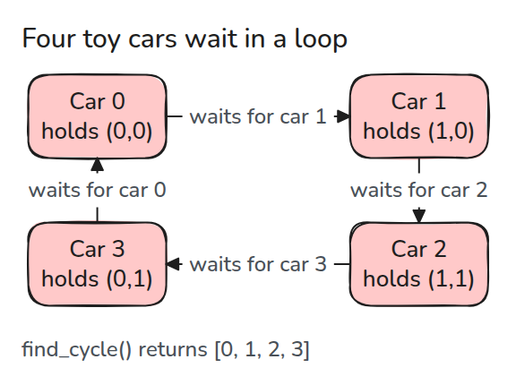
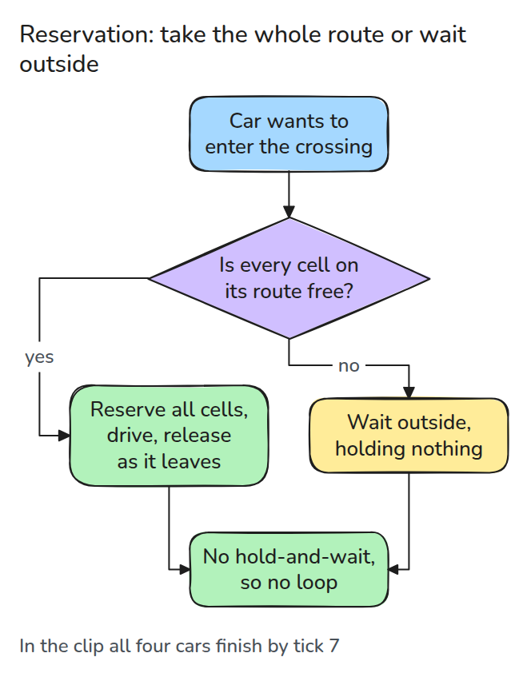
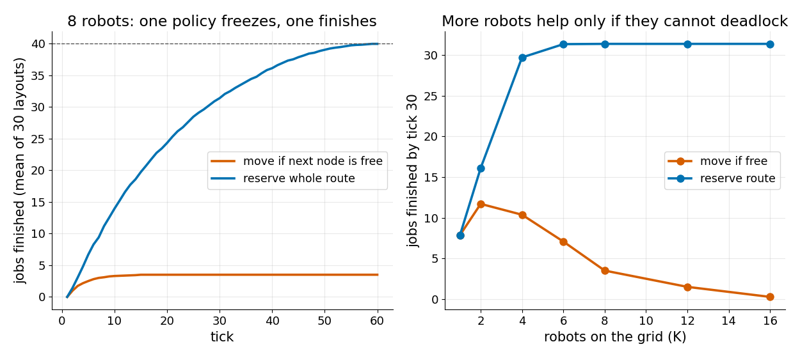

# 교통과 교착 (Traffic and Deadlock)

> 차선이 하나뿐인 교차로에서는 로봇들이 고리로 서로를 막을 수 있습니다. 누가 누구를 기다리는지 그려 고리를 찾고 경로 전체를 한꺼번에 잡아서 고리를 없앱니다.

**유형:** 만들기   **선수 지식:** 노드와 화살표로 그린 그래프   **시간:** 약 15분

## 쉽게 말하면

장난감 자동차 네 대가 교차로에서 만나요. 자동차마다 다음 자동차가 필요한 칸에 서서 앞칸이 비기를 기다려요. 기다림이 고리로 이어져서 서로 양보하며 기다려도 모든 자동차가 영원히 멈춰요.

교통 모델은 이것을 deadlock이라고 해요. 들어가기 전에 경로 전체가 비어 있을 때만 들어가서 그 경로를 예약하면 밖에서 기다리는 자동차는 다른 자동차가 필요한 칸을 차지하지 않아요. 그래서 고리가 생기지 않지만 예약한 경로 때문에 다른 자동차가 지나가지 못하기도 해요.

## 문제

로봇 네 대가 작은 교차로에 들어와 각자 한 칸씩 차지하고 멈춥니다. 다음 칸이 이미 차 있기 때문입니다. 각자가 다음 로봇이 필요한 칸을 쥐고 있어서 아무도 움직이지 못하고
처리량(tick당 끝낸 작업 수)은 0이 됩니다. 고장 난 것은 없습니다. 모든 로봇이 빈 칸을 기다렸을 뿐입니다.

## 개념



*화살표는 "그 칸에 서 있는 자동차를 기다린다"는 뜻입니다. 이 그래프의 고리가 교착이며 고리 안의 자동차는 영원히 움직이지 못합니다.*



*로봇은 경로 전체가 비어 있을 때에만 들어와서 그 경로를 쥡니다. 바깥에서 기다리는 로봇은 아무것도 쥐지 않으므로 아무도 그 로봇을 기다리지 않습니다.*



*왼쪽은 로봇 8대와 작업 40개를 30가지 배치로 평균한 값입니다. "비면 이동" 규칙은 약 3.5개에서 멈추고 예약은 40개를 모두 끝냅니다.
오른쪽은 tick 30까지 끝낸 작업 수를 격자 위 로봇 수에 따라 그렸습니다. 로봇이 늘수록 단순 규칙은 더 교착하고 예약은 경로 전체가 서로 막아서 31개 근처에서 평평해집니다. 이것이 예약의 대가입니다.*

교착에는 네 조건이 동시에 필요합니다. 한 칸에는 로봇이 하나만 들어갑니다.
hold-and-wait는 로봇이 다음 칸을 기다리는 동안 자기 칸을 쥐고 있는 것입니다.
no pushing은 누구도 밀려날 수 없다는 것이고 circular wait는 기다림이 고리를 이룬다는 것입니다.
예약은 hold-and-wait를 없앱니다.

클립에서 자동차 네 대는 2 x 2 격자의 칸 위에서 출발하고 각자 다음 자동차가 선 칸이 필요합니다.
0번은 (0,0), (1,0), (1,1)로, 1번은 (1,0), (1,1)로, 2번은 (1,1), (0,1)로, 3번은 (0,1), (0,0)으로 달립니다.
`naive`에서는 tick 1에 네 대가 모두 들어가고 `find_cycle()`은 고리에 있는 자동차 `[0, 1, 2, 3]`을 돌려줍니다.
`reserve`에서는 0번이 세 칸을 먼저 잡고 나머지는 밖에서 기다려서 네 대가 tick 7까지 모두 끝냅니다.


*`reserve` 규칙을 tick당 0.7초로 보여 줍니다. 앞칸이 비어 보여도 경로 전체가 비지 않으면 밖에서 기다리는 자동차를 빨간 막대가 막습니다. 주황색은 예약된 칸입니다.*

## 만들기

`Sim.wait_for()`는 로봇마다 자기 다음 칸에 서 있는 로봇을 돌려줍니다. `find_cycle()`은 그 포인터를 따라갑니다. `reserve` 정책은 경로의 모든 노드가 비어 있을 때에만 로봇을 들여보냅니다.

```python
need = p if self.policy == "reserve" else p[:1]
if len(self.at) < self.K and all(n not in self.occ and n not in self.res for n in need):
```

테스트는 로봇 네 대의 고리를 만들어 찾아내는지 보고 임의 작업 40개에서 예약 정책의 wait-for graph가 매 tick 비어 있는지 확인합니다.

```bash
cd robotics-engineering-from-scratch
python3 -m pytest phases/14-multi-robot-and-swarms/03-traffic-and-deadlock -q
python3 phases/14-multi-robot-and-swarms/03-traffic-and-deadlock/code/figure.py
```

## 실제 도구로 보기

이 레슨은 외부 자료를 참고하지 않았습니다. `find_cycle`을 그래프 라이브러리의 고리 탐지와 대조해 보고 경로 전체를 쥐어서 잃은 처리량은 시간 구간 예약으로 되찾아 보세요.

## 결과물

`outputs/skill-traffic-deadlock.md`는 로봇 무리의 교통 규칙을 검토하는 체크리스트입니다.

## 연습 문제

1. 예약 대신 "고리를 찾으면 한 칸 물러난다"로 바꾸고 처리량을 비교하세요.
2. 칸을 하나씩 잡되 고정된 전역 칸 순서로만 잡게 하고 고리가 생길 수 없음을 확인하세요.
3. 격자를 6 x 6으로 키우고 예약이 더는 나아지지 않는 로봇 수를 찾으세요.
