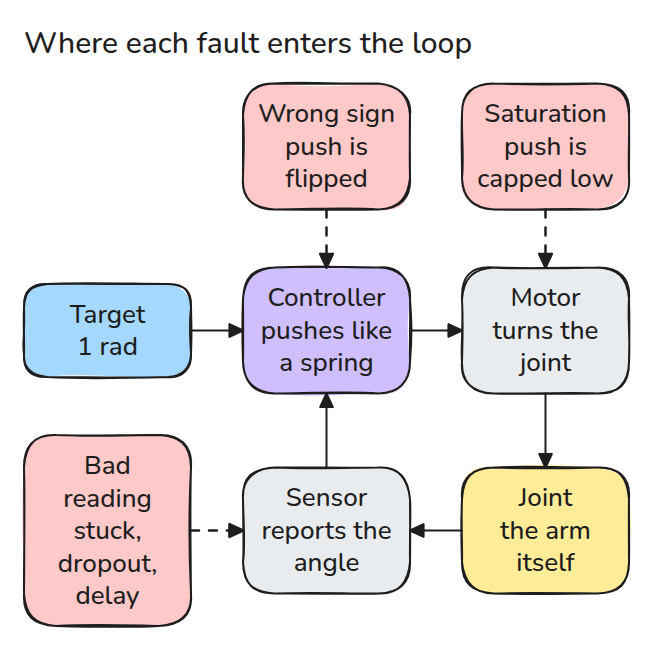
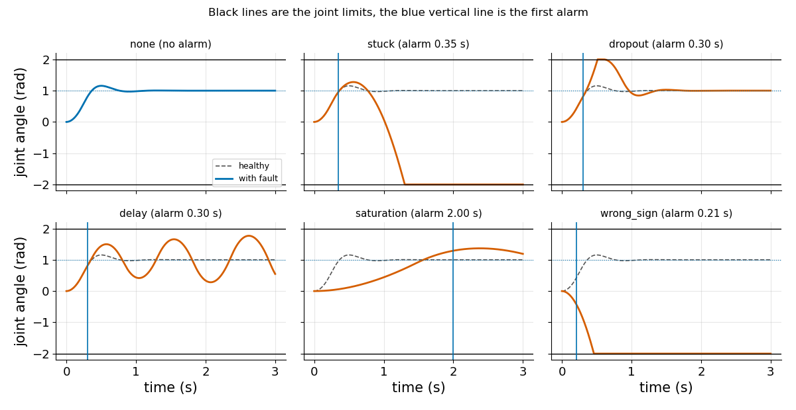
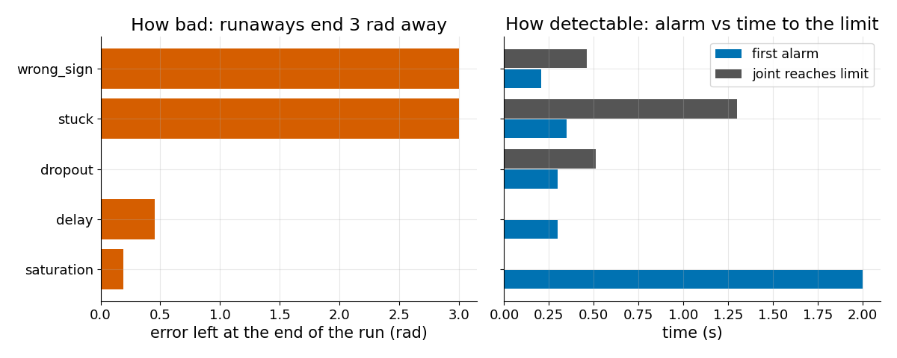
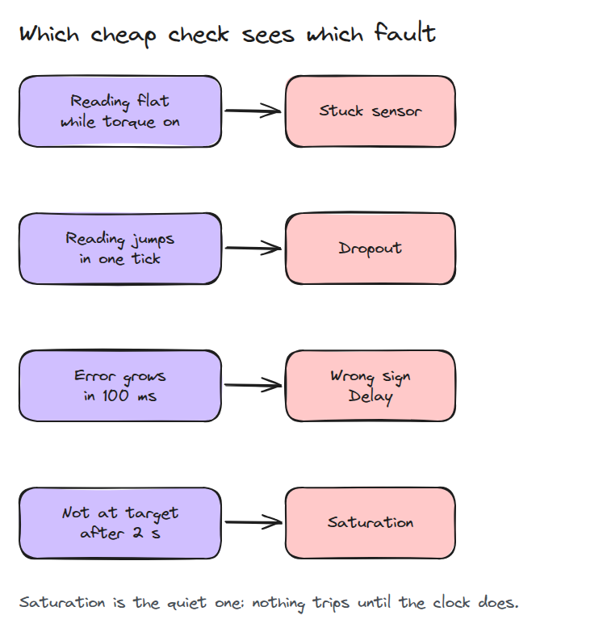

# Failure Modes

> Learn the ways a robot joint can fail quietly, and how to spot each one early.

**Type:** Build   **Prerequisites:** 03/02 Gravity Compensation   **Time:** ~15 minutes

## In Plain Words

A bench arm moves toward its target when its sensor freezes. The frozen reading says the arm is still fast, so the controller keeps braking and drives the arm back into the hard stop. The controller never broke. It obeyed a bad reading.

This lesson injects five faults and measures the damage and how early a cheap check could warn.

## Key Terms

- **Fault injection**: deliberately breaking a sensor, command or timing to see what happens.
- **PD controller**: pulls a joint toward its target like a spring and brakes it by its speed.
- **Hard stop**: a block that ends the joint's travel.
- **Torque**: the twisting push a motor gives a joint.
- **Saturation**: a command capped at the motor's maximum, so the push stays small.
- **Monitor**: a cheap check on signals the controller can see that raises an alarm.

## The Problem

A robot arm that worked well all week suddenly slams into its hard stop, and the log shows no error.

## The Concept

A robot arm can hurt people and itself, so learn how it fails before you decide what to guard. We break a simple controller five ways: a wrong sign, a frozen sensor, a brief dropout, a delay and a weak motor. For each one we watch how badly the arm ends up and how early a cheap check could have warned.



*Faults can hit the push going out or the reading coming back.*


*Blue runs the wrong way and the warning lamp lights before it hits the stop. Green settles on the target.*



*Wrong sign and a frozen sensor end at the stop. A dropout recovers, a delay wobbles.*



*Left: how far off each fault leaves the arm. Right: the alarm usually comes before the arm hits its stop.*



*Four cheap checks together flag all five faults.*

<details><summary>The math (optional)</summary>

A wrong sign turns the spring into a repeller: the joint hits the stop at 0.460 s, and the check "error grew in the last 100 ms" trips at 0.205 s, which is 0.255 s of warning. The four checks are: reading flat while the motor pushes, reading jumps, error grows for 100 ms, not at target after 2 s. Saturation trips only the last, a 2 s deadline. The joint is `J qdd = tau - b qd` with a hard stop at 2 rad (about 115 degrees).

</details>

## Build It

`simulate(fault)` runs one joint with a hard stop. Each fault is a few lines inside the loop, for example:

```python
if fault == "stuck" and on:
    held = held or (q, qd)
    qm, qdm = held          # controller sees a frozen joint
tau = clip(kp*(q_ref - qm) - kd*qdm, -tau_max, tau_max)
if fault == "wrong_sign":
    tau = -tau
```

`metrics()` measures the true joint. `alarm_time()` uses only what the controller can see. `ranked()` sorts the faults worst first.

```bash
cd robotics-engineering-from-scratch
python3 -m pytest phases/15-safety-and-deployment/01-failure-modes -q
python3 phases/15-safety-and-deployment/01-failure-modes/code/main.py
```

```text
rank fault        peak|q| final err limit at alarm at  warned first
1    wrong_sign      2.00     3.000    0.460    0.205  True
2    stuck           2.00     3.000    1.301    0.350  True
3    dropout         2.00     0.000    0.513    0.300  True
4    delay           1.77     0.451    never    0.300  True
5    saturation      1.37     0.190    never    2.000  True
6    none            1.16     0.000    never    never  False
```

## Use It

The same injection works in a MuJoCo joint or a ROS 2 node.

## Ship It

`outputs/skill-fault-injection-review.md` lists the five faults and questions for each monitor.

## Exercises

1. Inject the stuck sensor after the joint settles. What happens?
2. Find the delay where the loop first starts to wobble.
3. Add an encoder that reads twice the true angle and rank it.
