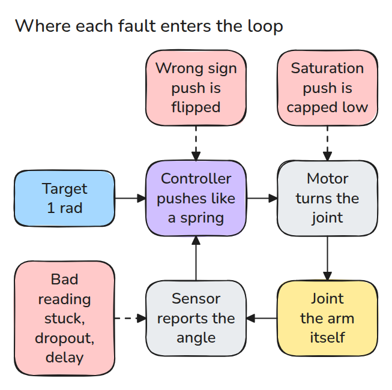
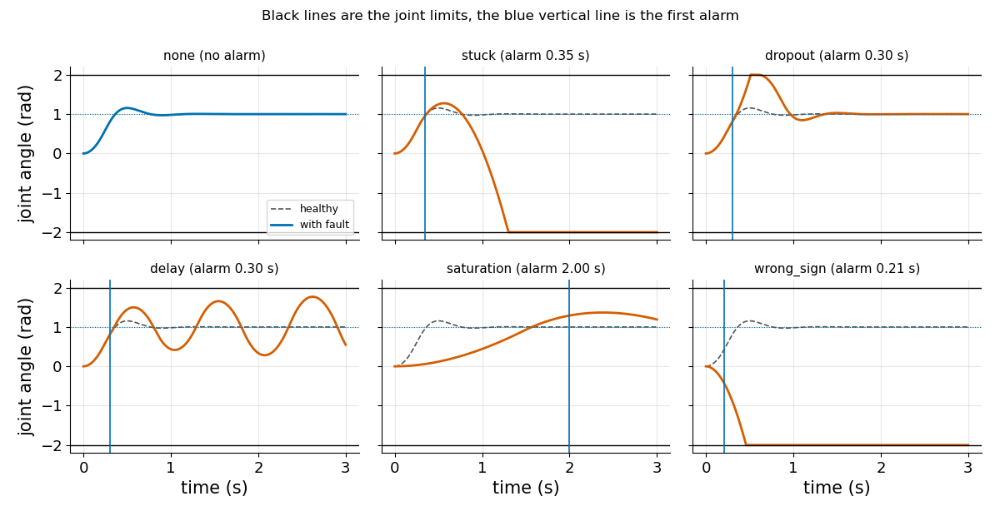
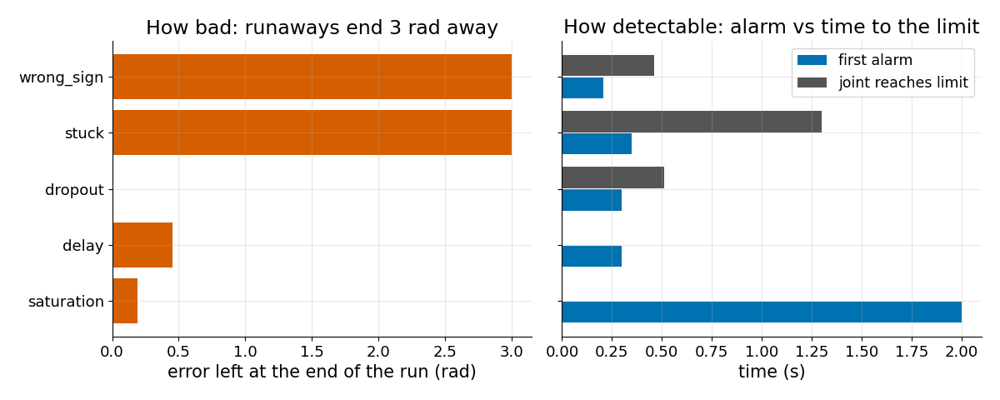
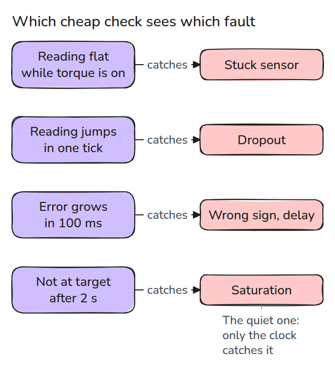

# Failure Modes

> Before you can guard a joint you have to know how it breaks, and the worst faults are the quiet ones.

**Type:** Build   **Prerequisites:** 03/02 Gravity Compensation   **Time:** ~15 minutes

## In Plain Words

A bench arm is moving toward its target angle when its sensor freezes. The frozen reading still says the arm is fast, so the controller keeps braking against a speed that is gone. That steady brake drives the arm back past its start and into the hard stop, the block that ends its travel.

The controller never broke. It obeyed a bad reading. This lesson injects five faults and measures two things: the damage the real arm takes, and how early a cheap check could warn.

## The Problem

A joint that tracked well all week suddenly slams into its stop, and the log shows no error. We break a small PD loop five ways. A PD controller pulls the joint toward its target like a spring and brakes it by its speed.

## The Concept



*Follow the loop from target to controller, motor, joint and sensor. Going out, wrong sign flips the push and saturation caps it small. Coming back, stuck freezes the reading, dropout zeroes it briefly and delay makes it arrive old.*

A stuck sensor makes the controller act on one frozen picture of the joint, so its push never changes. A wrong sign turns the spring into a repeller.

Example, wrong sign. The torque, the motor's twisting push, is flipped, so the joint runs away from the target and hits the stop at 0.460 s. A check on the controller's own signals, "error grew in the last 100 ms", trips at 0.205 s: 0.255 s of warning.


*Amber ghost: the target. Green settles on it. Blue runs the other way, and the lamp lights at 0.205 s, before the stop.*



*Watch where each curve ends. Dashed gray is the healthy run, the blue line the first alarm. Wrong sign and stuck end at the stop, dropout hits it and recovers, delay wobbles, saturation crawls.*



*Left: error left at the end. Right: the alarm beats the limit for every fault that reaches it, but saturation trips only the 2 s deadline check.*



*Four checks flag all five faults: reading flat while the motor pushes, reading jumps, error grows in 100 ms, not at target after 2 s. Saturation trips only the last, a clock check.*

## Build It

`simulate(fault)` runs a 1-DOF joint (`J qdd = tau - b qd`) with a hard stop at 2 rad (about 115 degrees). Each fault is a few lines inside the loop, for example:

```python
if fault == "stuck" and on:
    held = held or (q, qd)
    qm, qdm = held          # controller sees a frozen joint
tau = clip(kp*(q_ref - qm) - kd*qdm, -tau_max, tau_max)
if fault == "wrong_sign":
    tau = -tau
```

`metrics()` measures the true joint. `alarm_time()` uses only what the controller can see. `ranked()` sorts by reached-limit, then final error, then speed.

```bash
cd robotics-engineering-from-scratch
python3 -m pytest phases/15-safety-and-deployment/01-failure-modes -q
python3 phases/15-safety-and-deployment/01-failure-modes/code/main.py
```

```text
rank fault        peak|q| final err limit at alarm at  warned first
1    wrong_sign      2.00     3.000    0.460    0.205  True
2    stuck           2.00     3.000    1.301    0.350  True
3    dropout         2.00     0.000    0.513    0.300  True
4    delay           1.77     0.451    never    0.300  True
5    saturation      1.37     0.190    never    2.000  True
6    none            1.16     0.000    never    never  False
```

## Use It

The same injection works in a MuJoCo joint or a ROS 2 node. Wrap the sensor and command topics and compare your monitors with this table. Re-measure the thresholds on your own plant.

## Ship It

`outputs/skill-fault-injection-review.md` lists the five faults to inject and the questions to ask about each monitor.

## Exercises

1. Inject the stuck sensor after the joint has settled and explain why nothing bad happens.
2. Find the delay in milliseconds at which this loop first oscillates.
3. Add a sixth fault, an encoder that reads twice the true angle, and rank it.
