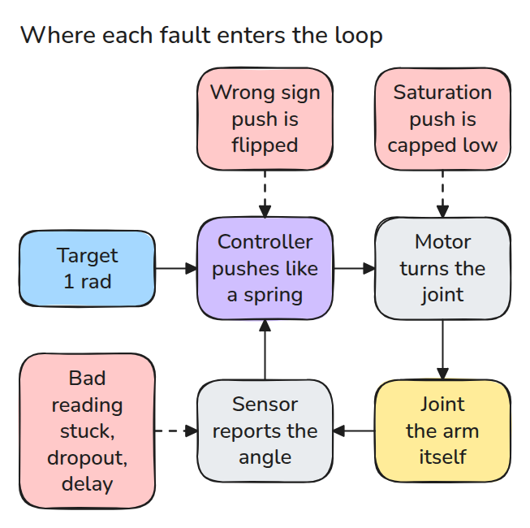
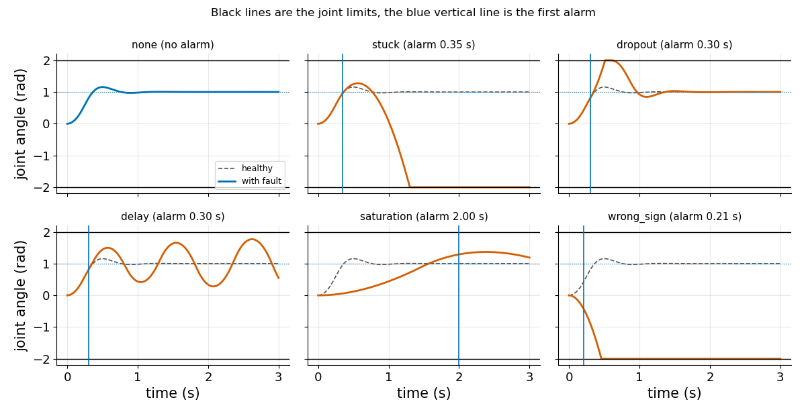
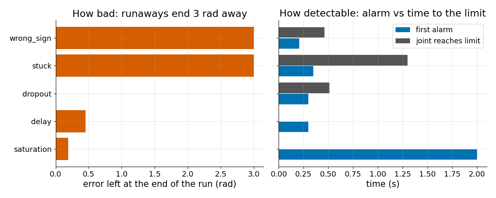
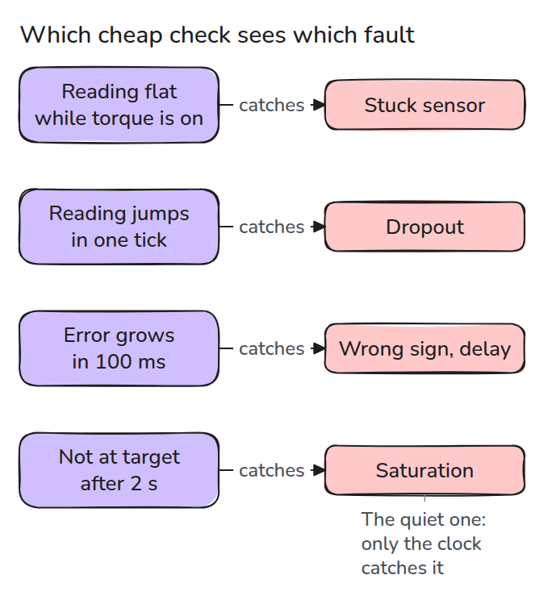

# 고장 유형 (Failure Modes)

> 관절을 지키려면 먼저 어떻게 망가지는지 알아야 하고 가장 위험한 결함은 조용한 결함입니다.

**유형:** 만들기   **선수 지식:** 03/02 중력 보상   **시간:** 약 15분

## 쉽게 말하면

작업대 위 로봇 팔이 목표 각도를 향해 움직이는 중에 센서가 얼어붙었다고 해 보세요. 얼어붙은 값은 여전히 팔이 빠르다고 말해요. 그래서 controller는 이미 사라진 속도에 맞서 계속 브레이크를 걸어요. 그
일정한 제동이 팔을 출발점 너머 반대편 hard stop, 곧 움직임의 끝을 막는 블록으로 밀어 넣어요.

controller는 고장 나지 않았어요. 잘못된 값을 그대로 따랐을 뿐이에요. 이 레슨에서는 결함 다섯 가지를 넣고 두 가지를 재요. 실제 팔이 입는 피해와 값싼 검사가 얼마나 일찍 경고할 수 있는지예요.

## 문제

일주일 내내 잘 따라가던 관절이 갑자기 stop에 부딪히는데 로그에는 에러가 없습니다. 여기서는 작은 PD loop를 다섯 가지 방식으로 망가뜨립니다. PD controller는 관절을 스프링처럼 목표 쪽으로 당기고 속도에 맞춰 브레이크를 겁니다.

## 개념



*목표에서 controller와 모터와 관절과 센서를 거쳐 다시 controller로 돌아오는 루프를 따라가 보세요. 나가는 쪽에서 wrong sign은 힘의 방향을 뒤집고 saturation은 힘을 작게 막습니다. 돌아오는 쪽에서 stuck은 측정값을 얼리고 dropout은 잠깐 0으로 읽히게 하고 delay는 낡은 값이 오게 합니다.*

stuck 센서가 있으면 controller는 얼어붙은 관절 사진 한 장만 보고 움직입니다. 그래서 힘이 바뀌지 않습니다. wrong sign은 스프링을 밀어내는 힘으로 바꿉니다.

계산 예, wrong sign입니다. torque, 곧 모터가 관절을 돌리는 힘의 방향이 뒤집혀서 관절은 목표 반대쪽으로 달려가 0.460초에 stop에 부딪힙니다. controller 자신의 신호에 거는 검사 "error grew in the last 100 ms"는 0.205초에 걸립니다. 경고가 0.255초 먼저 나오는 셈입니다.


*같은 경우를 작업대 위 로봇 팔로 본 장면입니다. 주황색 반투명 팔이 목표입니다. 초록 팔은 목표에 자리를 잡습니다. 파란 팔은 반대쪽으로 달려가고 램프는 0.205초에 켜져서 stop에 닿기 전입니다.*



*각 곡선이 어디에서 끝나는지 보세요. 회색 점선은 정상 실행이고 파란 세로선은 첫 경보입니다. wrong sign과 stuck은 stop에서 끝납니다. dropout은 stop에 부딪힌 뒤 회복하고 delay는 흔들리며 saturation은 기어갑니다.*



*왼쪽은 실행이 끝났을 때 남은 오차입니다. 오른쪽에서 한계에 닿는 결함은 모두 경보가 먼저 울리지만 saturation은 2초 기한 검사에만 걸립니다.*



*검사 네 개로 결함 다섯 개를 모두 표시합니다. 모터가 미는데도 측정값이 멈춰 있음, 측정값이 한 틱에 튐, 오차가 100 ms 안에 커짐, 2초 뒤에도 목표에 못 감입니다. saturation은 마지막 검사, 곧 시계에 기대는 검사에만 걸립니다.*

## 만들기


`simulate(fault)`는 2 rad(약 115도)에 hard stop이 있는 1자유도 관절(`J qdd = tau - b qd`)을 돌립니다. 결함은 루프 안의 몇 줄입니다. 예를 들면 다음과 같습니다.

```python
if fault == "stuck" and on:
    held = held or (q, qd)
    qm, qdm = held          # controller sees a frozen joint
tau = clip(kp*(q_ref - qm) - kd*qdm, -tau_max, tau_max)
if fault == "wrong_sign":
    tau = -tau
```

`metrics()`는 실제 관절을 잽니다. `alarm_time()`은 controller가 볼 수 있는 값만 씁니다. `ranked()`는 한계 도달 여부, 최종 오차, 도달 속도 순으로 정렬합니다.

```bash
cd robotics-engineering-from-scratch
python3 -m pytest phases/15-safety-and-deployment/01-failure-modes -q
python3 phases/15-safety-and-deployment/01-failure-modes/code/main.py
```

```text
rank fault        peak|q| final err limit at alarm at  warned first
1    wrong_sign      2.00     3.000    0.460    0.205  True
2    stuck           2.00     3.000    1.301    0.350  True
3    dropout         2.00     0.000    0.513    0.300  True
4    delay           1.77     0.451    never    0.300  True
5    saturation      1.37     0.190    never    2.000  True
6    none            1.16     0.000    never    never  False
```

## 실제 도구로 보기

같은 주입을 MuJoCo 관절이나 ROS 2 노드에서도 할 수 있습니다. 센서 topic과 명령 topic을 감싸고 자기 monitor를 이 표와 비교합니다. 임계값은 자기 plant에서 다시 재야 합니다.

## 결과물

`outputs/skill-fault-injection-review.md`는 주입할 결함 다섯 가지와 monitor마다 던질 질문을 정리합니다.

## 연습 문제

1. 관절이 안정된 뒤에 stuck 센서를 넣고 왜 아무 일도 없는지 설명하세요.
2. 이 루프가 처음 진동하는 delay를 밀리초 단위로 찾으세요.
3. 실제 각도의 두 배를 읽는 encoder를 여섯 번째 결함으로 넣고 순위를 매기세요.
