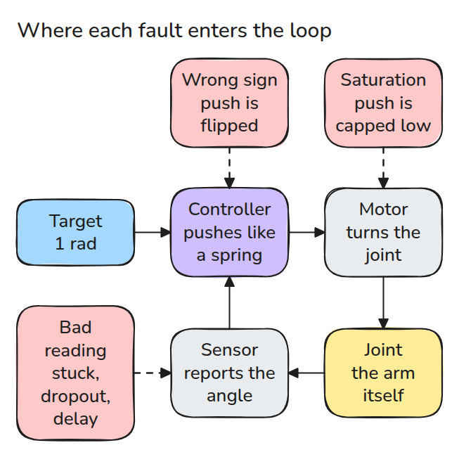
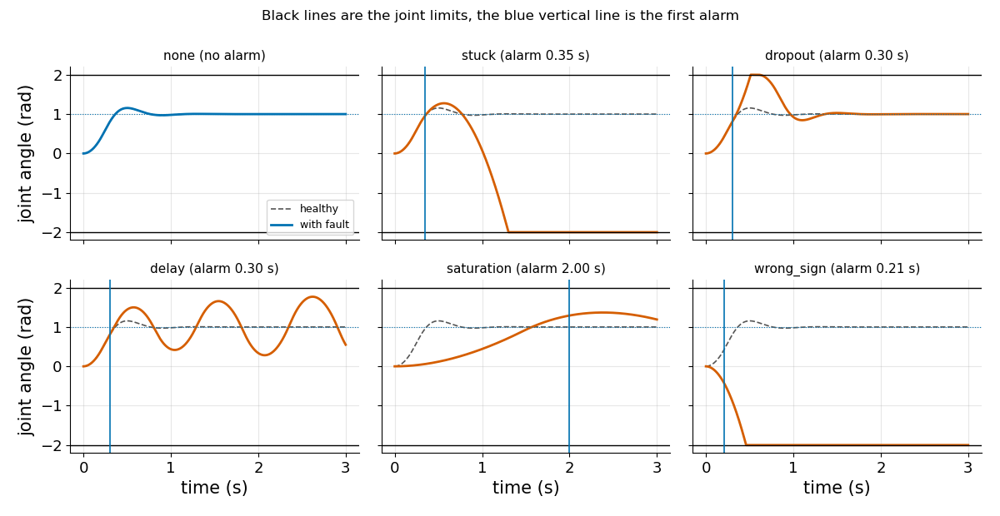
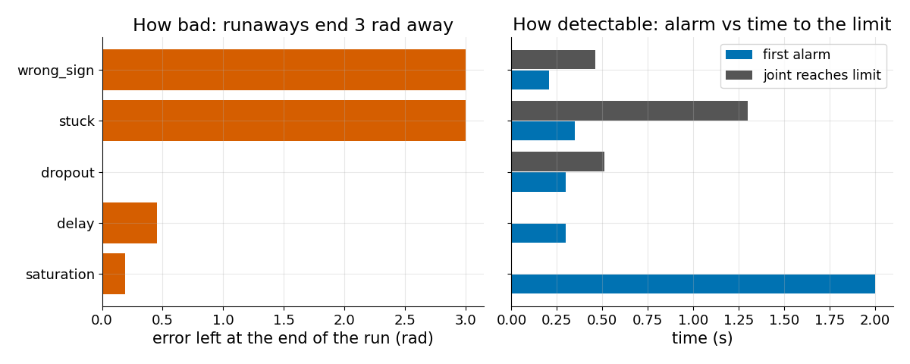
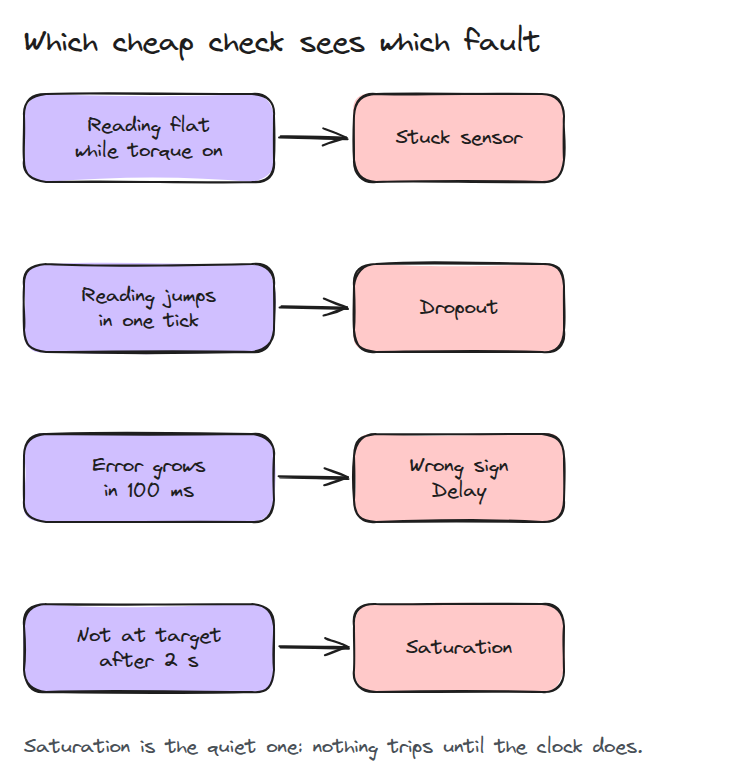

# 고장 유형 (Failure Modes)

> 로봇 관절이 조용히 고장 나는 방식과 각각을 일찍 알아채는 법을 배웁니다.

**유형:** 만들기   **선수 지식:** 03/02 중력 보상   **시간:** 약 15분

## 쉽게 말하면

작업대 위 로봇 팔이 목표를 향해 움직이는 중에 센서가 얼어붙었다고 해 보세요. 얼어붙은 값은 여전히 팔이 빠르다고 말해요. 그래서 controller는 계속 브레이크를 걸고 팔을 출발점 너머 hard stop으로 밀어 넣어요.

controller는 고장 나지 않았어요. 잘못된 값을 그대로 따랐을 뿐이에요. 이 레슨에서는 결함 다섯 가지를 넣고 피해와 값싼 검사가 얼마나 일찍 경고할 수 있는지 재요.

## 핵심 용어

- **Fault injection**: 어떻게 되는지 보려고 센서나 명령이나 타이밍을 일부러 망가뜨리는 일입니다.
- **PD controller**: 관절을 스프링처럼 목표 쪽으로 당기고 속도에 맞춰 브레이크를 거는 controller입니다.
- **Hard stop**: 관절의 움직임 끝을 막는 블록입니다.
- **Torque**: 모터가 관절을 돌리려고 주는 비트는 힘입니다.
- **Saturation**: 명령이 모터의 최대치에서 잘려 힘이 작게 머무는 현상입니다.
- **Monitor**: controller가 볼 수 있는 신호로 경보를 내는 값싼 검사입니다.

## 문제

일주일 내내 잘 움직이던 로봇 팔이 갑자기 hard stop에 부딪히는데 로그에는 에러가 없습니다. 작은 controller를 다섯 가지 방식으로 망가뜨려 어떻게 그런 일이 생기는지 봅니다.

## 개념

로봇 팔은 사람과 자신을 다치게 할 수 있으므로 무엇을 지킬지 정하기 전에 어떻게 고장 나는지 알아야 합니다.



*나가는 쪽에서 wrong sign은 힘의 방향을 뒤집고 saturation은 힘을 막습니다. 돌아오는 쪽에서 stuck은 측정값을 얼리고 dropout은 0으로 읽히게 하고 delay는 낡은 값이 오게 합니다.*

wrong sign은 스프링을 밀어내는 힘으로 바꿉니다. 관절은 목표 반대쪽으로 달려가 0.460초에 stop에 부딪힙니다. controller 자신의 신호에 거는 검사 "error grew in the last 100 ms"는 0.205초에 걸려서 경고가 0.255초 먼저 나옵니다.


*주황색 반투명 팔이 목표이고 초록 팔은 목표에 자리를 잡습니다. 파란 팔은 반대쪽으로 달려가고 램프는 0.205초에 켜져서 stop에 닿기 전입니다.*



*회색 점선은 정상 실행이고 파란 세로선은 첫 경보입니다. wrong sign과 stuck은 stop에서 끝나고 dropout은 stop에 부딪힌 뒤 회복하고 delay는 흔들리며 saturation은 기어갑니다.*



*왼쪽은 실행이 끝났을 때 남은 오차입니다. 오른쪽에서 한계에 닿는 결함은 saturation을 빼고 모두 경보가 먼저 울립니다.*



*검사 네 개로 결함 다섯 개를 모두 표시합니다. 모터가 미는데도 측정값이 멈춰 있음, 측정값이 튐, 오차가 100 ms 안에 커짐, 2초 뒤에도 목표에 못 감입니다.*

## 만들기

`simulate(fault)`는 2 rad(약 115도)에 hard stop이 있는 1자유도 관절(`J qdd = tau - b qd`)을 돌립니다. 결함은 루프 안의 몇 줄입니다. 예를 들면 다음과 같습니다.

```python
if fault == "stuck" and on:
    held = held or (q, qd)
    qm, qdm = held          # controller sees a frozen joint
tau = clip(kp*(q_ref - qm) - kd*qdm, -tau_max, tau_max)
if fault == "wrong_sign":
    tau = -tau
```

`metrics()`는 실제 관절을 잽니다. `alarm_time()`은 controller가 볼 수 있는 값만 씁니다. `ranked()`는 한계 도달 여부, 최종 오차, 도달 속도 순으로 정렬합니다.

```bash
cd robotics-engineering-from-scratch
python3 -m pytest phases/15-safety-and-deployment/01-failure-modes -q
python3 phases/15-safety-and-deployment/01-failure-modes/code/main.py
```

```text
rank fault        peak|q| final err limit at alarm at  warned first
1    wrong_sign      2.00     3.000    0.460    0.205  True
2    stuck           2.00     3.000    1.301    0.350  True
3    dropout         2.00     0.000    0.513    0.300  True
4    delay           1.77     0.451    never    0.300  True
5    saturation      1.37     0.190    never    2.000  True
6    none            1.16     0.000    never    never  False
```

## 실제 도구로 보기

같은 주입을 MuJoCo 관절이나 ROS 2 노드에서도 할 수 있습니다. 임계값은 자기 plant에서 다시 재야 합니다.

## 결과물

`outputs/skill-fault-injection-review.md`는 결함 다섯 가지와 monitor마다 던질 질문을 정리합니다.

## 연습 문제

1. 관절이 안정된 뒤에 stuck 센서를 넣으세요. 왜 아무 일도 없나요?
2. 이 루프가 처음 진동하는 delay를 찾으세요.
3. 실제 각도의 두 배를 읽는 encoder를 넣고 순위를 매기세요.
