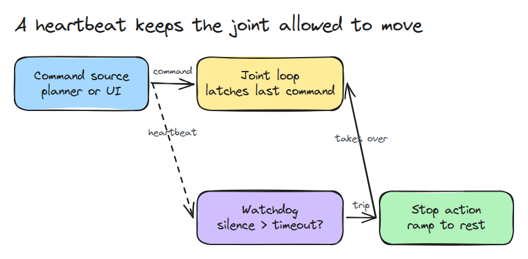
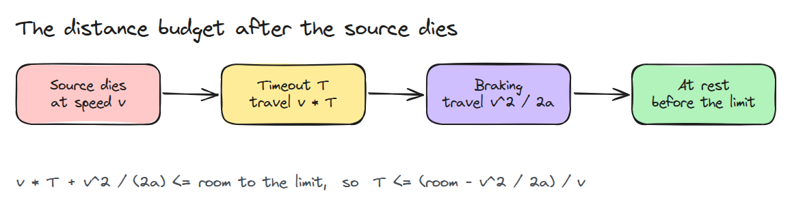
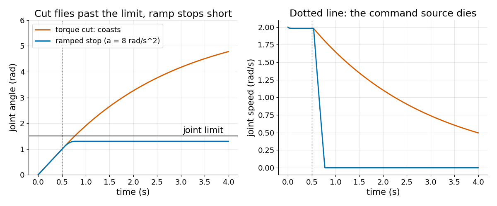
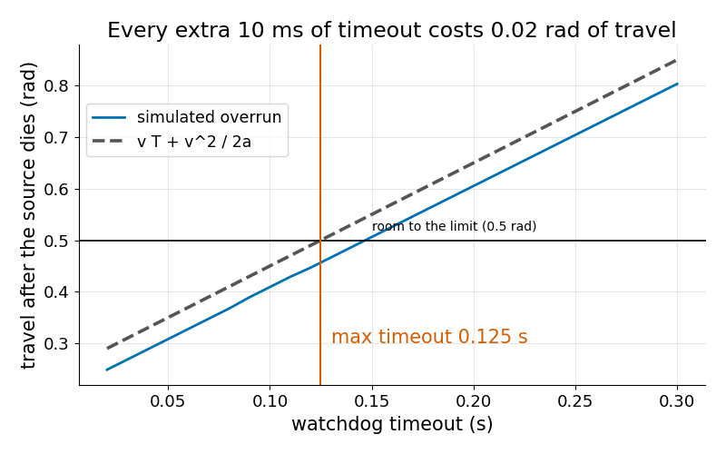

# Watchdogs and Stops

> A watchdog is only safe if the joint can stop in the room left after the timeout runs out.

**Type:** Build   **Prerequisites:** 15/01 Failure Modes   **Time:** ~15 minutes

## The Problem

The program that sends commands crashes, and the joint keeps executing the last velocity it was given. A watchdog notices the silence and stops the joint. But the stop takes time and distance, and some stops are not stops at all.

## The Concept



*The source sends commands and a heartbeat. If the heartbeat goes quiet for longer than the timeout, the watchdog hands the joint to a stop action.*

Braking at constant deceleration `a` from speed `v` takes `t = v / a` and covers `v * t - a * t^2 / 2 = v^2 / (2a)`. Before the brake even starts, the joint keeps moving for the whole timeout `T`.



*Travel during the timeout plus braking travel must fit in the room to the limit. That gives an upper bound on T.*



*Both stops start at the same moment. Cutting torque leaves only friction, so the joint coasts through the limit. A ramped stop ends well short.*



*Each 10 ms of timeout adds 2 rad/s * 10 ms = 0.02 rad. The simulation sits just under the formula because it is a conservative bound.*

A timeout also has a lower bound. It must exceed the heartbeat period plus jitter, or a single late message stops the joint for no reason.

## Build It

```python
def stop_distance(v, a):
    return v * v / (2.0 * a)

def max_timeout(room, v, a):
    return (room - stop_distance(v, a)) / v   # raises if this is <= 0
```

`simulate()` runs a joint holding 2 rad/s with a 1.5 rad limit, kills the source at 0.5 s, and applies `"cut"` (zero torque) or `"ramp"` (brake at 8 rad/s^2). Tests cover the formula against a frictionless run, the coast distance `J v / b`, and the timeout bound.

```bash
cd robotics-engineering-from-scratch
python3 -m pytest phases/15-safety-and-deployment/02-watchdogs-and-stops -q
python3 phases/15-safety-and-deployment/02-watchdogs-and-stops/code/main.py
```

## Use It

A real drive has a brake, a maximum safe deceleration and its own timeout. Read the drive documentation for the values and put them into `max_timeout`. This joint models no brake, so treat the cut result as "no help from the drive".

## Ship It

`outputs/skill-watchdog-budget.md` checks a watchdog timeout against the stopping budget and the heartbeat period.

## Exercises

1. Double the speed to 4 rad/s and show with `max_timeout` that the same 0.5 rad of room no longer works.
2. Lower the deceleration until `max_timeout` raises, and say what that means for the design.
3. Add 5 ms of heartbeat jitter and find the smallest timeout with no false trips.
