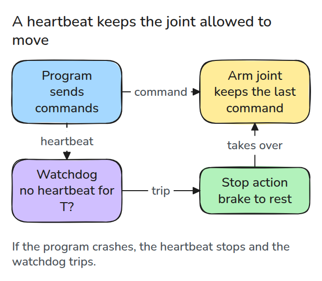
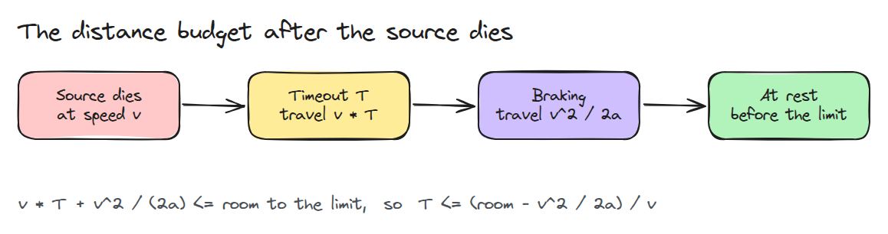
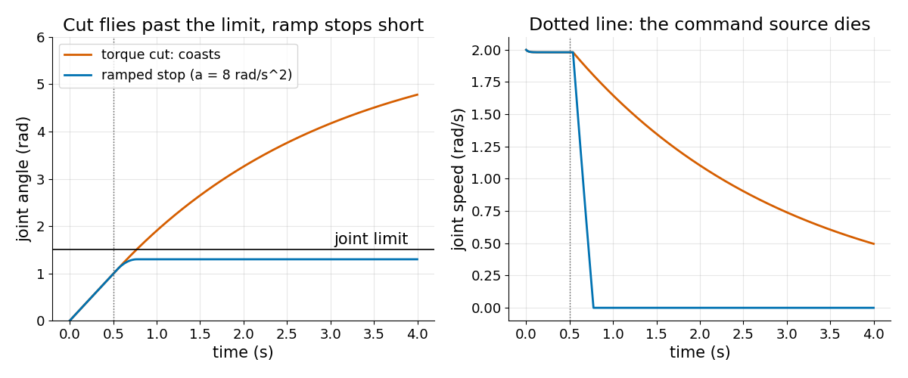
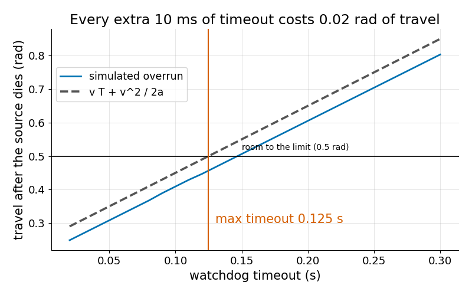

# Watchdogs and Stops

> Learn how to make a robot stop safely when its control program crashes.

**Type:** Build   **Prerequisites:** 15/01 Failure Modes   **Time:** ~15 minutes

## In Plain Words

A watchdog expects a regular "still here" message from the program steering a bench arm, and orders a stop when silence outlasts its timeout.

The arm keeps moving during that timeout, and braking needs distance too. Cutting power is not braking: like a bike you stop pedalling, the arm only coasts.

## Key Terms

- **Watchdog**: a monitor that orders a stop when expected messages stop arriving.
- **Heartbeat**: the regular "still here" message from the program that commands the joint.
- **Timeout `T`**: how long silence is tolerated before the watchdog trips.
- **Deceleration `a`**: how fast the speed drops while braking, in rad/s^2.
- **Hard stop**: a block that ends the joint's travel.
- **Jitter**: how much message arrival times wobble.

## The Problem

Your control program crashes while the arm is moving, and the arm keeps its last speed. The watchdog notices, but stopping takes time and distance, so the arm may reach its hard stop first.

## The Concept

Software crashes, so a real robot must stop on its own when its software goes quiet.



*A quiet heartbeat past the timeout triggers a stop.*

Braking at constant `a` from speed `v` covers `v^2 / (2a)`. Before that, the joint moves for the whole timeout `T`.



*Timeout travel plus braking travel must fit in the room left.*

Example: the joint is at 1.0 rad moving at 2 rad/s and the stop is at 1.5 rad, so the room is 0.5 rad. Braking at 8 rad/s^2 needs 2^2 / (2 * 8) = 0.25 rad, leaving 0.25 rad for the timeout: T <= 0.25 / 2 = 0.125 s. A 0.05 s timeout stops at 1.30 rad in simulation. A 0.2 s timeout travels 0.4 rad first and hits the stop.


*Green trips after 0.05 s and halts short. Blue waits 0.2 s and hits the stop.*



*Motor off: the joint coasts through the limit. A ramped stop ends short.*



*Each 10 ms of timeout adds 0.02 rad.*

A timeout also has a lower bound: it must exceed the heartbeat period plus jitter, or one late message stops the joint for no reason.

## Build It

```python
def stop_distance(v, a):
    return v * v / (2.0 * a)

def max_timeout(room, v, a):
    return (room - stop_distance(v, a)) / v   # raises if this is <= 0
```

`simulate()` runs a joint holding 2 rad/s with a 1.5 rad limit, kills the command program at 0.5 s, and applies `"cut"` (zero torque) or `"ramp"` (brake at 8 rad/s^2).

```bash
cd robotics-engineering-from-scratch
python3 -m pytest phases/15-safety-and-deployment/02-watchdogs-and-stops -q
python3 phases/15-safety-and-deployment/02-watchdogs-and-stops/code/main.py
```

## Use It

Put a real drive's documented brake values into `max_timeout`.

## Ship It

`outputs/skill-watchdog-budget.md` checks a timeout against the stopping budget and heartbeat period.

## Exercises

1. Double the speed to 4 rad/s. Does 0.5 rad of room still work?
2. Lower the deceleration until `max_timeout` raises. What does that mean?
3. Add 5 ms of heartbeat jitter. What timeout avoids false trips?
