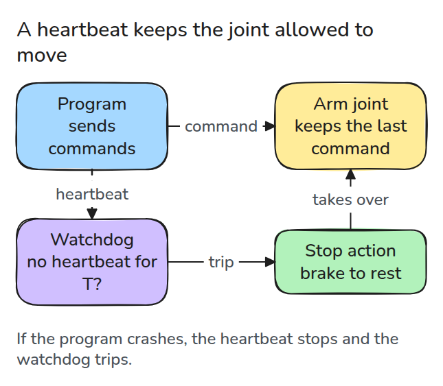
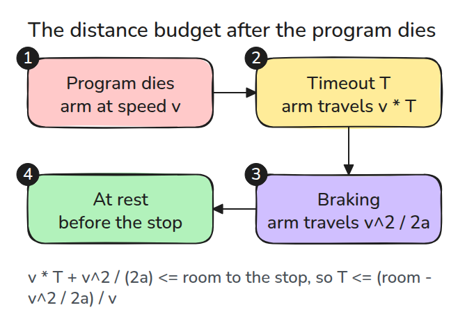
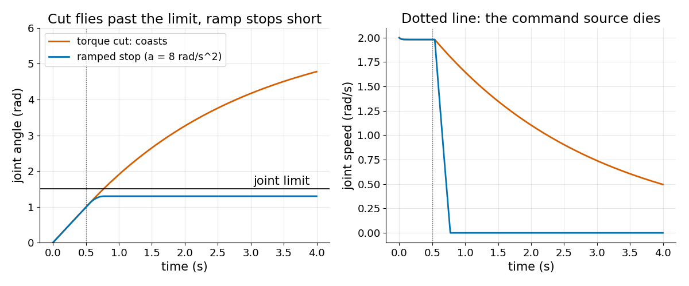
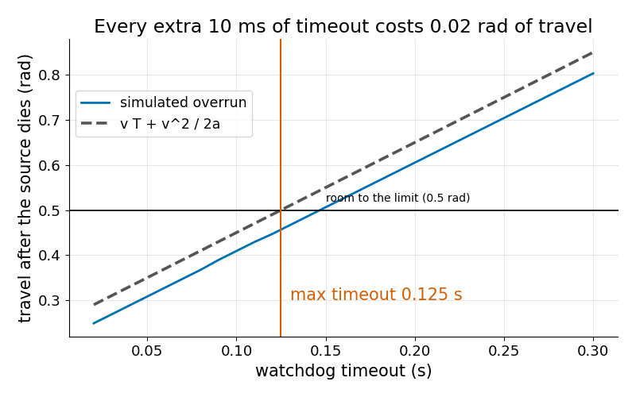

# Watchdog과 정지 (Watchdogs and Stops)

> watchdog은 timeout이 끝난 뒤 남은 거리 안에서 관절이 멈출 수 있어야 안전합니다.

**유형:** 만들기   **선수 지식:** 15/01 고장 유형   **시간:** 약 15분

## 쉽게 말하면

작업대 위 로봇 팔이 hard stop, 곧 움직임의 끝을 막는 블록을 향해 돌고 있는데 팔을 조종하던 프로그램이 죽었어요. 관절은 마지막 명령을 그대로 계속 실행해요. watchdog은 "아직 살아 있다"는 신호인
heartbeat가 규칙적으로 오기를 기다리다가 조용한 시간이 timeout을 넘기면 정지를 명령해요.

팔은 그 timeout 동안에도 계속 움직이고 제동에도 거리가 더 들어요. 이 제동 거리는 속도의 제곱에 따라 늘어요. 전원을 끊는 것은 제동이 아니에요. 자전거에서 페달만 멈추듯 팔은 그냥 굴러가요.

## 문제

명령을 보내던 프로그램이 죽었는데 관절은 마지막 속도를 계속 실행합니다. watchdog이 침묵을 알아채지만 정지에는 시간과 거리가 듭니다. 어떤 정지는 사실 정지가 아닙니다.

## 개념



*점선으로 된 heartbeat를 따라가 보세요. heartbeat가 timeout보다 길게 끊기면 watchdog이 관절을 정지 동작에 넘깁니다.*

속도 `v`에서 일정한 감속 `a`(속도가 줄어드는 빠르기, 단위 rad/s^2)로 제동하면 `t = v / a`가 걸리고 이동 거리는 `v * t - a * t^2 / 2 = v^2 / (2a)`입니다. 제동이 시작되기 전에도 관절은 timeout `T` 내내 움직입니다.



*timeout 동안의 이동과 제동 이동이 한계까지 남은 거리 안에 들어와야 합니다. 이것이 T의 상한입니다.*

계산 예입니다. 관절은 1.0 rad에서 2 rad/s로 움직이고 stop은 1.5 rad에 있으므로 여유는 0.5 rad입니다. 8 rad/s^2로 제동하면 2^2 / (2 * 8) = 0.25 rad가 필요하고 timeout에 쓸 수 있는 거리는 0.25 rad가 남습니다.

그래서 T <= 0.25 / 2 = 0.125초입니다. timeout 0.05초는 시뮬레이션에서 1.30 rad에 멈추는데 마찰이 도와서 식의 1.35(1.0 + 0.1 + 0.25)보다 작습니다. timeout 0.2초는 제동 전에 먼저 0.4 rad를 가서 stop에 부딪힙니다.


*같은 제동 정지를 timeout 두 가지로 본 장면입니다. 램프는 watchdog이 작동한 순간을 나타냅니다. 초록 팔은 0.05초 뒤에 작동해 stop 앞에서 멈춥니다. 파란 팔은 0.2초를 기다리다 stop에 부딪힙니다.*



*두 정지는 함께 시작합니다. 모터를 끄면 마찰만 남아 관절이 한계를 지나 미끄러집니다. ramp 정지, 곧 일정한 제동은 한계 훨씬 앞에서 멈춥니다.*



*timeout이 10 ms 늘 때마다 2 rad/s * 10 ms = 0.02 rad가 더해집니다. 시뮬레이션은 식 바로 아래에 놓이는데 식이 보수적인 상한이기 때문입니다.*

timeout에는 하한도 있습니다. heartbeat 주기에 jitter(도착 시각의 흔들림)를 더한 값보다 커야 합니다. 그렇지 않으면 늦은 메시지 하나에 관절이 이유 없이 멈춥니다.

## 만들기

```python
def stop_distance(v, a):
    return v * v / (2.0 * a)

def max_timeout(room, v, a):
    return (room - stop_distance(v, a)) / v   # raises if this is <= 0
```

`simulate()`는 2 rad/s로 움직이는 관절과 1.5 rad 한계를 두고 0.5초에 명령 프로그램을 죽입니다. 그다음 `"cut"`(토크 0)이나 `"ramp"`(8 rad/s^2 제동)를 적용합니다.

```bash
cd robotics-engineering-from-scratch
python3 -m pytest phases/15-safety-and-deployment/02-watchdogs-and-stops -q
python3 phases/15-safety-and-deployment/02-watchdogs-and-stops/code/main.py
```

## 실제 도구로 보기

실제 drive에는 자체 brake와 최대 안전 감속과 timeout이 있습니다. 문서에 적힌 값을 `max_timeout`에 넣습니다. 이 관절은 brake가 없으므로 cut 결과는 drive의 도움이 없는 경우로 읽습니다.

## 결과물

`outputs/skill-watchdog-budget.md`는 watchdog timeout을 정지 거리 예산과 heartbeat 주기에 맞춰 점검합니다.

## 연습 문제

1. 속도를 4 rad/s로 두 배 올리고 0.5 rad 여유로는 `max_timeout`이 더 이상 성립하지 않음을 보이세요.
2. `max_timeout`이 예외를 낼 때까지 감속을 낮추고 설계에 어떤 뜻인지 설명하세요.
3. heartbeat에 5 ms jitter를 더하고 오탐 없는 가장 짧은 timeout을 찾으세요.
