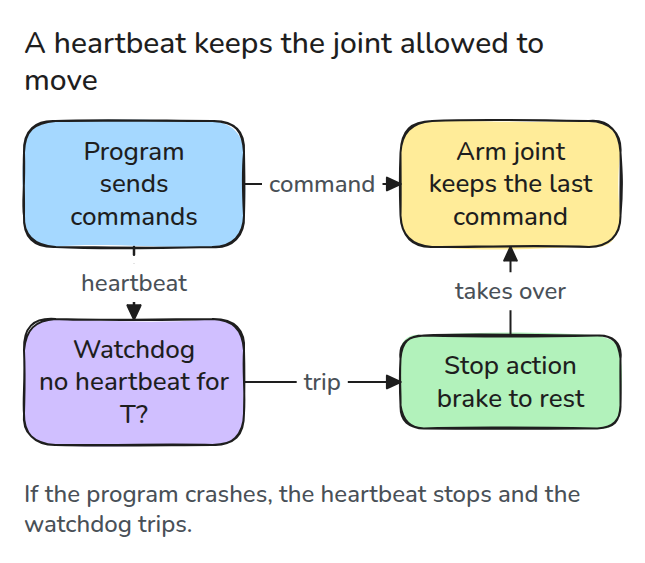
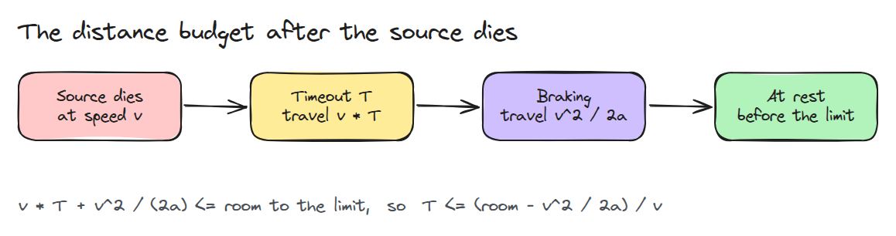
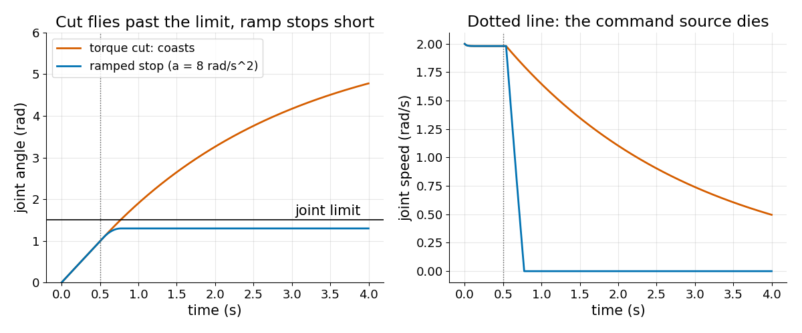
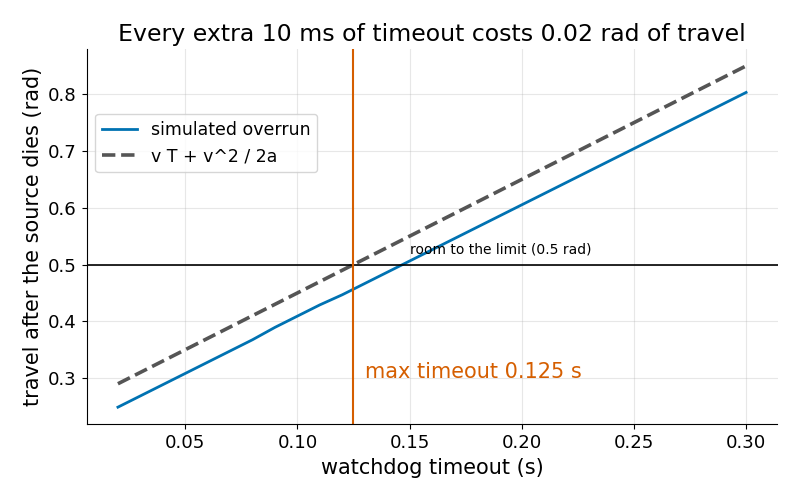

# Watchdog과 정지 (Watchdogs and Stops)

> 제어 프로그램이 죽었을 때 로봇이 안전하게 멈추게 하는 법을 배웁니다.

**유형:** 만들기   **선수 지식:** 15/01 고장 유형   **시간:** 약 15분

## 쉽게 말하면

작업대 위 로봇 팔을 조종하던 프로그램이 죽었는데 팔은 hard stop을 향해 돌고 있어요. watchdog은 "아직 살아 있다"는 신호가 규칙적으로 오기를 기다리다가 조용한 시간이 timeout을 넘기면 정지를 명령해요.

팔은 그 timeout 동안에도 계속 움직이고 제동에도 거리가 들어요. 전원을 끊는 것은 제동이 아니에요. 자전거에서 페달만 멈추듯 팔은 그냥 굴러가요.

## 핵심 용어

- **Watchdog**: 기다리던 메시지가 끊기면 정지를 명령하는 monitor입니다.
- **Heartbeat**: 관절에 명령을 보내는 프로그램이 규칙적으로 보내는 "아직 살아 있다"는 메시지입니다.
- **Timeout `T`**: watchdog이 작동하기 전까지 조용한 시간을 참아 주는 길이입니다.
- **Deceleration `a`**: 제동하는 동안 속도가 줄어드는 빠르기이고 단위는 rad/s^2입니다.
- **Hard stop**: 관절의 움직임 끝을 막는 블록입니다.
- **Jitter**: 메시지 도착 시각이 흔들리는 정도입니다.

## 문제

팔이 움직이는 중에 제어 프로그램이 죽었는데 팔은 마지막 속도로 계속 갑니다. watchdog이 침묵을 알아채지만 멈추는 데도 시간과 거리가 들어서 팔이 먼저 hard stop에 닿을 수 있습니다.

## 개념

소프트웨어는 흔히 죽으므로 실제 로봇은 소프트웨어가 조용해지면 스스로 멈출 수 있어야 합니다.



*heartbeat가 timeout보다 길게 끊기면 watchdog이 정지를 작동시킵니다.*

속도 `v`에서 일정한 감속 `a`로 제동하면 이동 거리는 `v^2 / (2a)`입니다. 그 전에도 관절은 timeout `T` 내내 움직입니다.



*timeout 동안의 이동과 제동 이동이 한계까지 남은 거리 안에 들어와야 합니다.*

계산 예입니다. 관절은 1.0 rad에서 2 rad/s로 움직이고 stop은 1.5 rad에 있으므로 여유는 0.5 rad입니다.
8 rad/s^2로 제동하면 2^2 / (2 * 8) = 0.25 rad가 필요하고 timeout에 쓸 수 있는 거리는 0.25 rad가 남습니다. 그래서 T <= 0.25 / 2 = 0.125초입니다.
timeout 0.05초는 시뮬레이션에서 1.30 rad에 멈춥니다. timeout 0.2초는 제동 전에 먼저 0.4 rad를 가서 stop에 부딪힙니다.


*초록 팔은 0.05초 뒤에 작동해 stop 앞에서 멈춥니다. 파란 팔은 0.2초를 기다리다 stop에 부딪힙니다.*



*모터를 끄면 마찰만 남아 관절이 한계를 지나 미끄러집니다. ramp 정지는 한계 앞에서 멈춥니다.*



*timeout이 10 ms 늘 때마다 0.02 rad가 더해집니다. 시뮬레이션은 식 바로 아래에 놓입니다.*

timeout에는 하한도 있습니다. heartbeat 주기에 jitter를 더한 값보다 커야 합니다. 그렇지 않으면 늦은 메시지 하나에 관절이 이유 없이 멈춥니다.

## 만들기

```python
def stop_distance(v, a):
    return v * v / (2.0 * a)

def max_timeout(room, v, a):
    return (room - stop_distance(v, a)) / v   # raises if this is <= 0
```

`simulate()`는 2 rad/s로 움직이는 관절과 1.5 rad 한계를 두고 0.5초에 명령 프로그램을 죽입니다. 그다음 `"cut"`(토크 0)이나 `"ramp"`(8 rad/s^2 제동)를 적용합니다.

```bash
cd robotics-engineering-from-scratch
python3 -m pytest phases/15-safety-and-deployment/02-watchdogs-and-stops -q
python3 phases/15-safety-and-deployment/02-watchdogs-and-stops/code/main.py
```

## 실제 도구로 보기

실제 drive에는 자체 brake와 최대 안전 감속이 있습니다. 문서에 적힌 값을 `max_timeout`에 넣습니다.

## 결과물

`outputs/skill-watchdog-budget.md`는 timeout을 정지 거리 예산과 heartbeat 주기에 맞춰 점검합니다.

## 연습 문제

1. 속도를 4 rad/s로 두 배 올리세요. 0.5 rad 여유로 여전히 되나요?
2. `max_timeout`이 예외를 낼 때까지 감속을 낮추세요. 무슨 뜻인가요?
3. heartbeat에 5 ms jitter를 더하고 오탐 없는 가장 짧은 timeout을 찾으세요.
