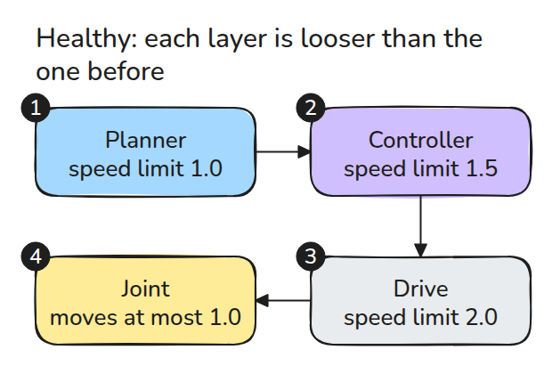
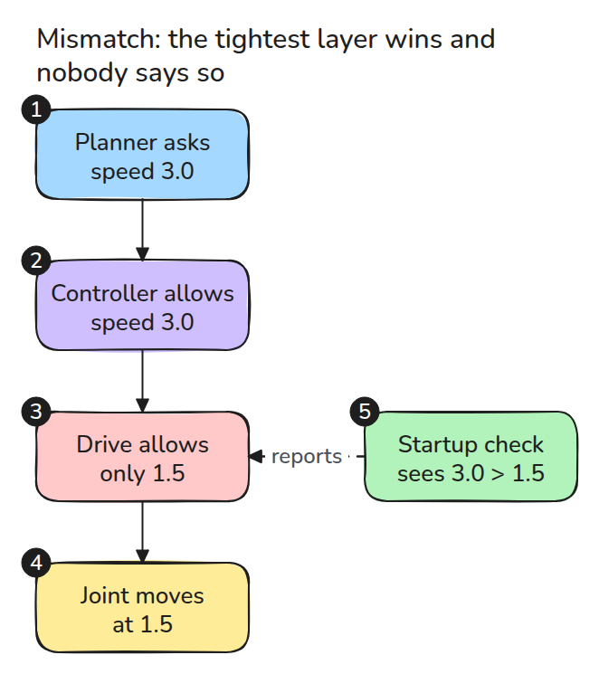
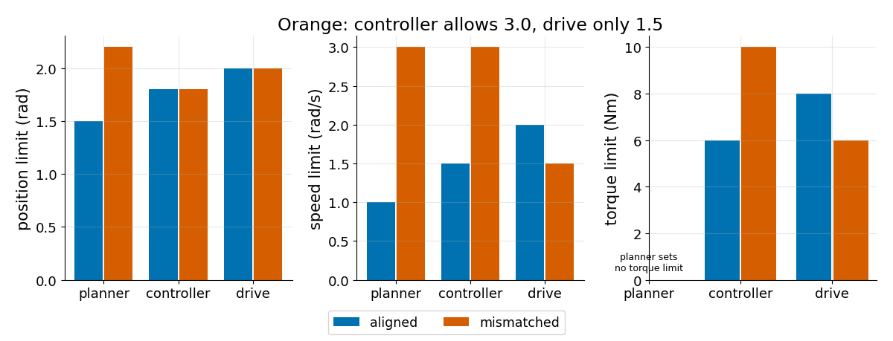
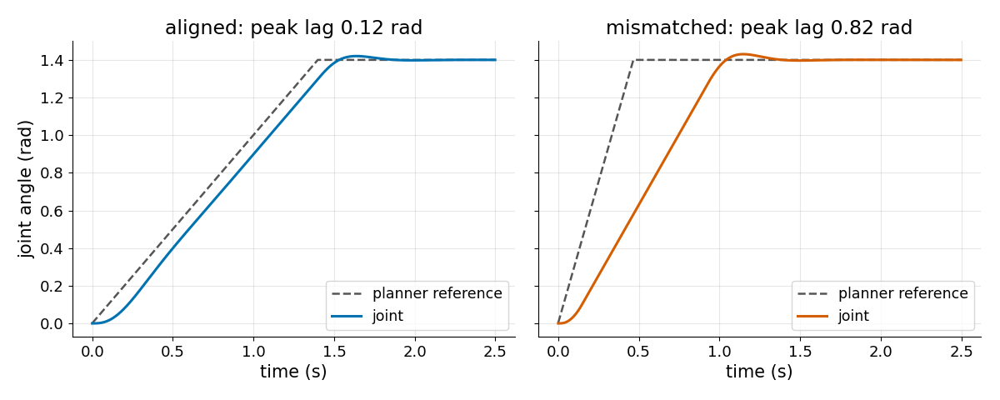

# Limits at Every Layer

> When two layers disagree about a limit, the tighter one wins and nothing reports it.

**Type:** Build   **Prerequisites:** 15/02 Watchdogs and Stops   **Time:** ~15 minutes

## In Plain Words

A bench arm takes orders through three layers. The planner draws the path, the controller pushes the motor, and the drive is the motor's own electronics. Each layer has its own speed limit.

Say the planner allows twice the speed the drive does. The planner thinks the arm moves at its faster speed while the real arm moves at the drive's, so the plan runs ahead and the gap grows. Nothing reports it, because the drive just trims the speed. The slowest limit wins.

## The Problem

You raise the speed limit in the planner to 3 rad/s and the joint still crawls at half that. Nothing logged an error, because the drive quietly clamped (cut) the speed to its own limit. Position, speed and torque each have a limit in all three layers, and no one checks that the three sets agree.

## The Concept



*Speed limits grow: 1.0, 1.5, 2.0. Each layer allows more than the one before, so the later layers are safety nets that never fire in normal use.*

The rule: for each quantity, walk from planner to drive. Every limit must be no looser than the next one that sets the same quantity, meaning it must not allow more. If it does, the later layer wins.



*Follow the request down the layers. The planner asks for 3.0, the controller agrees, the drive allows 1.5. A startup check compares every pair and reports before the first move.*

Worked example. Ask for 2.0 rad with position limits planner 2.2, controller 1.8 and drive 2.0, the `MISMATCHED` values. Planner and drive both allow it, but the controller clamps the target to 1.8, so the joint stops at 1.80 rad. `effective(MISMATCHED, "pos")` returns `(1.8, 'controller')`.


*The dark ghost is where the planner thinks the joint is, and the amber block is the goal. The blue arm stops 0.2 rad short with no warning. On green all three position limits allow 2.0.*



*Blue steps up from layer to layer. Orange breaks the pattern for speed, torque and position.*



*Same goal, same gains. With aligned limits the joint trails by 0.12 rad. With mismatched limits the planner finishes at 0.47 s while the joint is still 0.82 rad behind.*

## Build It

Each layer is a small dict, `None` meaning the layer sets no limit. The check skips `None` and compares neighbours.

```python
for (a, x), (b, y) in zip(set_, set_[1:]):
    if x > y:
        out.append((q, a, b, x, y, f"{a}.{q} = {x} is looser than {b}.{q} = {y}: {b} wins silently"))
```

`require_nested()` raises once with every message. `effective()` returns the limit the joint really feels and the layer that owns it. `simulate()` runs the three clamps around a PD loop.

```bash
cd robotics-engineering-from-scratch
python3 -m pytest phases/15-safety-and-deployment/03-limits-at-every-layer -q
python3 phases/15-safety-and-deployment/03-limits-at-every-layer/code/main.py
```

## Use It

Real stacks keep limits in a URDF, a controller config and the drive's own parameters. Load all three into one table at startup and run the same pairwise check. Read drive limits from the drive, not a copy.

## Ship It

`outputs/skill-limit-stack-audit.md` is a checklist for building that table and reading the report.

## Exercises

1. Make the planner torque limit explicit and extend the check to it.
2. Add an acceleration limit to every layer and report the effective one.
3. Explain why the check allows equal limits, and when you would want a margin instead.
