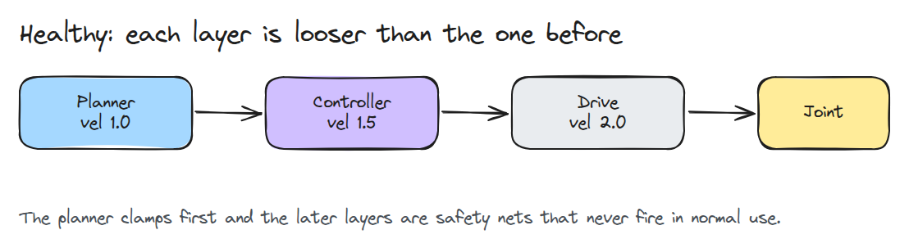
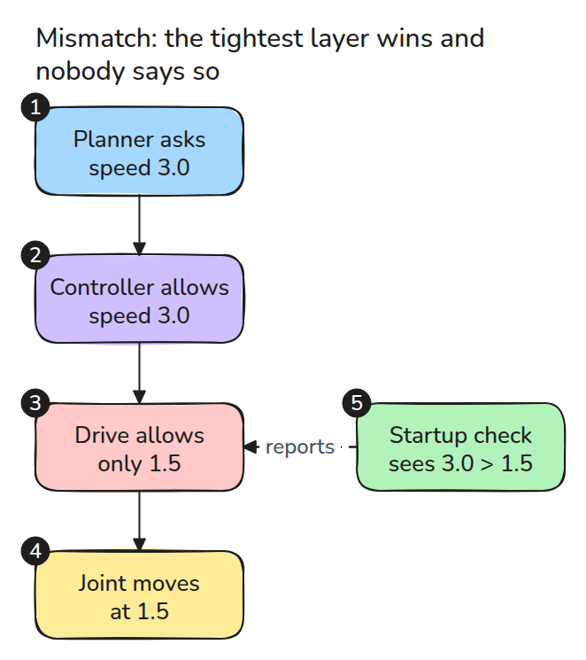
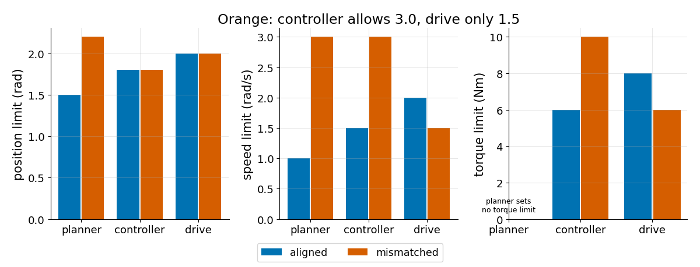
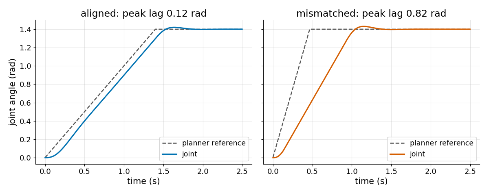

# Limits at Every Layer

> Learn why a robot can quietly move slower than you asked, and how to catch it at startup.

**Type:** Build   **Prerequisites:** 15/02 Watchdogs and Stops   **Time:** ~15 minutes

## In Plain Words

A bench arm takes orders through three layers: the planner draws the path, the controller pushes the motor, and the drive is the motor's own electronics. Each has a speed limit.

If the planner allows twice the drive's speed, the plan runs ahead of the real arm. Nothing reports it, because the drive just trims the speed. The slowest limit wins.

## Key Terms

- **Planner**: the layer that draws the path and sets the speed it asks for.
- **Controller**: the layer that turns the path into motor commands.
- **Drive**: the motor's own electronics, which enforce its hard limits.
- **Clamp**: cut a value so it stays within a limit.
- **Effective limit**: the limit the joint really feels, set by the tightest layer.
- **Nested limits**: each layer allows no more than the next layer.

## The Problem

You raise the speed limit in the planning software to 3 rad/s, but the arm still crawls at half that, with no error. A lower limit in the motor's electronics quietly cut the speed.

## The Concept

A robot has several layers that each set limits, so a mismatch hides until something goes wrong.



*Speed limits grow: 1.0, 1.5, 2.0. Later layers are safety nets that never fire in normal use.*

The rule: for each quantity, walk from planner to drive. A limit must not allow more than the next layer's. If it does, the later layer wins.



*The planner asks for 3.0, the drive allows 1.5. A startup check compares every pair before the first move.*

Example: ask for 2.0 rad with position limits planner 2.2, controller 1.8 and drive 2.0 (the `MISMATCHED` values). The controller clamps the target to 1.8, so the joint stops at 1.80 rad. `effective(MISMATCHED, "pos")` returns `(1.8, 'controller')`.


*The dark ghost is where the planner thinks the joint is. Blue stops 0.2 rad short. On green all limits allow 2.0.*



*Blue steps up from layer to layer. Orange breaks the pattern.*



*Aligned: the joint trails by 0.12 rad. Mismatched: the planner finishes at 0.47 s while the joint is 0.82 rad behind.*

## Build It

Each layer is a small dict, `None` meaning no limit. The check skips `None` and compares neighbours.

```python
for (a, x), (b, y) in zip(set_, set_[1:]):
    if x > y:
        out.append((q, a, b, x, y, f"{a}.{q} = {x} is looser than {b}.{q} = {y}: {b} wins silently"))
```

`require_nested()` raises once with every message. `effective()` returns the limit the joint really feels and its layer. `simulate()` runs the three clamps around a PD loop.

```bash
cd robotics-engineering-from-scratch
python3 -m pytest phases/15-safety-and-deployment/03-limits-at-every-layer -q
python3 phases/15-safety-and-deployment/03-limits-at-every-layer/code/main.py
```

## Use It

Real stacks keep limits in a URDF, a controller config and the drive's parameters. Load all three into one table at startup.

## Ship It

`outputs/skill-limit-stack-audit.md` builds that table and reads the report.

## Exercises

1. Extend the check to the planner's torque limit.
2. Add an acceleration limit to every layer.
3. Why does the check allow equal limits?
