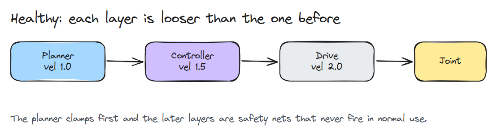
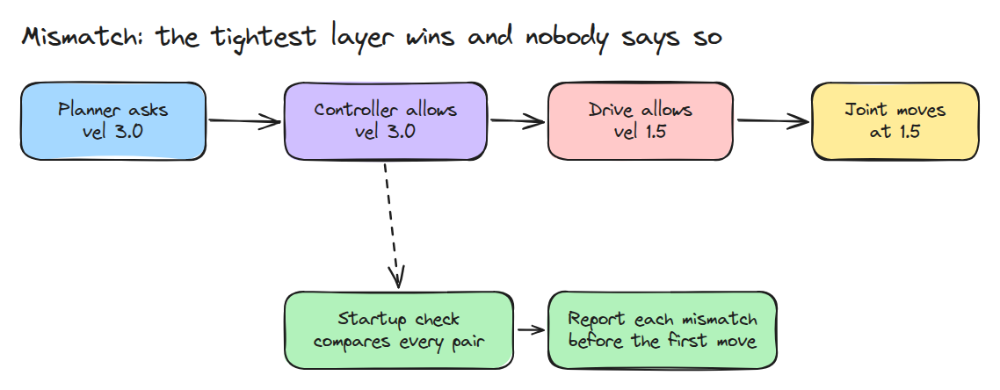
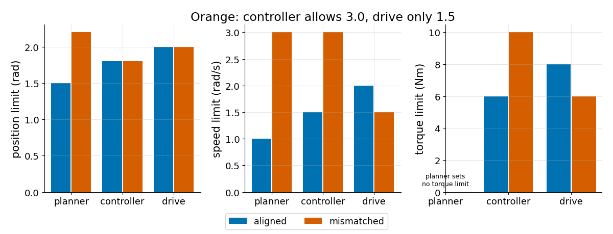
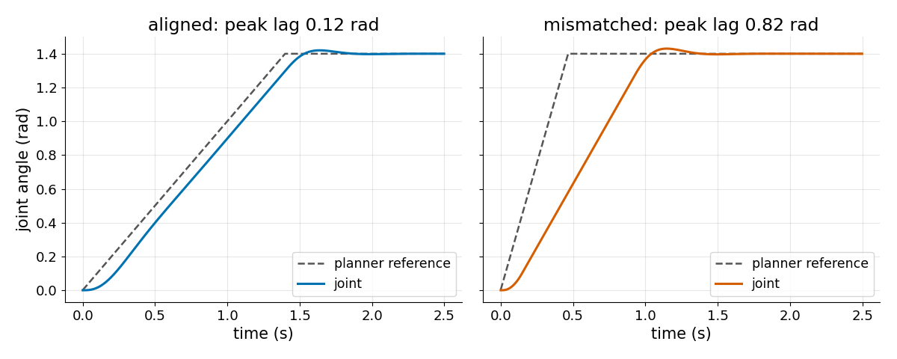

# 계층별 한계 (Limits at Every Layer)

> 두 계층이 한계에 동의하지 않으면 더 빡빡한 쪽이 이기고 아무도 그것을 알리지 않습니다.

**유형:** 만들기   **선수 지식:** 15/02 Watchdog과 정지   **시간:** 약 15분

## 문제

planner의 속도 한계를 3 rad/s로 올렸는데 관절은 그 절반으로 기어갑니다. clamp를 기록한 곳은 없습니다. drive가 조용히 속도를 잘랐기 때문입니다.
위치와 속도와 토크는 planner와 controller와 drive가 각자 clamp합니다. 세 세트가 맞는지 확인하는 곳은 없습니다.

## 개념



*planner는 controller가 허용하는 범위 안에 있고 controller는 drive가 허용하는 범위 안에 있습니다. 바깥 계층은 안전망입니다.*

규칙은 단순합니다. 각 양에 대해 planner에서 drive까지 계층을 따라갑니다. 모든 한계는 같은 양을 정하는 다음 계층보다 느슨하지 않아야 합니다. 어기면 아래쪽 계층이 이깁니다.



*planner는 3.0을 요청하고 controller도 동의하지만 drive는 1.5만 허용합니다. 시작 점검은 모든 쌍을 비교해 첫 움직임 전에 보고합니다.*



*파란색은 계층마다 올라가고 주황색은 속도와 토크와 위치에서 그 패턴을 깹니다.*



*목표와 게인은 같습니다. 한계가 맞으면 관절은 0.12 rad 뒤처집니다. 한계가 어긋나면 planner는 0.47초에 끝나는데 관절은 0.82 rad나 뒤에 있습니다.*

## 만들기

각 계층은 작은 dict이고 `None`은 그 계층이 한계를 정하지 않는다는 뜻입니다. 점검은 `None`을 건너뛰고 이웃끼리 비교합니다.

```python
for (a, x), (b, y) in zip(set_, set_[1:]):
    if x > y:
        out.append((q, a, b, x, y, f"{a}.{q} = {x} is looser than {b}.{q} = {y}: {b} wins silently"))
```

`require_nested()`는 모든 메시지를 담아 한 번만 예외를 냅니다. `effective()`는 관절이 실제로 느끼는 한계와 그 한계를 가진 계층을 돌려줍니다. `simulate()`는 PD loop 둘레에 clamp 세 개를 돌립니다.

```bash
cd robotics-engineering-from-scratch
python3 -m pytest phases/15-safety-and-deployment/03-limits-at-every-layer -q
python3 phases/15-safety-and-deployment/03-limits-at-every-layer/code/main.py
```

## 실제 도구로 보기

실제 시스템은 한계를 URDF와 controller 설정과 drive 자체 parameter에 나눠 둡니다. 시작할 때 셋을 한 표로 읽어 같은 쌍 비교를 돌립니다. 값이 drive register에 있으면 사본을 믿지 말고 drive에서 읽습니다.

## 결과물

`outputs/skill-limit-stack-audit.md`는 그 표를 만들고 보고를 읽는 체크리스트입니다.

## 연습 문제

1. planner의 토크 한계를 명시하고 점검을 거기까지 확장하세요.
2. 모든 계층에 가속도 한계를 추가하고 유효 한계를 보고하세요.
3. 점검이 같은 한계를 허용하는 이유와 여유를 두고 싶은 경우를 설명하세요.
