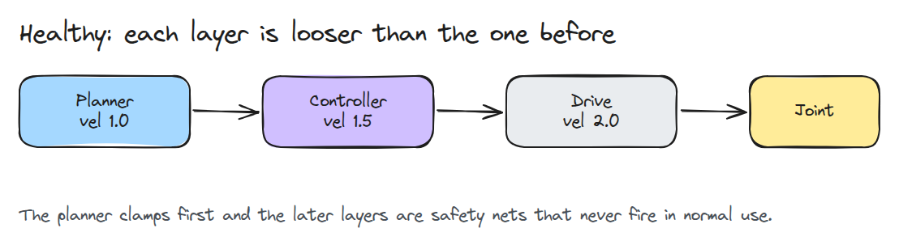
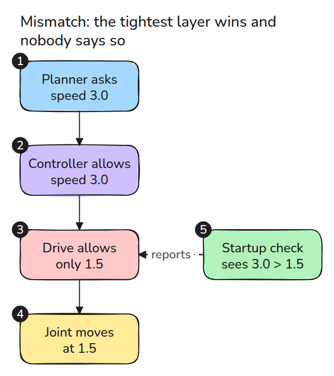
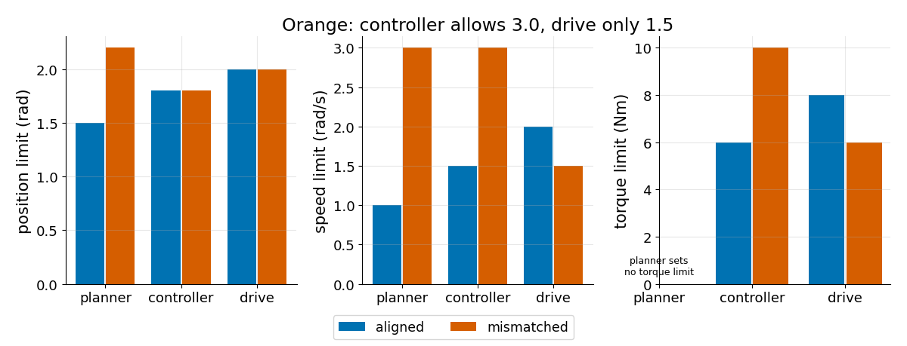
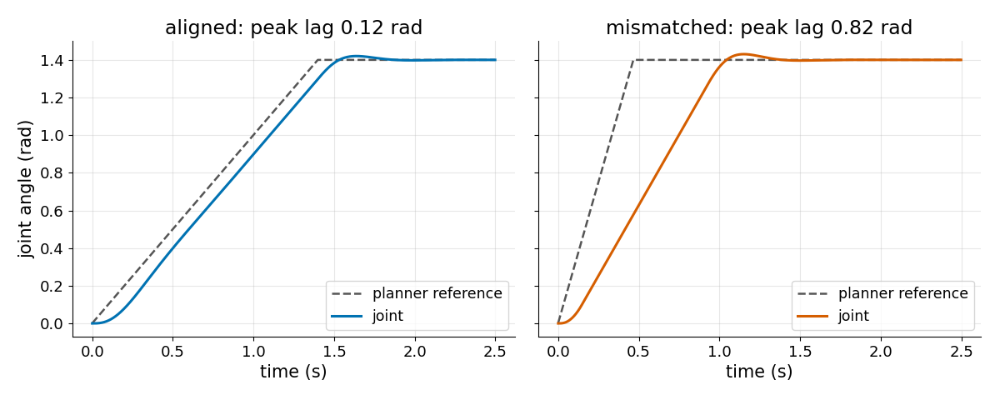

# 계층별 한계 (Limits at Every Layer)

> 로봇이 우리가 시킨 것보다 조용히 느리게 움직이는 이유와 시작할 때 이를 잡아내는 법을 배웁니다.

**유형:** 만들기   **선수 지식:** 없음   **시간:** 약 15분

## 쉽게 말하면

작업대 위 로봇 팔은 명령을 세 계층을 거쳐 받아요. planner는 경로를 그리고 controller는 모터를 밀고 drive는 모터에 붙은 전자장치예요. 계층마다 속도 한계가 있어요.

planner가 drive의 두 배 속도까지 허용하면 계획이 실제 팔보다 앞서가요. drive가 속도를 조용히 깎을 뿐이라 아무도 알려 주지 않아요. 가장 빡빡한 한계가 이겨요.

## 핵심 용어

- **Planner**: 경로를 그리고 요청할 속도를 정하는 계층입니다.
- **Controller**: 경로를 모터 명령으로 바꾸는 계층입니다.
- **Drive**: 모터에 붙은 전자장치이고 자기 hard limit을 지킵니다.
- **Clamp**: 값이 한계 안에 머물도록 잘라 내는 것입니다.
- **Effective limit**: 가장 빡빡한 계층이 정해서 관절이 실제로 느끼는 한계입니다.
- **Nested limits**: 계층마다 다음 계층보다 조금 덜 허용하는 구조이고 planner가 가장 빡빡합니다.

## 문제

계획 소프트웨어의 속도 한계를 3 rad/s로 올렸는데 팔은 여전히 그 절반으로 기어가고 에러도 남지 않습니다. 모터 전자장치의 더 낮은 한계가 속도를 조용히 깎았습니다.

## 개념

로봇에는 한계를 정하는 계층이 여럿이어서 어긋남이 눈에 띄지 않습니다. 계층은 다음 계층보다 조금씩 빡빡해야 합니다. 그래서 planner가 가장 빡빡하고 drive가 가장 느슨합니다. 앞 계층이 뒤 계층보다 많이 허용하면 뒤 계층이 조용히 이깁니다.
시작할 때 모든 쌍을 비교해서 로봇이 움직이기 전에 보고하면 됩니다.



*정상 구조는 계층마다 다음 계층보다 조금씩 빡빡합니다.*



*planner는 많이 요청하고 drive는 적게 허용합니다.*


*어두운 반투명 팔은 planner가 관절이 있다고 믿는 위치입니다. 파란 팔은 목표 앞에서 멈춥니다. 초록은 한계가 서로 맞습니다.*



*파란색은 계층마다 올라가고 주황색은 그 패턴을 깹니다.*



*한계가 맞으면 관절이 따라가고 어긋나면 계획보다 한참 뒤처집니다.*

<details><summary>The math (optional)</summary>

정상일 때 속도 한계는 1.0, 1.5, 2.0입니다. 어긋난 경우에는 planner와 controller가 3.0을 허용하지만 drive는 1.5만 허용하므로 `effective(L, 'vel')`은 `(1.5, 'drive')`를 돌려줍니다.
위치 한계가 planner 2.2와 controller 1.8과 drive 2.0일 때(`MISMATCHED` 값) 2.0 rad 요청은 controller가 1.8로 잘라서 관절은 1.80 rad에서 멈추고 `effective(MISMATCHED,
"pos")`는 `(1.8, 'controller')`를 돌려줍니다.
0.2 rad 모자랍니다. 한계가 맞으면 관절은 0.12 rad 뒤처집니다. 어긋나면 planner는 0.47초에 끝나는데 관절은 0.82 rad나 뒤에 있습니다.

</details>

## 만들기

각 계층은 한계를 적은 작은 표이고 `None`은 한계가 없다는 뜻입니다. 점검은 이웃끼리 비교합니다.

```python
for (a, x), (b, y) in zip(set_, set_[1:]):
    if x > y:
        out.append((q, a, b, x, y, f"{a}.{q} = {x} is looser than {b}.{q} = {y}: {b} wins silently"))
```

`require_nested()`는 모든 어긋남을 한꺼번에 보고합니다. `effective()`는 관절이 실제로 느끼는 한계와 그 계층을 돌려줍니다.

```bash
cd robotics-engineering-from-scratch
python3 -m pytest phases/15-safety-and-deployment/03-limits-at-every-layer -q
python3 phases/15-safety-and-deployment/03-limits-at-every-layer/code/main.py
```

## 실제 도구로 보기

실제 시스템은 한계를 로봇 설명 파일(URDF)과 controller 설정과 drive 자체 설정에 나눠 둡니다. 시작할 때 셋을 한 표에 모아 읽습니다.

## 결과물

`outputs/skill-limit-stack-audit.md`는 그 표를 만들고 점검 보고서를 읽습니다.

## 연습 문제

1. 모터가 얼마나 세게 밀 수 있는지(토크)의 한계를 점검에 넣으세요.
2. 모든 계층에 가속도 한계를 추가하세요.
3. 점검은 왜 같은 한계를 허용하나요?
