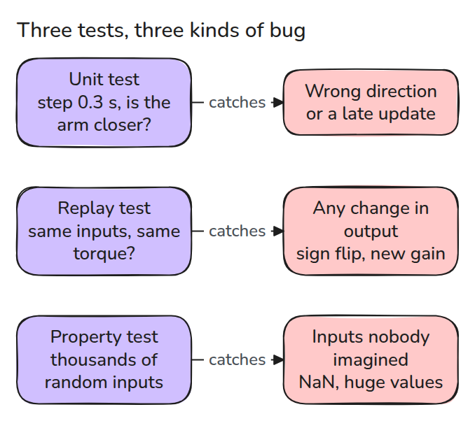
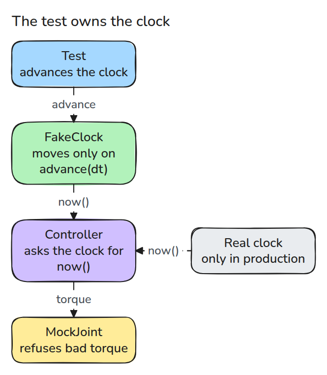
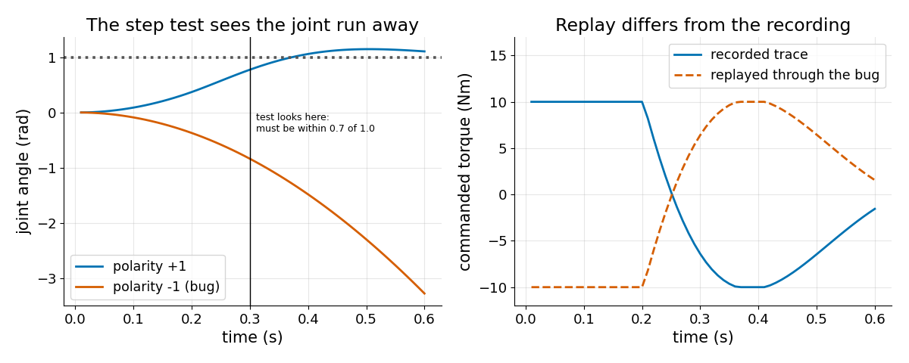
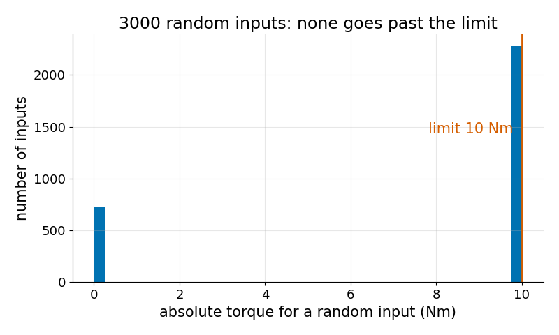

# Testing Robot Code

> Learn how to test robot code without waiting for real time and without risking a real robot.

**Type:** Build   **Prerequisites:** 15/01 Failure Modes   **Time:** ~15 minutes

## In Plain Words

Testing a timer app does not mean waiting for the alarm: you jump its pretend clock ahead. A robot test does the same with a fake clock.

## Key Terms

- **Fake clock**: a clock the test moves forward by hand.
- **Mock joint**: a pretend arm that refuses bad torque.
- **Unit test**: moves the fake clock and checks one simple rule.
- **Replay test**: feeds a recording back in and compares the output.
- **Property test**: throws many random inputs at one rule.
- **Golden trace**: a trusted recording from a healthy run.

## The Problem

You change a robot controller and want to know if it still works. Trying it on a real arm takes time and risks damage.

## The Concept

A bug in robot code can break hardware, so it must be caught on a computer before the robot moves. Three kinds of tests catch three kinds of bug. A unit test jumps the fake clock and checks one rule, like "after the target moves, the joint gets closer". A replay test feeds a recording back in. A property test throws many random inputs at one rule.



*Unit: one rule. Replay: compare with a recording. Property: random inputs.*



*The controller asks for the time. In production that is the real clock, in tests a fake one.*



*Left: the step test fails because the joint ends far from the target. Right: the buggy controller gives the mirror image of the recorded push.*


*The red arrow is the push: green goes toward the target, blue (sign flipped) goes away.*



*The rule: the push is always a real number and never over the limit.*

<details><summary>The math (optional)</summary>

Replay example: a step of 1.0 rad gives `kp * error = 40 * 1.0 = 40`, clipped to `tau_max` 10, so the recorded first torque is +10.0. The flipped controller answers -10.0 first, then the mirror of all 80 recorded samples, 10 ms apart. The replay test fails at the first. The step test checks after 0.3 s. The property test checks torque is finite and never over the limit.

</details>

## Build It

`FakeClock` has `now()` and `advance(dt)`. `MockJoint` refuses a torque over its limit, NaN included. `Controller` gives zero torque if updates stop for too long. `run()` returns the trace.

```python
def test_step_direction_test_catches_the_sign_bug():
    with pytest.raises(AssertionError, match="moved away"):
        check_step_direction(polarity=-1)
```

`code/tests/golden_trace.json` came from the healthy controller. The controller returns zero torque for NaN and infinity, or the property test fails.

```bash
cd robotics-engineering-from-scratch
python3 -m pytest phases/15-safety-and-deployment/04-testing-robot-code -q
python3 phases/15-safety-and-deployment/04-testing-robot-code/code/main.py
```

## Use It

In a ROS 2 node, inject the clock the same way. Replay real recordings of a good run through new code before each release.

## Ship It

`outputs/skill-robot-test-plan.md` turns a controller into unit, replay and property tests.

## Exercises

1. Change the push strength. Does the replay test fail?
2. Write a test that a controller with stale updates returns exactly zero.
3. Test that swapped arguments are caught.
