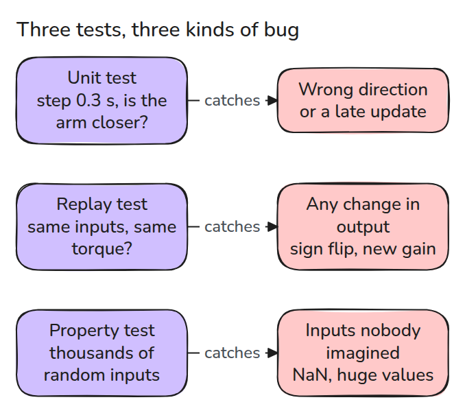
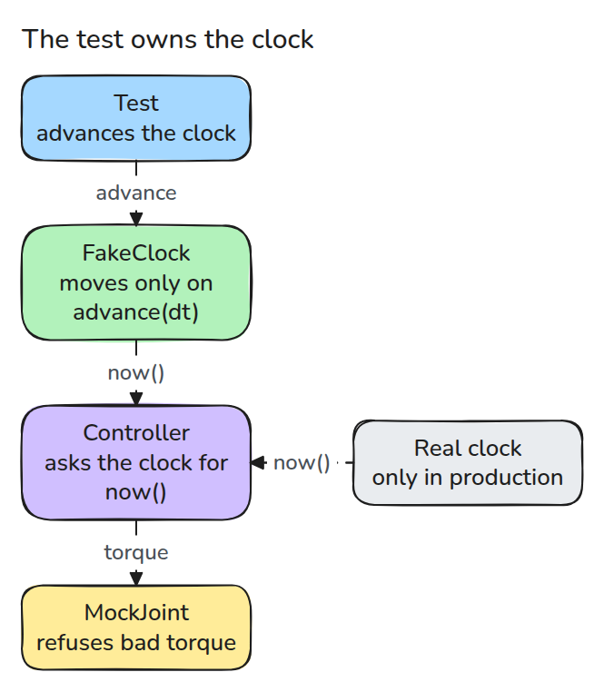
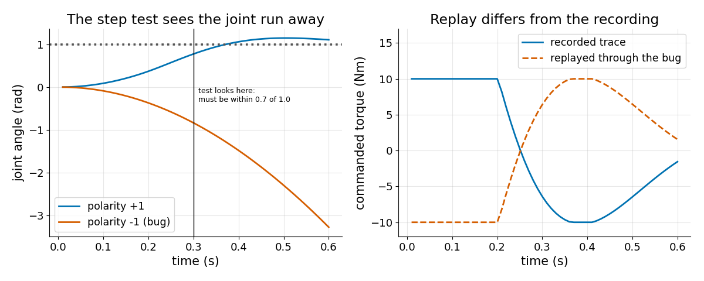
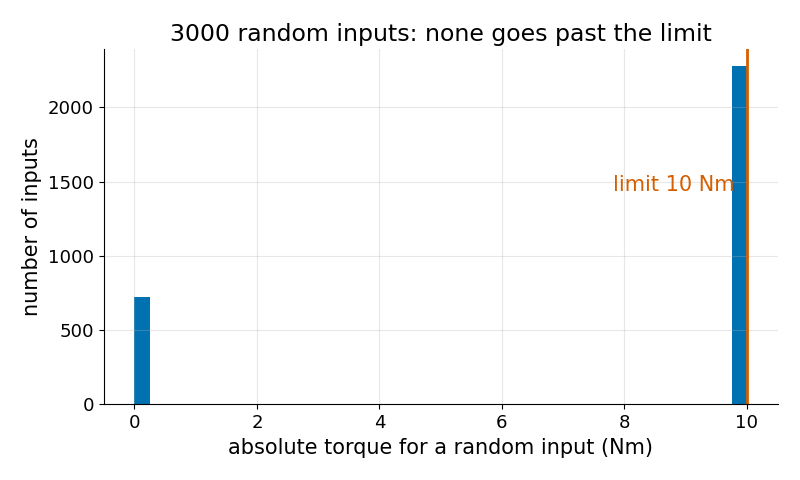

# Testing Robot Code

> A robot test must control time, refuse bad commands, and replay what really happened.

**Type:** Build   **Prerequisites:** 15/01 Failure Modes   **Time:** ~15 minutes

## In Plain Words

To test a timer app, give it a pretend clock and jump past the deadline. You can check its reaction immediately instead of waiting for
real time to pass.

Robot tests can control time the same way. A mock joint rejects invalid or excessive torque, and replay feeds recorded observations
back through the controller to compare commands. Checking that motion approaches the target catches a reversed sign. Trying many
unusual inputs tests rules such as keeping every command finite and within its limit.

## The Problem

Robot code depends on a clock, a joint and inputs you cannot predict, so tests either sleep for seconds, need hardware, or check nothing. The wrong-sign fault from lesson 01 shows it. The code ran, the joint ran away, and a test that only checks "it returns a number" passes.

## The Concept



*A unit test pins down logic, a replay test pins down behaviour, and a property test hunts inputs nobody wrote a case for.*



*The controller asks for the time through an object. In production that is the real clock. In a test it is a fake the test advances, so ten seconds pass in no time and never flake.*



*Left: the step-direction test fails because the joint ends far from the target after 0.3 s. Right: a replay of recorded inputs through the buggy controller gives the mirror image of the recorded torque.*



*The property test draws thousands of random inputs and checks one rule: torque is finite and never over the limit.*

## Build It

`FakeClock` has `now()` and `advance(dt)`. `MockJoint` integrates a simple plant and raises if it is handed a torque over its limit, NaN included. `Controller` is a PD loop that gives zero torque when the gap between updates exceeds a timeout. `run()` returns the trace as `(q_meas, q_ref, tau)` rows.

```python
def test_step_direction_test_catches_the_sign_bug():
    with pytest.raises(AssertionError, match="moved away"):
        check_step_direction(polarity=-1)
```

The recorded trace in `code/tests/golden_trace.json` came from the healthy controller. Without its non-finite guard the property test fails on NaN input, so the controller returns zero torque for NaN and infinity.

```bash
cd robotics-engineering-from-scratch
python3 -m pytest phases/15-safety-and-deployment/04-testing-robot-code -q
python3 phases/15-safety-and-deployment/04-testing-robot-code/code/main.py
```

## Use It

In a ROS 2 node, inject the clock the same way, or use simulated time. Record real bags of a good run and replay them through the new code before every release. A property-testing library such as hypothesis can run that kind of search.

## Ship It

`outputs/skill-robot-test-plan.md` turns a controller into a list of unit, replay and property tests.

## Exercises

1. Change `kp` and watch the replay test fail, then decide whether to re-record.
2. Write a property test that a stale controller always returns exactly zero.
3. Add a test for a swapped `q_meas` and `q_ref` argument order.
