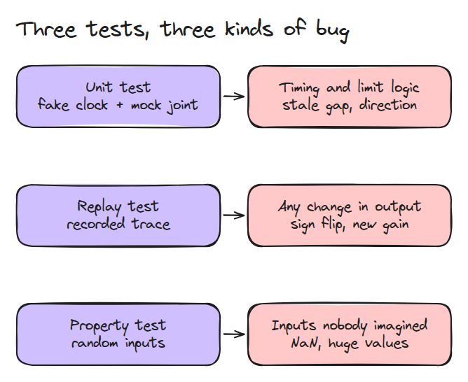
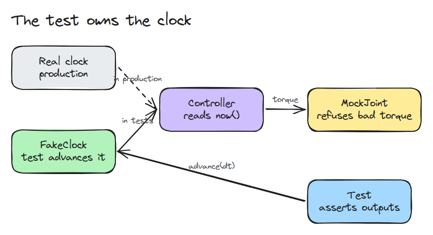
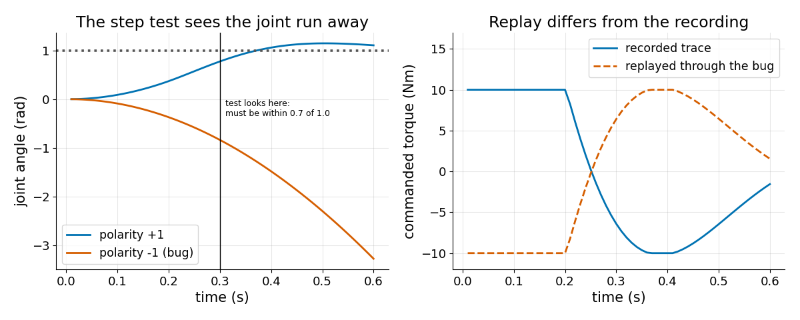
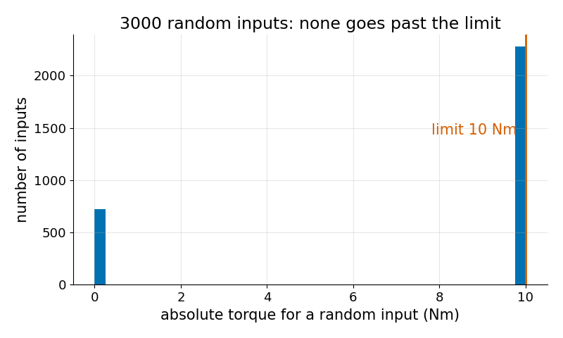

# 로봇 코드 테스트 (Testing Robot Code)

> 로봇 테스트는 시간을 통제하고 나쁜 명령을 거부하고 실제로 있었던 일을 다시 재생해야 합니다.

**유형:** 만들기   **선수 지식:** 15/01 고장 유형   **시간:** 약 15분

## 문제

로봇 코드는 시계와 관절과 예측할 수 없는 입력에 의존합니다. 그래서 테스트가 몇 초씩 sleep하거나 하드웨어가 필요하거나 아무것도 검사하지 못합니다. 01 레슨의 wrong sign 결함이 그 증거입니다. 관절이 폭주해도 "숫자를 돌려준다"만 보는 테스트는 통과합니다.

## 개념



*unit 테스트는 로직을 고정하고 replay 테스트는 동작을 고정합니다. property 테스트는 아무도 케이스를 쓰지 않은 입력을 찾아냅니다.*



*제어기는 객체를 통해 시간을 묻습니다. 운영에서는 진짜 시계를 받고 테스트에서는 테스트가 앞으로 돌리는 가짜 시계를 받습니다. 그래서 10초가 순식간에 지나고 결과가 흔들리지 않습니다.*



*왼쪽에서는 0.3초 뒤 관절이 목표에서 멀어 step 방향 테스트가 실패합니다. 오른쪽은 녹화된 입력을 버그가 있는 제어기에 재생했을 때 녹화 토크의 거울상이 나오는 모습입니다.*



*property 테스트는 무작위 입력을 수천 개 뽑아 한 가지만 확인합니다. 토크는 유한하고 한계를 넘지 않는다는 것입니다.*

## 만들기

`FakeClock`은 `now()`와 `advance(dt)`를 가집니다. `MockJoint`는 단순한 plant를 적분하고 한계를 넘는 토크나 NaN을 받으면 예외를 냅니다. `Controller`는 PD loop이며 update 간격이 timeout을 넘으면 토크 0을 냅니다.

`run()`은 trace를 `(q_meas, q_ref, tau)` 행으로 돌려줍니다.

```python
def test_step_direction_test_catches_the_sign_bug():
    with pytest.raises(AssertionError, match="moved away"):
        check_step_direction(polarity=-1)
```

`code/tests/golden_trace.json`의 녹화본은 정상 제어기에서 얻었습니다. 유한값 검사가 없으면 property 테스트가 NaN 입력에서 실패합니다. 그래서 제어기는 NaN과 무한대에 토크 0을 돌려줍니다.

```bash
cd robotics-engineering-from-scratch
python3 -m pytest phases/15-safety-and-deployment/04-testing-robot-code -q
python3 phases/15-safety-and-deployment/04-testing-robot-code/code/main.py
```

## 실제 도구로 보기

ROS 2 노드에서도 시계를 같은 방식으로 주입하거나 simulated time을 씁니다. 정상 실행의 실제 bag을 녹화해 두고 배포 전마다 새 코드에 재생합니다. hypothesis 같은 property 테스트 라이브러리를 쓸 수 있습니다.

## 결과물

`outputs/skill-robot-test-plan.md`는 제어기를 unit, replay, property 테스트 목록으로 바꿔 줍니다.

## 연습 문제

1. `kp`를 바꿔 replay 테스트가 실패하는 것을 보고 다시 녹화할지 판단하세요.
2. update가 끊긴(stale) 제어기가 항상 정확히 0을 돌려준다는 property 테스트를 쓰세요.
3. `q_meas`와 `q_ref` 인자 순서가 바뀐 경우를 잡는 테스트를 추가하세요.
