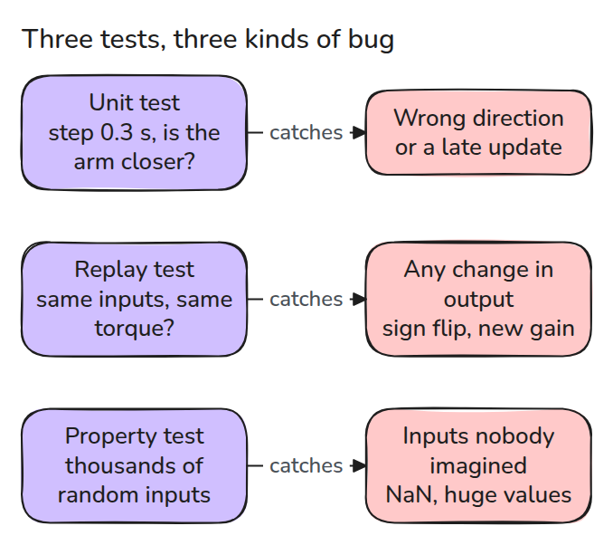
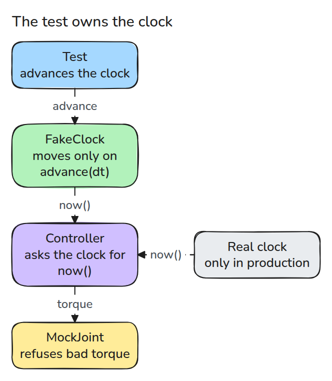
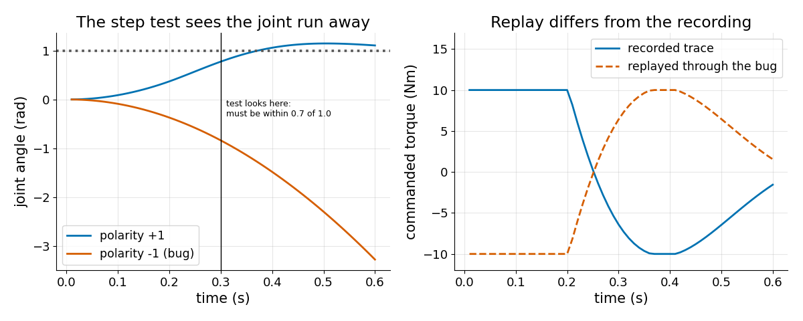
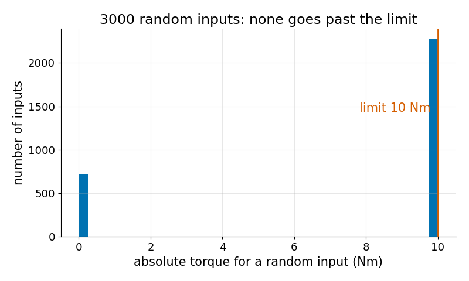

# 로봇 코드 테스트 (Testing Robot Code)

> 실제 시간을 기다리지 않고 실제 로봇도 위험에 빠뜨리지 않으면서 로봇 코드를 시험하는 법을 배웁니다.

**유형:** 만들기   **선수 지식:** 없음   **시간:** 약 15분

## 쉽게 말하면

타이머 앱을 시험할 때는 알람이 울릴 때까지 기다리지 않고 가짜 시계를 앞으로 옮겨요. 로봇 테스트도 가짜 시계로 똑같이 해요.

## 핵심 용어

- **Fake clock**: 테스트가 손으로 앞으로 돌리는 시계입니다.
- **Mock joint**: 나쁜 힘(torque), 예를 들어 실제 숫자가 아닌 힘(NaN)을 거부하는 가짜 팔입니다.
- **Unit test**: 가짜 시계를 돌리고 단순한 규칙 하나를 확인하는 테스트입니다.
- **Replay test**: 녹화를 다시 넣어 출력을 믿을 수 있는 녹화와 비교하는 테스트입니다.
- **Property test**: 규칙 하나에 무작위 입력을 많이 던지는 테스트입니다.
- **Golden trace**: 정상 실행에서 얻은 믿을 수 있는 녹화본입니다.

## 문제

로봇 controller(팔을 조종하는 프로그램)를 고쳤는데 여전히 되는지 알고 싶습니다. 실제 팔에서 돌리면 시간이 들고 망가질 위험이 있습니다.

## 개념

로봇 코드의 버그는 하드웨어를 망가뜨릴 수 있어서 로봇이 움직이기 전에 컴퓨터에서 잡아야 합니다. unit 테스트는 가짜 시계를 돌리고 "목표가 움직이면 관절이 더 가까워진다" 같은 규칙 하나를 확인합니다.
replay 테스트는 녹화를 다시 넣습니다. property 테스트는 규칙 하나에 무작위 입력을 많이 던집니다.



*unit은 가짜 시계에서 규칙 하나를 확인하고 replay는 녹화와 비교하고 property는 무작위 입력에 규칙 하나를 확인합니다.*



*controller는 시간을 물어봅니다. 실제 로봇에서는 진짜 시계를 받고 테스트에서는 가짜 시계를 받습니다.*



*왼쪽에서는 관절이 목표에서 멀어 unit 테스트가 실패합니다. 오른쪽은 버그가 있는 controller의 힘이 녹화된 힘과 반대인 모습입니다.*


*빨간 화살표는 미는 힘입니다. 초록은 목표 쪽으로 밀고 반대로 미는 파란 쪽은 멀어집니다.*



*규칙은 미는 힘이 NaN이 아니고 한계를 넘지 않는다는 것입니다.*

<details><summary>The math (optional)</summary>

replay 예시입니다. 1.0 rad step은 `kp * error = 40 * 1.0 = 40`을 만들고 `tau_max` 10으로 잘리므로 녹화된 첫 torque는 +10.0입니다.
부호가 뒤집힌 controller의 첫 답은 -10.0이고 그 뒤에도 10 ms 간격의 샘플 80개 모두 녹화 torque의 거울상입니다. replay 테스트는 첫 샘플에서 실패합니다. unit 테스트는 0.3초 뒤를 확인합니다.
property 테스트는 토크가 유한하고 한계를 넘지 않는지 확인합니다.

</details>

## 만들기

`FakeClock`은 `now()`와 `advance(dt)`를 가집니다. `MockJoint`는 한계를 넘는 토크나 NaN을 받으면 예외를 냅니다. `Controller`는 update가 너무 오래 끊기면 토크 0을 냅니다. 

```python
def test_step_direction_test_catches_the_sign_bug():
    with pytest.raises(AssertionError, match="moved away"):
        check_step_direction(polarity=-1)
```

`code/tests/golden_trace.json`은 정상 controller에서 얻었습니다. controller가 NaN과 무한대에 힘 0을 돌려주지 않으면 property 테스트가 실패합니다.

```bash
cd robotics-engineering-from-scratch
python3 -m pytest phases/15-safety-and-deployment/04-testing-robot-code -q
python3 phases/15-safety-and-deployment/04-testing-robot-code/code/main.py
```

## 실제 도구로 보기

ROS 2 노드에서도 시계를 같은 방식으로 넘겨 줍니다. 정상 실행의 실제 녹화를 새 코드에 재생합니다.

## 결과물

`outputs/skill-robot-test-plan.md`는 controller를 unit, replay, property 테스트로 바꿔 줍니다.

## 연습 문제

1. 미는 힘의 세기를 바꿔 보세요. replay 테스트가 실패하나요?
2. update가 끊긴 controller가 정확히 0을 돌려준다는 테스트를 쓰세요.
3. 호출에서 측정 각도와 목표 각도를 바꿔 넣어 보세요. 테스트가 잡아내나요?
