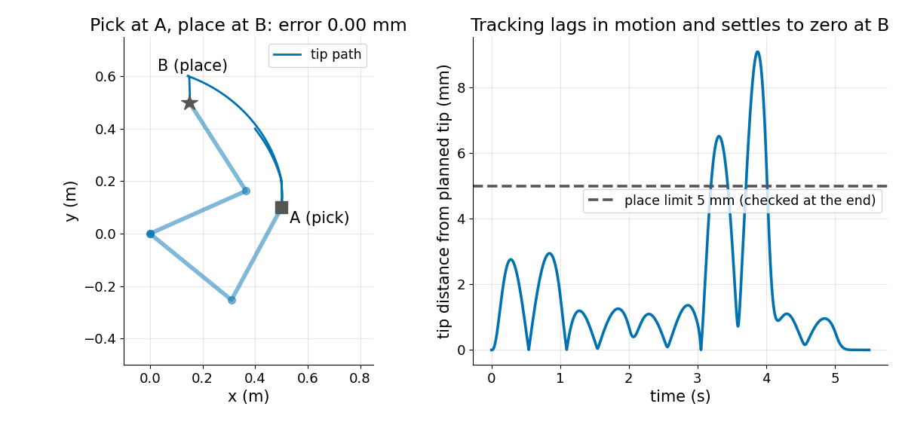
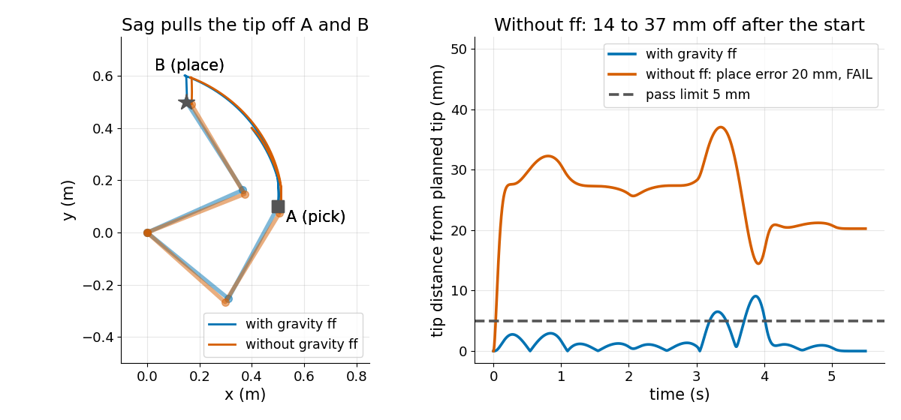

# Arm Pick and Place in Simulation

> Put four earlier ideas together to make a robot arm move a ball, and see what breaks when one is missing.

**Type:** Build   **Prerequisites:** 02/02 Inverse Kinematics, 03/02 Gravity Compensation, 09/01 Trajectory Profiles   **Time:** ~30 minutes

## In Plain Words

A bench arm lifts a ball off a post (A) and sets it on a marker (B). Gravity pulls the arm down, so it needs a steady upward push just to hold still.

Gravity feedforward adds that push in advance. Without it, the controller pushes back only after the arm sags, so the ball lands beside the marker.

## Key Terms

- **Inverse kinematics (IK)**: finding the joint angles that put the hand at a chosen point.
- **Quintic**: a smooth curve that starts and ends at rest.
- **PD loop**: pushes in proportion to the error and brakes in proportion to the speed.
- **Feedforward**: a push added in advance from a model, instead of waiting for error.
- **Sag**: the steady drop of the arm below its planned pose under gravity.
- **Waypoint**: a pose the path must pass through, such as hovering over A.

## The Problem

You ask an arm to pick up a ball and place it on a marker. Each earlier lesson passes its own test, yet the ball lands 2 cm off. Where does the miss come from?

## The Concept

Real robot tasks chain several parts together, so one small missing part can ruin the whole task.


*IK finds the joint angles for each stop, a quintic joins them, and a PD loop with feedforward drives the arm.*


*Without feedforward all of gravity's torque becomes error, which the position spring turns into sag.*

Hold the arm at B. The shoulder carries 6.11 Nm (`gravity()`). With `kp = 150` (Nm per radian of error) and no feedforward it sinks about `6.11 / 150 = 0.04` rad. The tip, 0.5 m away, moves about 0.02 m. `run()` reports 20.24 mm.


*Blue, without feedforward, stops 20 mm from the marker. Green keeps it. Sag is drawn 6 times larger.*



*The tip lags the plan by up to 9 mm while moving, then settles to 0.00 mm at B.*



*Without feedforward the tip sits 14 to 37 mm off the plan and the check fails.*

## Build It

The new part is the arm: `M(q) a + C(q, v) + g(q) = tau` (inertia, motion-coupling and gravity terms), stepped every millisecond.

```python
q, v = step(q, v, ff * gravity(qd) + kp * (qd - q) + kd * (vd - v))
```

`ik()` gives the waypoints, `reference()` the planned angles and speeds `qd, vd`, and `ff` scales the feedforward. `run()` returns the pick error, the place error and `passed` (place error below 5 mm).

```bash
cd robotics-engineering-from-scratch
python3 -m pytest phases/16-capstones/01-arm-pick-and-place-sim -q
python3 phases/16-capstones/01-arm-pick-and-place-sim/code/main.py
```

## Use It

Compare MuJoCo's `qfrc_bias` with `coriolis + gravity` from this lesson.

Sources: [MuJoCo mjData reference](https://mujoco.readthedocs.io/en/stable/APIreference/APItypes.html), read 2026-11-09.

## Ship It

`outputs/skill-pick-place-miss-triage.md` traces a miss at B to its likely stage.

## Exercises

1. Scale the feedforward to 0.9. What `kp` still passes?
2. Add a 0.5 kg block to link 2 after the pick.
3. Replace the quintic with a trapezoid.
