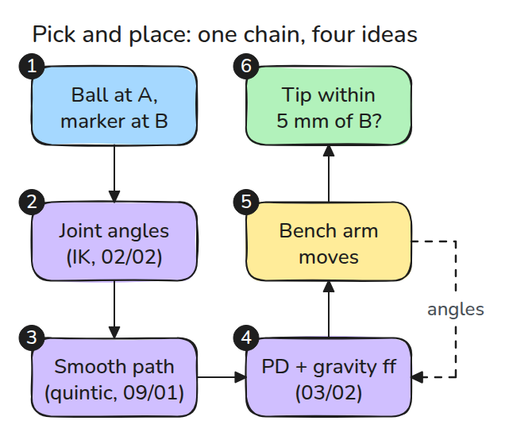
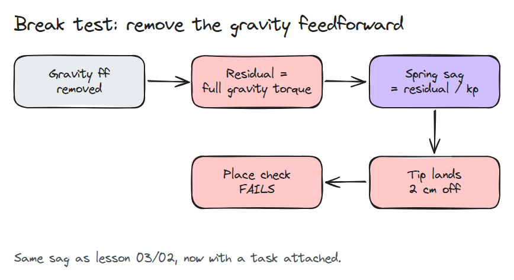
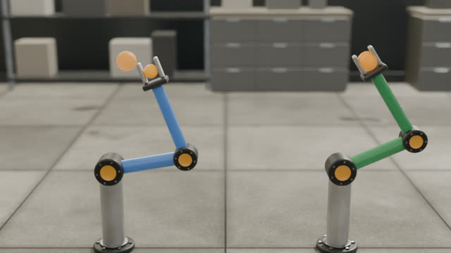

# Arm Pick and Place in Simulation

> Put four earlier ideas together to make a robot arm move a ball, and see what breaks when one is missing.

**Type:** Build   **Prerequisites:** 02/02 Inverse Kinematics, 03/02 Gravity Compensation, 09/01 Trajectory Profiles   **Time:** ~30 minutes

## In Plain Words

A bench arm lifts a ball off a post (A) and sets it on a marker (B). Gravity pulls the arm down, so it needs a steady upward push just to hold still.

Gravity feedforward adds that push in advance. Without it, the controller pushes back only after the arm sags, so the ball lands beside the marker.

## Key Terms

- **Inverse kinematics (IK)**: finding the joint angles that put the hand at a chosen point.
- **PD loop**: a controller, the program that drives the motor, which pushes by how far off the arm is and brakes by how fast it moves.
- **Feedforward**: a push worked out before the arm moves, not after an error shows.
- **Sag**: the steady drop of the arm below its planned pose because of gravity.
- **Waypoint**: a pose the path must pass through, such as hovering over A.

## The Problem

Each earlier lesson passes its own test, yet the arm sets the ball 2 cm off its marker. Where does the miss come from?

## The Concept

Real robot tasks chain several parts together, so one small missing part can ruin the whole task. Four parts work together: IK finds the poses, a smooth path joins them, a controller follows it, and gravity feedforward holds the arm up. Remove the feedforward, which works quietly, and the arm sags.



*IK finds poses, a smooth path joins them, a controller with feedforward drives the arm.*



*Without feedforward, gravity pulls the arm off its plan, and the controller pushes back only after it sags.*

[](../assets/clip-example.mp4)

*Blue, without feedforward, stops short of the marker. Green reaches it. The sag is drawn bigger.*


*The tip follows the plan closely and ends exactly on the marker.*


*Without feedforward the tip sits off the plan and misses the marker, so the check fails.*

<details><summary>The math (optional)</summary>

Holding the arm at B, the shoulder must carry 6.11 Nm (`gravity()`). With `kp = 150` (Nm per radian of error) and no feedforward it sinks about `6.11 / 150 = 0.04` rad. The tip, 0.5 m away, moves about 0.02 m, and `run()` reports 20.24 mm. With feedforward the tip lags the plan by up to 9 mm while moving, then settles to 0.00 mm at B. Without it the tip sits 14 to 37 mm off the plan. Sag is drawn 6 times larger in the clip. The smooth path between poses is a quintic (a curve that starts and ends at rest). The arm model is `M(q) a + C(q, v) + g(q) = tau`. Compare MuJoCo's `qfrc_bias` with `coriolis + gravity` from this lesson.

</details>

## Build It

The new part is the arm itself, stepped every millisecond.

```python
q, v = step(q, v, ff * gravity(qd) + kp * (qd - q) + kd * (vd - v))
```

`ik()` gives the waypoints and `ff` scales the feedforward. `run()` returns `passed` (place error under 5 mm).

```bash
cd robotics-engineering-from-scratch
python3 -m pytest phases/16-capstones/01-arm-pick-and-place-sim -q
python3 phases/16-capstones/01-arm-pick-and-place-sim/code/main.py
```

## Use It

MuJoCo and other simulators compute the arm's motion for you.

Sources: [MuJoCo mjData reference](https://mujoco.readthedocs.io/en/stable/APIreference/APItypes.html), read 2026-11-09.

## Ship It

`outputs/skill-pick-place-miss-triage.md` traces a miss at B to its likely stage.

## Exercises

1. Use only 90% of the feedforward. How hard must the controller push back to still pass?
2. In the code, add 0.5 kg to link 2 after the pick.
3. Replace the smooth path with a speed-up, cruise, slow-down path.
