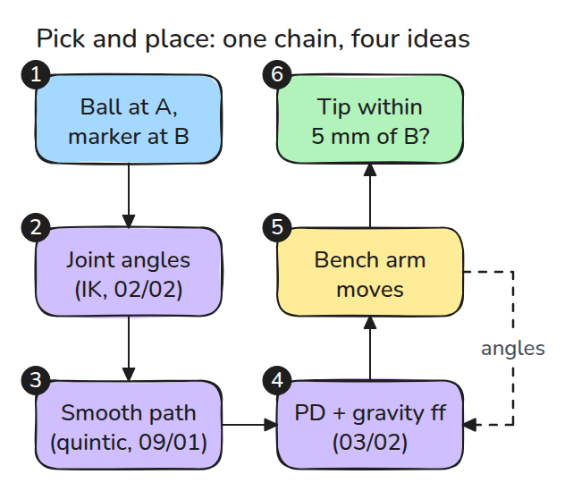
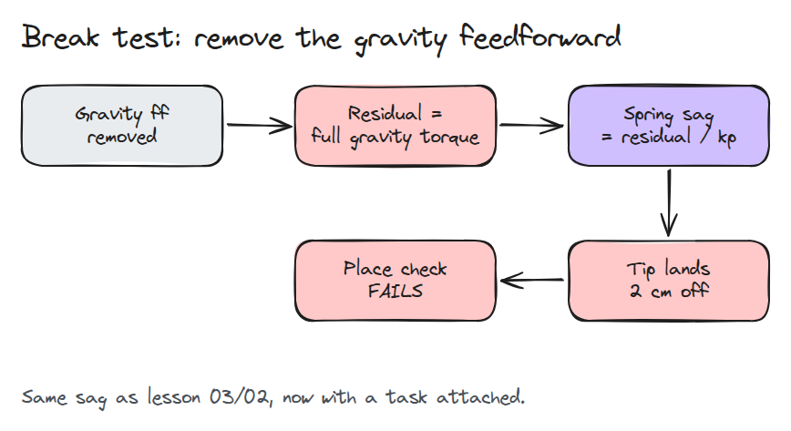
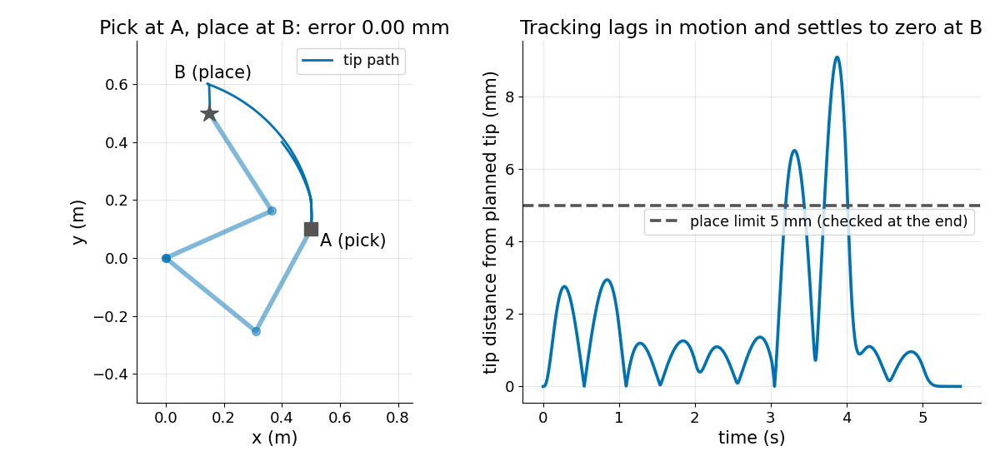
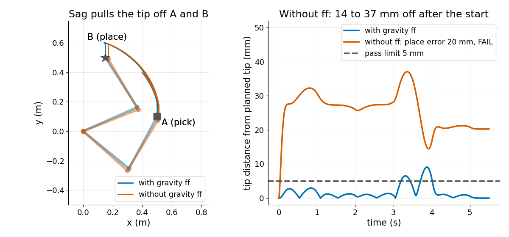

# Arm Pick and Place in Simulation

> Four earlier ideas make one task, and removing the quietest one, gravity feedforward, makes the whole task fail.

**Type:** Build   **Prerequisites:** 02/02 Inverse Kinematics, 03/02 Gravity Compensation, 09/01 Trajectory Profiles   **Time:** ~30 minutes

## In Plain Words

Moving a cup from a table to a shelf combines several jobs: choose your arm angles, move without a sudden start, and keep supporting
your arm's weight.

This simulated arm joins IK, a quintic trajectory and a PD controller with gravity feedforward. Feedforward supplies the holding torque
before a position error is needed. Remove it and the controller must let the arm sag to create enough corrective torque. The planned
destination stays the same, but the actual tip can miss the placing point.

## The Problem

Every earlier lesson passes its own test, yet the parts have never had to work together. A pick-and-place run needs all of them at once. A fault in one shows up as a miss at the end. Here you build the whole chain on a simulated planar arm and learn to read where a miss comes from.

## The Concept



*Targets become joint waypoints, waypoints become a smooth path, and a PD loop with gravity feedforward drives a simulated arm. The tip error at B decides pass or fail.*



*Without feedforward the full gravity torque becomes a residual, and the position spring turns it into sag.*



*The tip hovers over A, picks, lifts, hovers over B and places. It lags the plan by up to 9 mm while moving, then settles to 0.00 mm at B.*



*Without feedforward the tip sits 14 to 37 mm off the plan after the start and places 20 mm from B, so the check fails.*

## Build It

The new part is the arm itself: `M(q) a + C(q, v) + g(q) = tau`, stepped every millisecond.

```python
q, v = step(q, v, ff * gravity(qd) + kp * (qd - q) + kd * (vd - v))
```

`ik()` gives the waypoints, `reference()` gives `qd, vd` along quintic segments, and `ff` scales the feedforward from `gravity()`. `run()` returns the pick error, the place error and `passed` (place error below 5 mm). A free-swing energy test checks the Coriolis terms.

```bash
cd robotics-engineering-from-scratch
python3 -m pytest phases/16-capstones/01-arm-pick-and-place-sim -q
python3 phases/16-capstones/01-arm-pick-and-place-sim/code/main.py
```

## Use It

Real simulators supply `M`, `C` and `g` for you. MuJoCo's `qfrc_bias` is documented as `C(qpos,qvel)`, computed by `mj_fwdVelocity`. Compare it with `coriolis + gravity` from this lesson.

Sources: [MuJoCo mjData reference](https://mujoco.readthedocs.io/en/stable/APIreference/APItypes.html), read 2026-11-09.

## Ship It

`outputs/skill-pick-place-miss-triage.md` turns a miss at B into the likely stage that caused it.

## Exercises

1. Scale the feedforward to 0.9 and find the smallest `kp` that still passes.
2. Add a 0.5 kg block to link 2 after the pick and watch the place error.
3. Replace the quintic path with a trapezoid and compare the peak tracking error.
