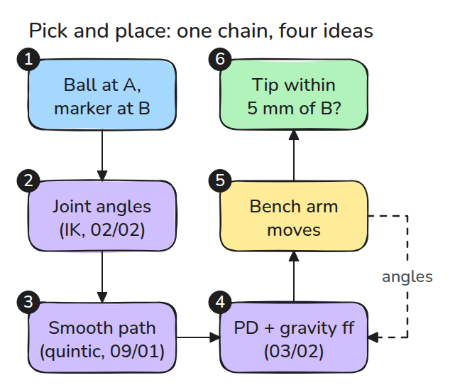
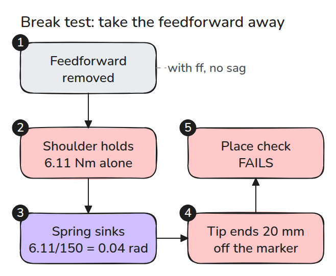
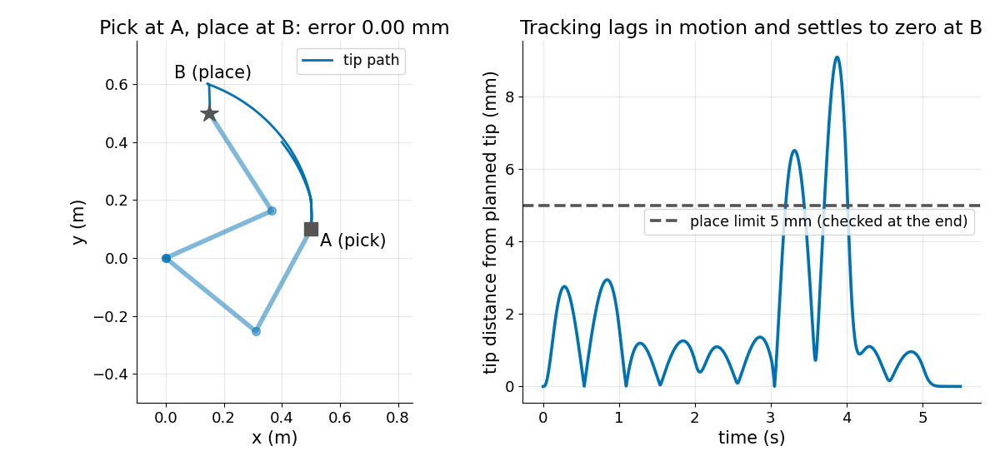
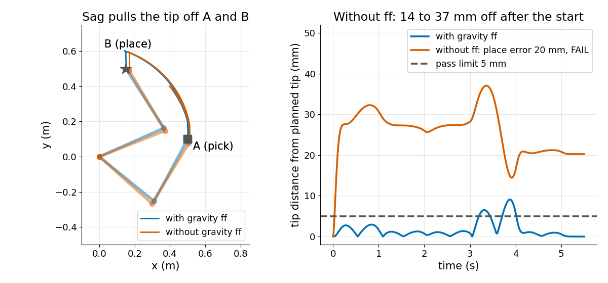

# 시뮬레이션 팔 Pick and Place

> 앞서 배운 네 가지가 하나의 작업이 됩니다. 가장 조용한 부품인 중력 feedforward를 빼면 작업 전체가 실패합니다.

**유형:** 만들기   **선수 지식:** 02/02 역기구학, 03/02 중력 보상, 09/01 궤적 프로파일   **시간:** 약 30분

## 쉽게 말하면

bench arm이 받침(A) 위의 공을 집어 올려 표시(B) 위에 내려놓아요. 중력이 팔 전체를 아래로 당기기 때문에 팔은 가만히 있기만 해도 위로 받쳐 주는 힘이 계속 필요해요.

gravity feedforward는 그 힘을 미리 더해 줘요. 이것이 없으면 controller는 팔이 처진 뒤에야 되밀고 그 힘은 처진 만큼만 커져요. 그래서 팔은 계획보다 낮은 곳에 멈추고 공은 표시 옆에 떨어져요.

## 문제

앞의 레슨은 모두 자기 테스트를 통과했지만 이번 실행에서는 공이 표시에서 2 cm 벗어난 곳에 떨어집니다. 여기서는 시뮬레이션에서 전체 체인을 만들고 빗나감의 원인을 찾는 법을 익힙니다.

## 개념



*번호를 따라가 보세요. IK(역기구학)는 손이 각 지점에 닿는 관절 각도를 찾고 quintic(처음과 끝에서 멈추는 곡선)이 그 지점들을 잇습니다. PD 루프(오차만큼 밀고 속도만큼 브레이크를 거는 제어)는 gravity feedforward를 더해 팔을 그 경로로 움직입니다.*



*왼쪽부터 읽어 보세요. feedforward가 없으면 중력 토크 전체가 오차가 되고 position 스프링이 그 오차를 처짐으로 바꿉니다.*

팔을 B에 가만히 세워 두고 계산해 봅시다. 어깨는 6.11 Nm를 버텨야 합니다(`gravity()`).

`kp = 150`(오차 1 rad당 미는 힘 150 Nm)이고 feedforward가 없으면 스프링이 그 힘을 전부 만들어야 해서 어깨는 `6.11 / 150 = 0.04` rad 정도 내려앉습니다.

팁은 어깨에서 약 0.5 m 떨어져 있으므로 `0.04 × 0.5 = 0.02` m 움직입니다. `run()`이 보고하는 값은 20.24 mm입니다.


*feedforward를 끄는 순간의 파란 팔을 보세요. 약 0.04 rad 내려앉아 표시에서 20 mm 떨어진 곳에 멈춥니다. 초록 팔은 feedforward를 유지해서 그대로 있습니다. 처짐은 6배로 그렸습니다.*



*팁을 보세요. A 위에서 대기하다 집고 들어 올려 B 위로 옮긴 뒤 내려놓습니다. 움직이는 동안은 오차가 생긴 뒤에야 controller가 반응하므로 계획보다 최대 9 mm 뒤처지고 B에서는 0.00 mm로 수렴합니다.*



*앞 그림과 비교해 보세요. feedforward가 없으면 시작 이후 팁이 계획에서 14~37 mm 벗어나고 B에서 20 mm 떨어진 곳에 놓아 검사에 실패합니다.*

## 만들기

새로 들어가는 부품은 팔 자체입니다. `M(q) a + C(q, v) + g(q) = tau`(관성과 관절끼리 주고받는 힘과 중력을 나타내는 항들)를 1 ms마다 한 걸음씩 적분합니다.

```python
q, v = step(q, v, ff * gravity(qd) + kp * (qd - q) + kd * (vd - v))
```

`ik()`가 waypoint를 주고 `reference()`가 quintic 구간을 따라 계획한 각도와 속도 `qd, vd`를 줍니다. `ff`는 `gravity()`에서 나온 feedforward의 배율입니다.

`run()`은 pick 오차와 place 오차, 그리고 `passed`(place 오차 5 mm 미만)를 돌려줍니다. 자유 스윙 에너지 테스트가 Coriolis 항을 검증합니다.

```bash
cd robotics-engineering-from-scratch
python3 -m pytest phases/16-capstones/01-arm-pick-and-place-sim -q
python3 phases/16-capstones/01-arm-pick-and-place-sim/code/main.py
```

## 실제 도구로 보기

실제 시뮬레이터는 `M`, `C`, `g`를 대신 계산해 줍니다. MuJoCo 문서는 `qfrc_bias`를 `C(qpos,qvel)`로 설명하고 `mj_fwdVelocity`가 계산한다고 적고 있습니다. 이 레슨의 `coriolis + gravity`와 비교해 보세요.

출처: [MuJoCo mjData 레퍼런스](https://mujoco.readthedocs.io/en/stable/APIreference/APItypes.html), 2026년 11월 9일 확인.

## 결과물

`outputs/skill-pick-place-miss-triage.md`는 B에서 빗나간 결과를 원인이 된 단계로 좁혀 줍니다.

## 연습 문제

1. feedforward 배율을 0.9로 두고 여전히 통과하는 가장 작은 `kp`를 찾으세요.
2. pick 뒤에 link 2에 0.5 kg 블록을 달고 place 오차를 관찰하세요.
3. quintic 경로를 trapezoid로 바꾸고 최대 추종 오차를 비교하세요.
