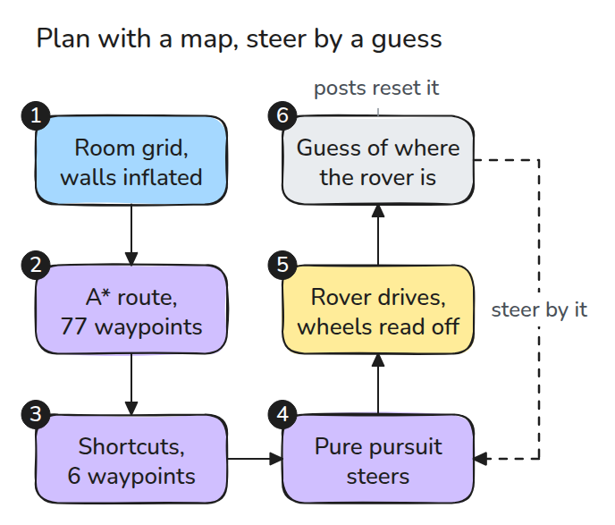
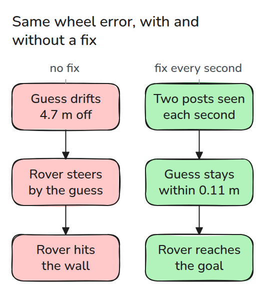
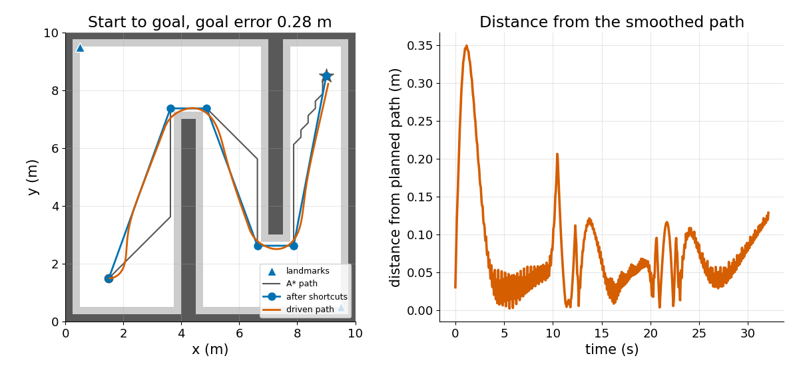
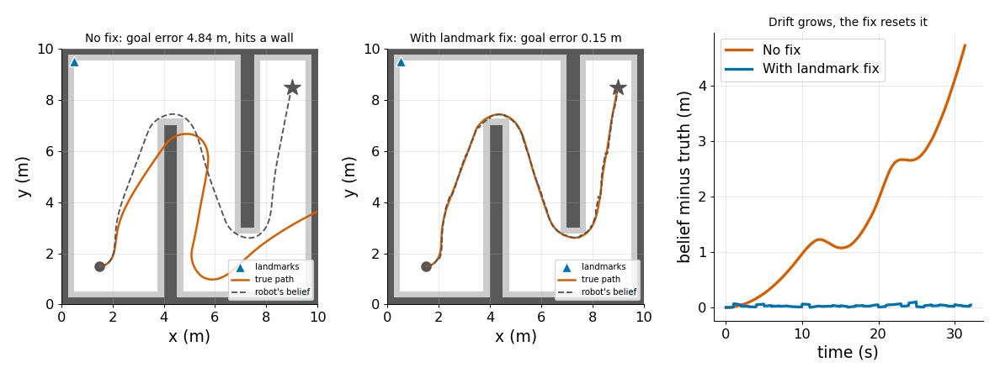

# Mobile Navigation in Simulation

> A planner draws the route, but the robot only follows where it believes it is, so a drifting odometry estimate turns a good plan into a crash.

**Type:** Build   **Prerequisites:** 08/01 Differential Drive, 08/04 Pure Pursuit, 09/03 Collision Checking   **Time:** ~30 minutes

## In Plain Words

A rover steers along a planned route by checking where it believes it is. It forms that belief by adding wheel turns, which is called odometry. If the wheels read a little wrong, each step adds error to the belief.

The rover keeps steering to put its belief on the route, so the real rover drifts off into a wall. Two posts at known spots fix this. The direction between them shows which way the rover faces, and one post then shows where it is, so it resets its belief.

## The Problem

The route was clean and the follower tracked it in tests. On a longer run the rover ends pressed against a wall while its display says it is on the path. The plan was fine. The belief was wrong.

## The Concept



*Follow the numbers: A\* (a shortest-route search) plans on a grid padded by the rover's radius, shortcuts trim the route, and pure pursuit steers along it by the odometry belief.*



*Compare the rows: same wheel error, but only the bottom row uses landmark posts.*

Drive straight at 0.6 m/s with the lesson's wheel error: speed read 3% high, turn rate read 0.03 rad/s off (it is not turning), plus noise. After 10 s the facing is wrong by `0.03 × 10 = 0.3` rad. The belief is off by 0.015 m after 1 s, 0.26 m after 5 s and 0.97 m after 10 s. It grows faster than time because the facing error turns each later metre sideways. A fix each second keeps the 10 s gap at 0.012 m.


*Watch the pale rover (the belief). Blue's stays on the line while the real rover curves away. Green is fixed every second.*



*Follow the orange line: A\* gives 77 waypoints (21.1 m), shortcuts keep 6 (19.8 m), and the rover ends 0.28 m from the goal, clear of the walls.*



*Panels one and two: without a fix the belief ends 4.7 m off and the rover hits a wall; with a fix once per second it stays within 0.11 m, goal error 0.15 m.*

## Build It

The rover steers from `est`, its belief, while the true pose moves as commanded. Wheel readings carry a speed error, a turn-rate bias and noise.

```python
vm = v * (1 + scale_err) + rng.normal(0, sigma)
wm = w + w_bias + rng.normal(0, sigma)
est = est + dt * np.array([vm * np.cos(est[2]), vm * np.sin(est[2]), wm])
```

`pose_fix()` recovers the pose from two landmarks seen in the rover frame: heading from the direction between them, position from the first. Walls do not block the beacons in this model.

```bash
cd robotics-engineering-from-scratch
python3 -m pytest phases/16-capstones/02-mobile-navigation-sim -q
python3 phases/16-capstones/02-mobile-navigation-sim/code/main.py
```

## Use It

ROS 2 Nav2's NavFn planner has a `use_astar` parameter: "Whether to use A*. If `false`, uses Dijkstra's expansion." Run both searches on this grid and compare the paths.

Sources: [Nav2 NavFn planner configuration](https://docs.nav2.org/rolling/configuration_and_development/configuration_guide/planners_plugins/configuring_navfn/), read 2026-11-09.

## Ship It

`outputs/skill-nav-drift-triage.md` separates a bad plan from a bad pose estimate when a robot misses its goal.

## Exercises

1. Hide the beacons for the first half of the run and measure the drift before the first fix.
2. Replace the two-landmark fix with a range-only fix to one landmark and see what stays unknown.
3. Widen the inflation radius to 0.6 m and check that the planner still finds a route.
