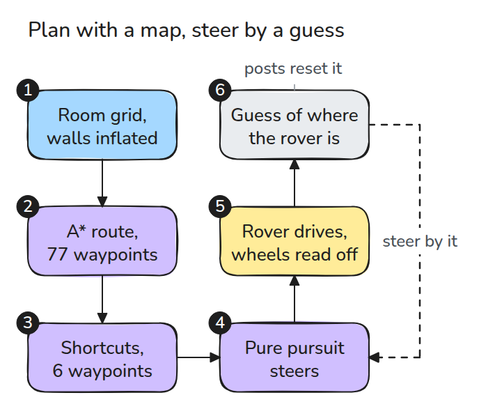
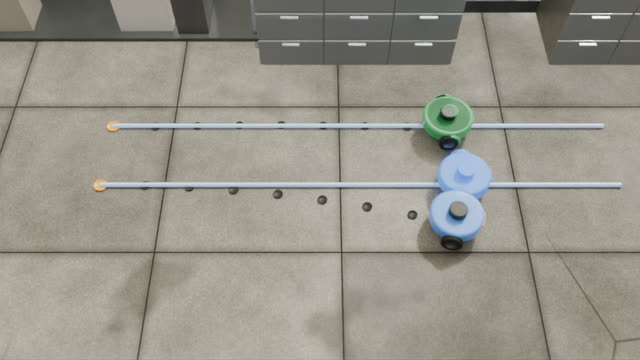
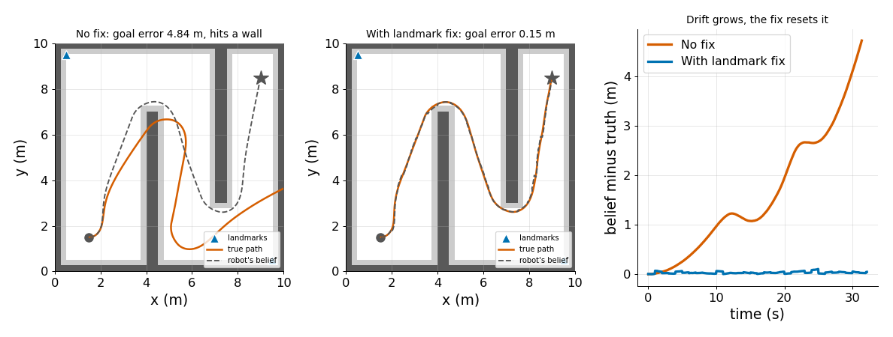

# Mobile Navigation in Simulation

> Drive a simulated rover to a goal and see why a drifting position estimate leads it into a wall.

**Type:** Build   **Prerequisites:** 08/01 Differential Drive, 08/04 Pure Pursuit, 09/03 Collision Checking   **Time:** ~30 minutes

## In Plain Words

A rover follows a route using where it believes it is. It builds that belief by adding up wheel turns (odometry). A slightly wrong wheel reading adds error each step, so the real rover drifts into a wall. Two posts at known spots let it reset its belief.

## Key Terms

- **Odometry**: working out position by adding up wheel turns.
- **Belief (`est`)**: where the rover thinks it is, which can drift from the truth.
- **A\***: a search that finds the shortest route on a grid.
- **Pure pursuit**: steering toward a point a little way ahead on the route.
- **Landmark**: a post at a known spot that the rover can see to correct its position.
- **Pose**: position plus the direction the rover faces.

## The Problem

Your rover drives a clean route and ends pressed against a wall, yet its screen says it is on the path.

## The Concept

A robot never knows exactly where it is, so a good plan needs a way to correct its position. A planner finds a clear route on a grid whose walls are made thicker by the rover's size. The rover follows it by its belief about where it is.



*A\* plans a route, a trimming step shortens it, and pure pursuit follows it.*


*Same wheel error in both rows, but only the bottom row uses landmark posts.*

[](../assets/clip-example.mp4)

*The pale rover is the belief. Blue's stays on the line while the real rover curves away. Green is corrected every second.*


*The planned route and the rover's path.*



*Without corrections the belief drifts far and the rover hits a wall. With a correction each second it stays close.*

<details><summary>The math (optional)</summary>

Drive straight at 0.6 m/s with speed read 3% high and turn rate read 0.03 rad/s off. After 10 s the facing is wrong by `0.03 × 10 = 0.3` rad. The belief is off by 0.015 m after 1 s, 0.26 m after 5 s and 0.97 m after 10 s, because the facing error turns each later metre sideways. With a correction each second it is only 0.012 m off after 10 s. A\* gives 77 waypoints (21.1 m), shortcuts keep 6 (19.8 m). Without a correction the belief ends 4.7 m off and the rover hits a wall. With a correction each second it stays within 0.11 m, and the goal error is 0.15 m.

</details>

## Build It

The rover steers from `est`, its belief. Wheel readings carry a speed error, a steady error in turning and random noise.

```python
vm = v * (1 + scale_err) + rng.normal(0, sigma)
wm = w + w_bias + rng.normal(0, sigma)
est = est + dt * np.array([vm * np.cos(est[2]), vm * np.sin(est[2]), wm])
```

`pose_fix()` recovers the pose from two landmarks: the direction between them gives the facing, the first gives the position.

```bash
cd robotics-engineering-from-scratch
python3 -m pytest phases/16-capstones/02-mobile-navigation-sim -q
python3 phases/16-capstones/02-mobile-navigation-sim/code/main.py
```

## Use It

Nav2, the navigation package for ROS 2, has a planner called NavFn with a `use_astar` switch.

Sources: [Nav2 NavFn](https://docs.nav2.org/rolling/configuration_and_development/configuration_guide/planners_plugins/configuring_navfn/), 2026-11-09.

## Ship It

`outputs/skill-nav-drift-triage.md` separates a bad plan from a bad pose.

## Exercises

1. Hide the landmark posts for the first half of the run.
2. Correct the position using only the distance to one landmark. What stays unknown?
3. Make the safety padding 0.6 m wide.
