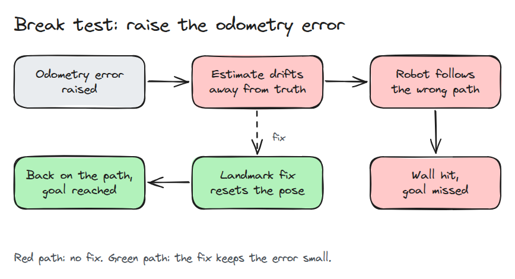
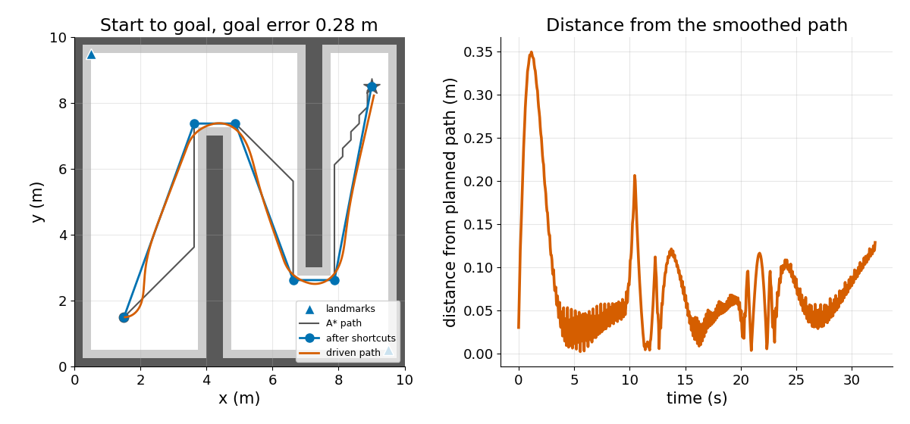

# Mobile Navigation in Simulation

> Drive a simulated rover to a goal and see why a drifting position estimate leads it into a wall.

**Type:** Build   **Prerequisites:** 08/01 Differential Drive, 08/04 Pure Pursuit, 09/03 Collision Checking   **Time:** ~30 minutes

## In Plain Words

A rover follows a route by checking where it believes it is, built by adding wheel turns (odometry). A slightly wrong wheel reading adds error each step, so the real rover drifts into a wall. Two posts at known spots let it reset its belief.

## Key Terms

- **Odometry**: estimating position by adding up wheel turns.
- **Belief (`est`)**: where the rover thinks it is, which can drift from the true pose.
- **A\***: a search that finds the shortest route on a grid.
- **Pure pursuit**: steering toward a point a little way ahead on the route.
- **Landmark**: a post at a known spot that the rover sees to correct its pose.
- **Pose**: position plus facing direction.

## The Problem

Your rover drives a long way along a clean route and ends pressed against a wall, yet its screen says it is on the path. Its idea of where it is had drifted.

## The Concept

A robot never knows exactly where it is, so a good plan needs a way to correct its position.


*A\* plans on a grid padded by the rover's radius, shortcuts trim the route, and pure pursuit follows it.*



*Only the bottom row uses landmark posts.*

Drive straight at 0.6 m/s with speed read 3% high and turn rate read 0.03 rad/s off. After 10 s the facing is wrong by `0.03 × 10 = 0.3` rad. The belief is off by 0.015 m after 1 s, 0.26 m after 5 s and 0.97 m after 10 s, because the facing error turns each later metre sideways. A fix each second keeps it at 0.012 m.


*The pale rover is the belief. Blue's stays on the line while the real rover curves away. Green is fixed every second.*



*A\* gives 77 waypoints (21.1 m), shortcuts keep 6 (19.8 m).*


*Without a fix the belief ends 4.7 m off and the rover hits a wall. With a fix each second it stays within 0.11 m.*

## Build It

The rover steers from `est`, its belief. Wheel readings carry a speed error, a turn-rate bias and noise.

```python
vm = v * (1 + scale_err) + rng.normal(0, sigma)
wm = w + w_bias + rng.normal(0, sigma)
est = est + dt * np.array([vm * np.cos(est[2]), vm * np.sin(est[2]), wm])
```

`pose_fix()` recovers the pose from two landmarks: heading from the direction between them, position from the first.

```bash
cd robotics-engineering-from-scratch
python3 -m pytest phases/16-capstones/02-mobile-navigation-sim -q
python3 phases/16-capstones/02-mobile-navigation-sim/code/main.py
```

## Use It

ROS 2 Nav2's NavFn planner has a `use_astar` parameter ("If `false`, uses Dijkstra's expansion").

Sources: [Nav2 NavFn](https://docs.nav2.org/rolling/configuration_and_development/configuration_guide/planners_plugins/configuring_navfn/), 2026-11-09.

## Ship It

`outputs/skill-nav-drift-triage.md` separates a bad plan from a bad pose.

## Exercises

1. Hide the beacons for the first half of the run.
2. Use a range-only fix to one landmark. What stays unknown?
3. Widen the inflation radius to 0.6 m.
