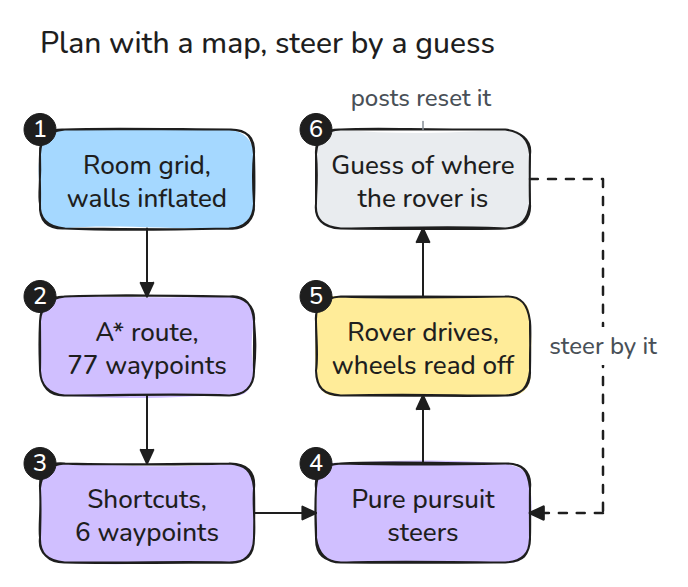
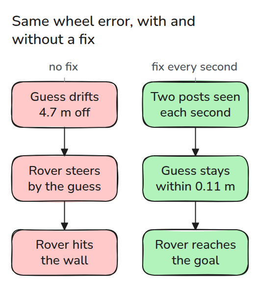
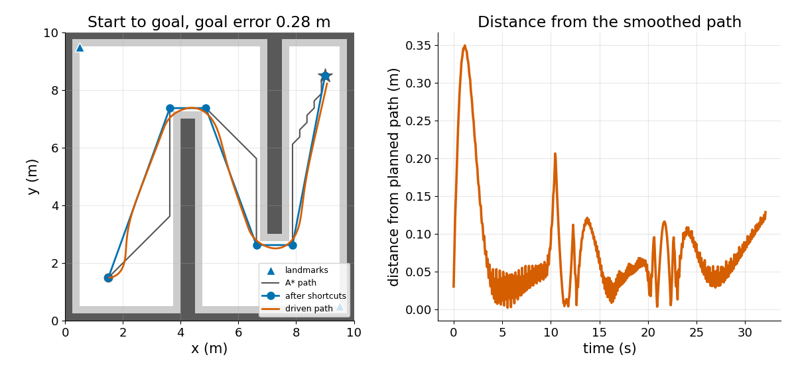
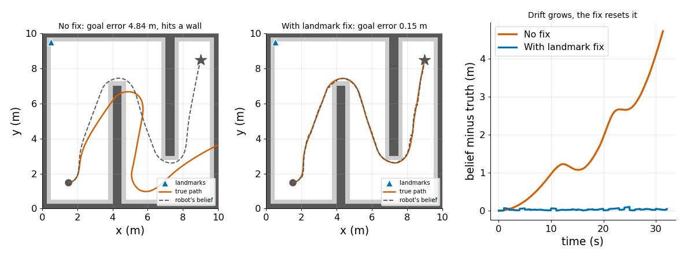

# 시뮬레이션 모바일 내비게이션

> planner는 경로를 그려 주지만 로봇은 자기가 어디에 있다고 믿는 곳을 기준으로 따라갑니다. 그래서 오도메트리 추정이 어긋나면 좋은 계획도 충돌로 끝납니다.

**유형:** 만들기   **선수 지식:** 08/01 차동 구동, 08/04 Pure Pursuit, 09/03 충돌 검사   **시간:** 약 30분

## 쉽게 말하면

로버는 자기가 어디에 있다고 믿는지 확인하면서 계획한 경로를 따라가요. 그 믿음은 바퀴가 돈 만큼을 더해서 만들고 이것을 odometry라고 해요. 바퀴가 조금 틀리게 읽으면 한 걸음마다 믿음에 오차가 조금씩 더 쌓여요.

로버는 믿음이 경로 위에 놓이도록 계속 조향하기 때문에 실제 로버는 경로에서 벗어나 벽으로 향해요. 위치를 아는 기둥 두 개가 이 문제를 풀어 줘요. 두 기둥 사이의 방향으로 로버가 어느 쪽을 보는지 알고 기둥 하나로 어디에 있는지 알아서 믿음을 고쳐요.

## 문제

경로는 깨끗했고 추종기도 테스트에서는 잘 따라갔습니다. 그런데 긴 주행에서는 로버가 벽에 붙어 있고 화면은 여전히 경로 위라고 말합니다. 계획은 맞았고 믿음이 틀렸습니다.

## 개념



*번호를 따라가 보세요. A\*(가장 짧은 경로를 찾는 탐색)가 로버 반지름만큼 덧댄 격자에서 경로를 짜고 shortcut이 경로를 다듬습니다. pure pursuit은 odometry로 만든 믿음을 보고 경로를 따라 조향합니다.*



*두 줄을 비교해 보세요. 바퀴 오차는 같지만 아래 줄만 landmark 기둥을 씁니다.*

바퀴 오차를 이 레슨의 값으로 두고 0.6 m/s로 직선 주행해 봅시다. 속도는 3% 크게 읽고 회전율은 로버가 돌지 않는데도 0.03 rad/s 어긋나게 읽으며 잡음도 있습니다.

10초 뒤 방향은 `0.03 × 10 = 0.3` rad 틀립니다. 믿음은 1초 뒤 0.015 m, 5초 뒤 0.26 m, 10초 뒤 0.97 m 어긋납니다. 시간보다 빠르게 커지는 이유는 heading 오차(잘못 잡은 방향)가 이후에 가는 거리마다 옆으로 틀어지게 만들기 때문입니다.

1초마다 보정하면 10초 뒤의 차이는 0.012 m로 유지됩니다.


*옅은 로버(믿음)를 보세요. 파란 쪽은 선 위에 있는데 실제 로버는 옆으로 휘어 갑니다. 초록 로버는 1초마다 보정해서 선을 지킵니다.*



*주황색 선을 따라가 보세요. A\*는 waypoint 77개(21.1 m)를 주고 shortcut을 거치면 6개(19.8 m)가 되며 로버는 벽에 닿지 않고 목표에서 0.28 m 떨어진 곳에 도착합니다.*



*앞의 두 패널을 보세요. 보정이 없으면 믿음이 실제 위치에서 4.7 m 벗어나고 로버는 벽에 부딪힙니다. 1초마다 보정하면 0.11 m 안에 머물고 목표 오차는 0.15 m입니다.*

## 만들기

로버는 믿음인 `est`를 보고 조향하고 실제 자세는 명령대로 움직입니다. 바퀴 측정값에는 속도 오차, 회전율 bias, 잡음이 들어 있습니다.

```python
vm = v * (1 + scale_err) + rng.normal(0, sigma)
wm = w + w_bias + rng.normal(0, sigma)
est = est + dt * np.array([vm * np.cos(est[2]), vm * np.sin(est[2]), wm])
```

`pose_fix()`는 로버 좌표계에서 본 landmark 두 개로 자세를 복원합니다. heading은 두 점 사이의 방향에서 얻고 위치는 첫 번째 landmark에서 얻습니다. 이 모델에서 벽은 beacon을 가리지 않습니다.

```bash
cd robotics-engineering-from-scratch
python3 -m pytest phases/16-capstones/02-mobile-navigation-sim -q
python3 phases/16-capstones/02-mobile-navigation-sim/code/main.py
```

## 실제 도구로 보기

ROS 2 Nav2의 NavFn planner에는 `use_astar` 파라미터가 있습니다. 문서에는 "Whether to use A*. If `false`, uses Dijkstra's expansion."이라고 적혀 있습니다.
이 격자에서 두 탐색을 모두 돌려 경로를 비교해 보세요.

출처: [Nav2 NavFn](https://docs.nav2.org/rolling/configuration_and_development/configuration_guide/planners_plugins/configuring_navfn/)
2026년 11월 9일 확인.

## 결과물

`outputs/skill-nav-drift-triage.md`는 로봇이 목표를 놓쳤을 때 계획 문제와 자세 추정 문제를 가려 줍니다.

## 연습 문제

1. 주행 전반부에는 beacon을 가리고 첫 보정 전까지의 drift를 재세요.
2. 두 landmark 보정을 landmark 하나에 대한 거리 보정으로 바꾸고 무엇이 미지수로 남는지 보세요.
3. 부풀림 반지름을 0.6 m로 넓혀도 planner가 경로를 찾는지 확인하세요.
