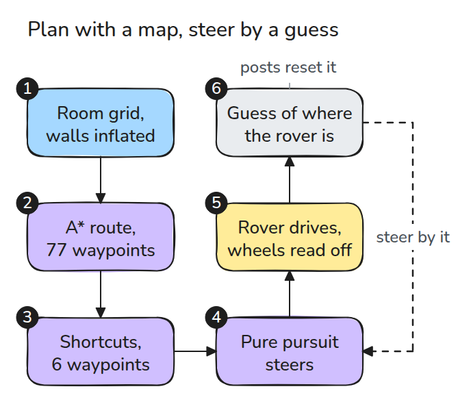
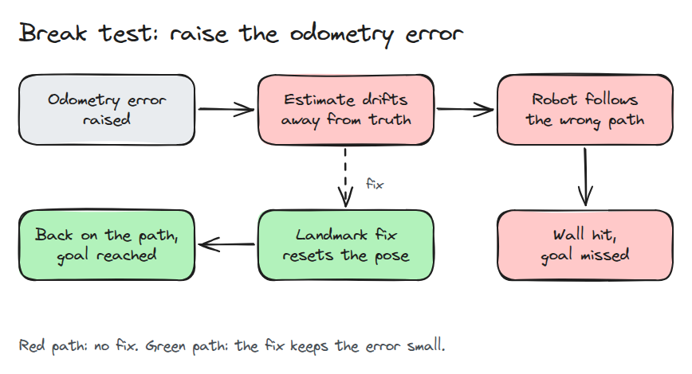
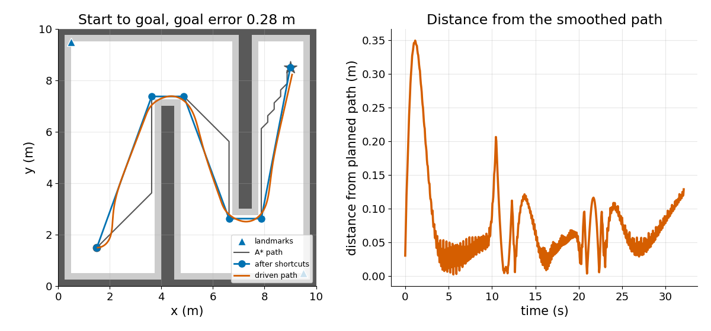
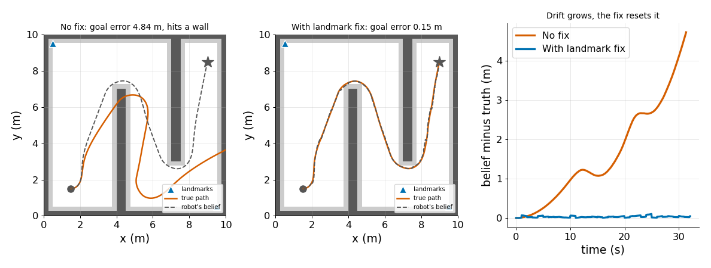

# 시뮬레이션 모바일 내비게이션

> 시뮬레이션 로버를 목표까지 몰아 보고 위치 추정이 어긋나면 벽으로 가는 이유를 봅니다.

**유형:** 만들기   **선수 지식:** 08/01 차동 구동, 08/04 Pure Pursuit, 09/03 충돌 검사   **시간:** 약 30분

## 쉽게 말하면

로버는 자기가 어디에 있다고 믿는지 확인하면서 계획한 경로를 따라가요. 그 믿음은 바퀴가 돈 만큼을 더해서 만들고 이것을 odometry라고 해요. 바퀴가 조금 틀리게 읽으면 한 걸음마다 믿음에 오차가 쌓여요.

로버는 믿음을 경로 위에 놓으려고 조향하기 때문에 실제 로버는 벽으로 벗어나요. 위치를 아는 기둥 두 개로 믿음을 고칠 수 있어요.

## 핵심 용어

- **Odometry**: 바퀴가 돈 만큼을 더해서 위치를 추정하는 방법입니다.
- **Belief (`est`)**: 로버가 자기가 있다고 믿는 위치이고 실제 자세에서 벗어날 수 있습니다.
- **A\***: 격자에서 가장 짧은 경로를 찾는 탐색입니다.
- **Pure pursuit**: 경로 위 조금 앞의 점을 향해 조향하는 방법입니다.
- **Landmark**: 위치를 아는 기둥이고 로버가 보고 자세를 고칩니다.
- **Pose**: 위치와 바라보는 방향입니다.

## 문제

로버가 깨끗한 경로를 따라 멀리 갑니다. 끝에서는 벽에 붙어 있는데 화면은 경로 위라고 말합니다. 자기 위치에 대한 믿음이 어긋난 것입니다.

## 개념

로봇은 자기 위치를 확실히 알 수 없어서 좋은 계획만으로는 부족하고 위치를 고치는 방법이 필요합니다.



*A\*가 로버 반지름만큼 덧댄 격자에서 경로를 짜고 shortcut이 경로를 다듬습니다. pure pursuit은 그 경로를 따라갑니다.*



*아래 줄만 landmark 기둥을 씁니다.*

0.6 m/s로 직선 주행하는데 속도는 3% 크게 읽고 회전율은 0.03 rad/s 어긋나게 읽는다고 해 봅시다. 10초 뒤 방향은 `0.03 × 10 = 0.3` rad 틀립니다.
믿음은 1초 뒤 0.015 m, 5초 뒤 0.26 m, 10초 뒤 0.97 m 어긋납니다. 방향 오차가 이후에 가는 거리마다 옆으로 틀어지게 만들기 때문입니다. 1초마다 보정하면 0.012 m로 유지됩니다.


*옅은 로버가 믿음입니다. 파란 쪽은 믿음이 선 위에 있는데 실제 로버는 옆으로 휘어 갑니다. 초록 로버는 1초마다 보정합니다.*



*A\*는 waypoint 77개(21.1 m)를 주고 shortcut을 거치면 6개(19.8 m)가 되며 로버는 목표에서 0.28 m 떨어진 곳에 도착합니다.*



*보정이 없으면 믿음이 실제 위치에서 4.7 m 벗어나고 로버는 벽에 부딪힙니다. 1초마다 보정하면 0.11 m 안에 머뭅니다.*

## 만들기

로버는 믿음인 `est`를 보고 조향합니다. 바퀴 측정값에는 속도 오차, 회전율 bias, 잡음이 들어 있습니다.

```python
vm = v * (1 + scale_err) + rng.normal(0, sigma)
wm = w + w_bias + rng.normal(0, sigma)
est = est + dt * np.array([vm * np.cos(est[2]), vm * np.sin(est[2]), wm])
```

`pose_fix()`는 landmark 두 개로 자세를 복원합니다. 방향은 두 점 사이의 방향에서 얻고 위치는 첫 번째 landmark에서 얻습니다.

```bash
cd robotics-engineering-from-scratch
python3 -m pytest phases/16-capstones/02-mobile-navigation-sim -q
python3 phases/16-capstones/02-mobile-navigation-sim/code/main.py
```

## 실제 도구로 보기

ROS 2 Nav2의 NavFn planner에는 `use_astar` 파라미터가 있습니다. 문서에는 "Whether to use A*. If `false`, uses Dijkstra's expansion."이라고 적혀 있습니다.

출처: [Nav2 NavFn](https://docs.nav2.org/rolling/configuration_and_development/configuration_guide/planners_plugins/configuring_navfn/), 2026년 11월 9일 확인.

## 결과물

`outputs/skill-nav-drift-triage.md`는 계획 문제와 자세 추정 문제를 가려 줍니다.

## 연습 문제

1. 주행 전반부에는 beacon을 가리세요.
2. landmark 하나에 대한 거리 보정을 쓰세요. 무엇이 미지수로 남나요?
3. 부풀림 반지름을 0.6 m로 넓히세요.
