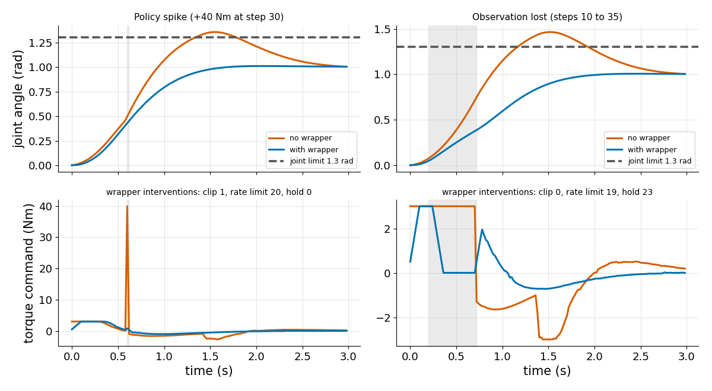

# A Learned Policy with a Safety Wrapper

> Put a plain safety layer around a learned model and see it keep a robot arm inside its limits.

**Type:** Build   **Prerequisites:** none   **Time:** ~30 minutes

## In Plain Words

A learned policy picks an arm's push from what a camera sees. If the camera freezes, the arm acts on the last picture and pushes past its safe limit.

A wrapper is plain code between the policy and the motor. It notices an old picture and eases the push to zero. It also clips any huge push.

## Key Terms

- **Learned policy**: a trained model that turns what the robot sees into an action.
- **Safety wrapper**: plain code between the policy and the motor that limits every command.
- **Clip**: cut a value so it stays inside a range.
- **Rate limit**: a cap on how much a command may change per step.
- **Stale observation**: a camera picture older than the wrapper allows.

## The Problem

A trained model picks how hard an arm pushes. It passes every test, then one wild output or lost camera frame sends the arm into its limit. 

## The Concept

Learned models are powerful but unpredictable, so real robots wrap them in code whose command limits you can test. The wrapper has three simple rules. If the picture is too old or the model's output is not a number, ease the push to zero. Never push harder than a safe maximum. Never change the push too fast. Each rule counts how often it acts, so you can see what the wrapper had to fix.


*The action passes through the wrapper, which checks the picture's age.*


*A sudden huge output is clipped and rate-limited. An old picture becomes a hold: zero push, eased in.*

[](../assets/clip-example.mp4)

*A sudden kick throws blue past the red limit bar. The wrapped green arm hardly notices.*


*On a clean run the wrapper barely changes anything.*



*With the wrapper the joint stays under the limit after a spike or a lost picture. Without it, it overshoots.*

<details><summary>The math (optional)</summary>

These rules bound commands, not joint position: a policy that always asks for 3 Nm still drives the joint to 8.5 rad. Rules: request zero torque if the picture is over 3 steps old (a step is 0.02 s) or the action is not a number, clip torque to 3 Nm, and change it by at most 0.5 Nm per step. At step 30 a spike makes the policy ask for 39.9 Nm. Clipping gives 3 Nm, but the torque was 0.31 Nm, so the rate limit allows only 0.81 Nm. Spike: peak torque about 40 Nm without the wrapper, 3 Nm with it, joint peak 1.36 rad against 1.01. Lost observation: 1.47 against 1.01. Limit: 1.3 rad. The kick sends blue 0.056 rad past the limit (drawn 4 times larger). A clean run shows no clip and no hold, though the rate limit acts 19 times. The spike run shows 1 clip, the lost-observation run 23 zero-torque requests.

</details>

## Build It

The code runs the three rules in order.

```python
if age > self.max_age or not np.isfinite(raw): raw = 0.0
c = np.clip(raw, -self.umax, self.umax)
r = self.u + np.clip(c - self.u, -self.du, self.du)
```

Each rule counts how often it changed the action.

```bash
cd robotics-engineering-from-scratch
python3 -m pytest phases/16-capstones/03-learned-policy-with-safety-wrapper -q
python3 phases/16-capstones/03-learned-policy-with-safety-wrapper/code/main.py
```

## Use It

ros2_control, a ROS 2 package for driving robot hardware, also limits joint commands. Read how it limits commands and match each limit to one of the three rules.

Sources: [ros2_control joint limiting](https://control.ros.org/rolling/doc/ros2_control/hardware_interface/doc/joint_limiting.html), 2026-11-09.

## Ship It

`outputs/skill-policy-wrapper-audit.md` checks range, rate and staleness.

## Exercises

1. Raise the allowed age until the lost-picture run crosses the limit.
2. Add a position or speed limit as a fourth rule.

