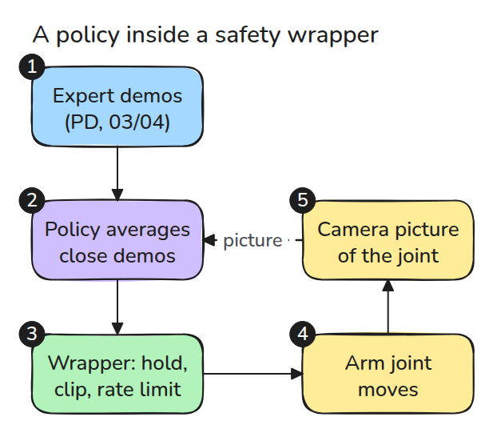
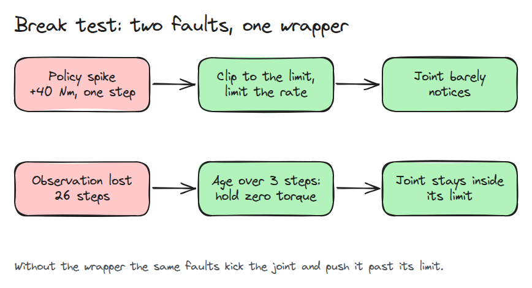
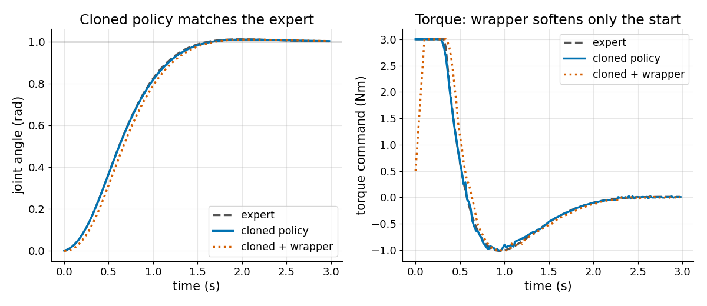

# A Learned Policy with a Safety Wrapper

> Put a plain safety layer around a learned model and see it keep a robot arm inside its limits.

**Type:** Build   **Prerequisites:** 03/01 The Sampling Limit, 03/04 PID and Tuning   **Time:** ~30 minutes

## In Plain Words

A learned policy picks an arm's push from what a camera sees. If the camera freezes, the arm acts on the last picture and pushes past its safe limit.

A wrapper is plain code between the policy and the motor. It notices an old picture and cuts the push to zero. It also clips any huge push.

## Key Terms

- **Learned policy**: a trained model that maps what the robot sees to an action.
- **Safety wrapper**: plain code between the policy and the motor that limits every command.
- **Clip**: cut a value so it stays inside a range.
- **Rate limit**: a cap on how much a command may change per step.
- **Stale observation**: a camera picture older than the wrapper allows.
- **Nearest-neighbour policy**: averages the actions of the closest recorded demonstrations.

## The Problem

A trained model picks how hard an arm pushes. It passes every test, then one wild output or lost camera frame sends the arm into its limit. A model cannot be proved safe, but plain code around it can.

## The Concept

Learned models are powerful but unpredictable, so real robots wrap them in code whose behaviour you can prove.



*The action passes through the wrapper, which checks the picture's age.*



*A spike is clipped and rate limited. A picture older than 3 steps becomes a hold (zero torque).*

Three rules: hold zero torque if the picture is over 3 steps old (a step is 0.02 s), clip torque to 3 Nm, and change it by at most 0.5 Nm per step. At step 30 a spike makes the policy ask for 39.9 Nm. Clipping gives 3 Nm, but the torque was 0.31 Nm, so the rate limit allows only 0.81 Nm. Unwrapped, the joint takes all 39.9 Nm.


*The kick sends blue 0.056 rad past the red bar (the 1.3 rad limit, drawn 4 times larger). Green hardly notices.*



*On a clean run the wrapper only slows the first torque ramp.*


*Spike: peak torque about 40 Nm without the wrapper, 3 Nm with it, joint peak 1.36 rad against 1.01. Lost observation: 1.47 against 1.01. The limit is 1.3 rad.*

## Build It

The code runs the three rules in that order.

```python
if age > self.max_age: raw = 0.0
c = np.clip(raw, -self.umax, self.umax)
r = self.u + np.clip(c - self.u, -self.du, self.du)
```

Each rule counts how often it changed the action: the spike run shows 1 clip, the lost-observation run 23 hold steps, a clean run neither.

```bash
cd robotics-engineering-from-scratch
python3 -m pytest phases/16-capstones/03-learned-policy-with-safety-wrapper -q
python3 phases/16-capstones/03-learned-policy-with-safety-wrapper/code/main.py
```

## Use It

ros2_control handles joint limits for hardware interfaces. Compare its startup log with the three rules here.

Sources: [ros2_control joint limiting](https://control.ros.org/rolling/doc/ros2_control/hardware_interface/doc/joint_limiting.html), 2026-11-09.

## Ship It

`outputs/skill-policy-wrapper-audit.md` checks range, rate and staleness.

## Exercises

1. Raise `max_age` until the lost-observation run crosses 1.3 rad.
2. Add a speed limit as a fourth rule.
3. Train on 5 episodes instead of 40.
