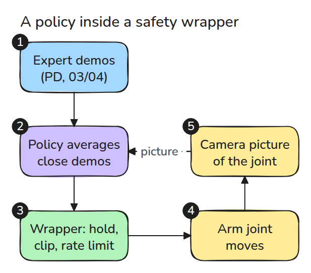
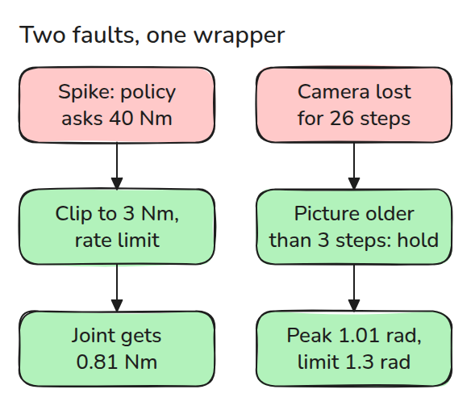
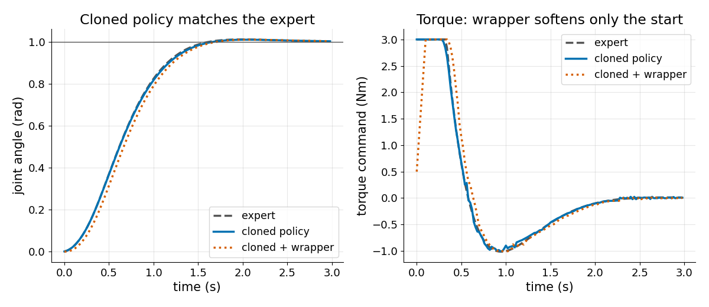
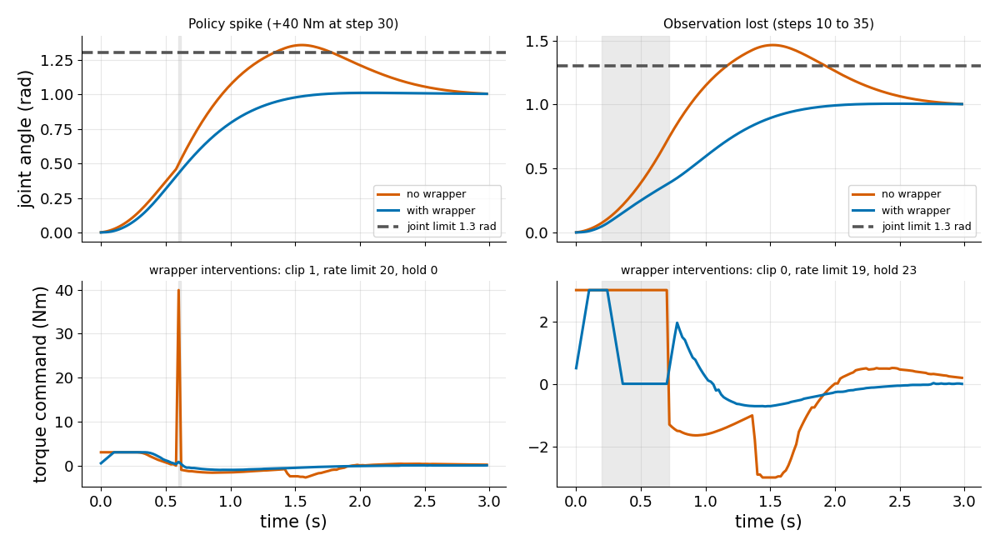

# A Learned Policy with a Safety Wrapper

> A learned policy is allowed to be wrong sometimes, so the code around it must make sure that being wrong is never dangerous.

**Type:** Build   **Prerequisites:** 03/01 The Sampling Limit, 03/04 PID and Tuning   **Time:** ~30 minutes

## In Plain Words

A learned policy is a program that picks an arm's push from what a camera sees. If the camera freezes, the arm keeps acting on the last picture, which says it is still short of the target. It keeps pushing and swings past its safe limit.

A wrapper is plain code between the policy and the motor. It notices that the picture is old and cuts the push to zero, so the arm coasts and slows through its own friction. It also clips any huge push.

## The Problem

A trained policy passes every test, then one bad output or one lost camera frame sends a joint into its limit. Nobody can prove a model never does this, but plain code around it can be proved.

## The Concept



*Follow the arrows. A nearest-neighbour policy averages the closest of an expert's recorded demonstrations. Its action passes through the wrapper, which also checks how old the picture is.*



*Compare the rows. A spike is clipped and rate limited. A picture older than 3 steps becomes a hold command (zero torque).*

The wrapper has three rules: hold zero torque if the picture is over 3 steps old (a step is 0.02 s), clip torque to 3 Nm, and let torque change by at most 0.5 Nm per step. At step 30 a spike makes the policy ask for 39.9 Nm (its usual output plus 40). Clipping gives 3 Nm, but the torque was 0.31 Nm, so the rate limit allows only 0.81 Nm. Unwrapped, the joint takes all 39.9 Nm.


*Watch blue after the red arrow flashes. The kick sends it past the target and the red bar (the 1.3 rad limit) before it returns. The wrapped green arm hardly notices.*



*Look at both curves. On a clean run the learned policy follows the expert to the target, and the wrapper only slows the first torque ramp.*



*Compare each pair of curves. Spike: peak torque about 40 Nm without the wrapper, 3 Nm with it, and the joint peaks at 1.36 rad against 1.01 rad. Lost observation: 1.47 rad against 1.01 rad. The limit is 1.3 rad.*

## Build It

The code runs the three rules in that order.

```python
if age > self.max_age: raw = 0.0
c = np.clip(raw, -self.umax, self.umax)
r = self.u + np.clip(c - self.u, -self.du, self.du)
```

Each rule counts how often it changed the action. The spike run shows 1 clip, the lost-observation run shows 23 hold steps, and a clean run shows no clip and no hold.

```bash
cd robotics-engineering-from-scratch
python3 -m pytest phases/16-capstones/03-learned-policy-with-safety-wrapper -q
python3 phases/16-capstones/03-learned-policy-with-safety-wrapper/code/main.py
```

## Use It

ros2_control provides joint-limit handling for hardware interfaces, and the `enforce_command_limits` parameter on `ros2_control_node` sets it globally. At startup the controller manager logs which limits each joint has. Compare them with the three rules here.

Sources: [ros2_control joint limiting](https://control.ros.org/rolling/doc/ros2_control/hardware_interface/doc/joint_limiting.html), read 2026-11-09.

## Ship It

`outputs/skill-policy-wrapper-audit.md` checks that a wrapper around a learned policy covers range, rate and staleness.

## Exercises

1. Raise `max_age` until the lost-observation run first crosses 1.3 rad.
2. Add a speed limit as a fourth rule and count its interventions.
3. Train on 5 episodes instead of 40 and see which fault the wrapper now catches more often.
