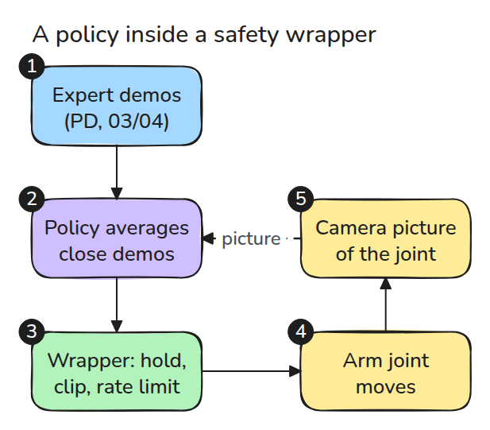
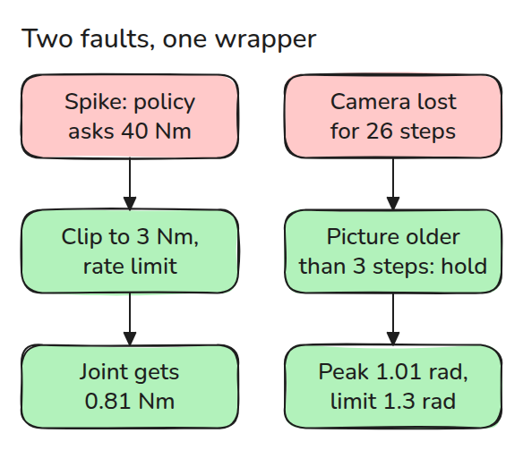
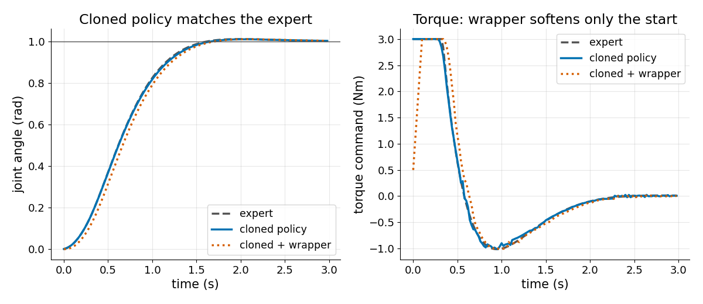
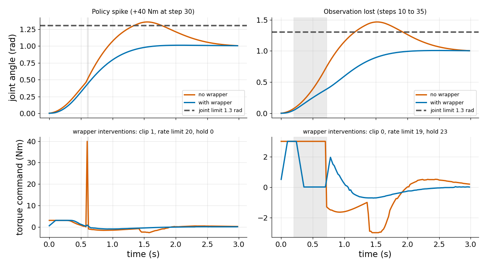

# 안전 wrapper를 두른 학습 정책

> 학습된 정책은 가끔 틀려도 됩니다. 그래서 주변 코드는 틀렸을 때도 위험하지 않게 만들어야 합니다.

**유형:** 만들기   **선수 지식:** 03/01 샘플링 한계, 03/04 PID와 튜닝   **시간:** 약 30분

## 쉽게 말하면

learned policy는 카메라가 본 것으로 팔을 얼마나 밀지 고르는 프로그램이에요. 카메라 화면이 멈추면 팔은 마지막 화면에 따라 계속 움직여요. 그 화면에서는 팔이 아직 목표에 못 미쳤으니 계속 밀다가 안전 한계를 넘어 흔들려요.

wrapper는 정책과 모터 사이에 끼우는 평범한 코드예요. 화면이 낡았다는 것을 알아채고 미는 힘을 없애서 팔이 마찰 때문에 서서히 느려지며 미끄러지게 해요. 너무 큰 힘도 잘라 내요.

## 문제

학습한 정책은 모든 테스트를 통과합니다. 그러다 나쁜 출력 하나나 유실된 카메라 프레임 하나에 관절이 한계로 달려갑니다. 모델이 절대 그러지 않는다고 증명할 수는 없지만 모델 주변의 일반 코드는 증명할 수 있습니다.

## 개념



*화살표를 따라가 보세요. nearest-neighbour 정책은 전문가가 기록한 시연 중 가장 가까운 몇 개의 action을 평균 냅니다. 정책의 action은 wrapper를 지나고 wrapper는 화면이 얼마나 낡았는지도 확인합니다.*



*두 줄을 비교해 보세요. spike는 clip과 변화율 제한으로 막습니다. 3 step보다 오래된 화면은 hold 명령(토크 0)이 됩니다.*

wrapper에는 규칙이 세 개 있습니다. 화면이 3 step보다 오래되면 토크 0으로 hold합니다(1 step은 0.02초). 토크는 3 Nm로 clip하고 step당 변화는 최대 0.5 Nm로 제한합니다.

step 30에서 spike 때문에 정책이 39.9 Nm를 요구합니다(평소 출력에 40을 더한 값). clip하면 3 Nm인데 직전 토크가 0.31 Nm였으므로 변화율 제한이 0.81 Nm까지만 허용합니다. wrapper가 없으면 관절은 39.9 Nm를 그대로 받습니다.


*빨간 화살표가 번쩍인 뒤의 파란 팔을 보세요. 그 충격으로 목표와 빨간 막대(1.3 rad의 limit)를 지나쳤다가 돌아옵니다. wrapper를 두른 초록 팔은 거의 영향을 받지 않습니다.*



*두 곡선을 보세요. 깨끗한 실행에서 학습한 정책은 expert처럼 목표에 도착하고 wrapper는 처음 토크가 올라가는 구간만 늦춥니다.*



*곡선 쌍마다 비교해 보세요. spike에서는 최대 토크가 wrapper 없이 약 40 Nm, 있으면 3 Nm이고 관절 최대각은 1.36 rad 대 1.01 rad입니다. 관측 유실에서는 1.47 rad 대 1.01 rad입니다. 한계는 1.3 rad입니다.*

## 만들기

코드는 규칙 세 개를 그 순서대로 실행합니다.

```python
if age > self.max_age: raw = 0.0
c = np.clip(raw, -self.umax, self.umax)
r = self.u + np.clip(c - self.u, -self.du, self.du)
```

규칙마다 action을 몇 번 바꿨는지 셉니다. spike 실험은 clip 1회, 관측 유실 실험은 hold 23 step, 깨끗한 실행은 clip과 hold가 0회입니다.

```bash
cd robotics-engineering-from-scratch
python3 -m pytest phases/16-capstones/03-learned-policy-with-safety-wrapper -q
python3 phases/16-capstones/03-learned-policy-with-safety-wrapper/code/main.py
```

## 실제 도구로 보기

ros2_control은 hardware interface에 대한 joint limit 처리를 제공합니다. `ros2_control_node`의 `enforce_command_limits` 파라미터가 모든 interface의 joint limit 처리를 전역으로 정합니다.

시작할 때 controller manager가 joint마다 어떤 limit이 있는지 로그로 남깁니다. 그 목록을 여기의 규칙 세 개와 비교해 보세요.

출처: [ros2_control joint limiting](https://control.ros.org/rolling/doc/ros2_control/hardware_interface/doc/joint_limiting.html)
2026년 11월 9일 확인.

## 결과물

`outputs/skill-policy-wrapper-audit.md`는 학습 정책을 감싼 wrapper가 범위, 변화율, 낡은 관측을 모두 다루는지 점검합니다.

## 연습 문제

1. 관측 유실 실험이 처음 1.3 rad를 넘을 때까지 `max_age`를 올려 보세요.
2. 네 번째 규칙으로 속도 제한을 넣고 개입 횟수를 세어 보세요.
3. 40개 대신 5개 episode로 학습시키고 wrapper가 어느 고장을 더 자주 막는지 보세요.
