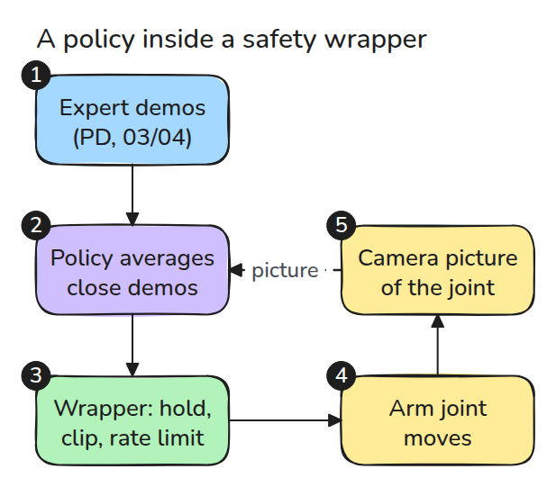
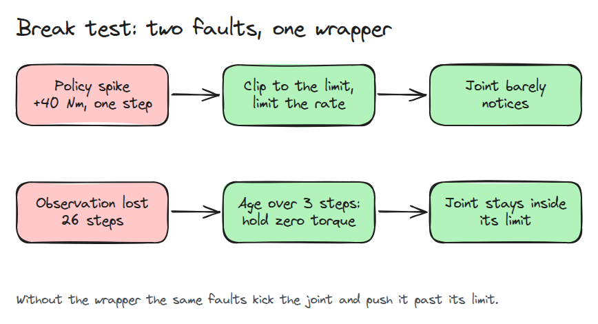
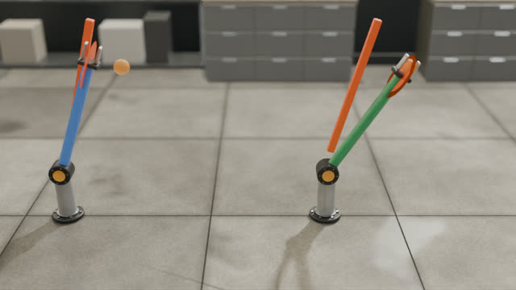
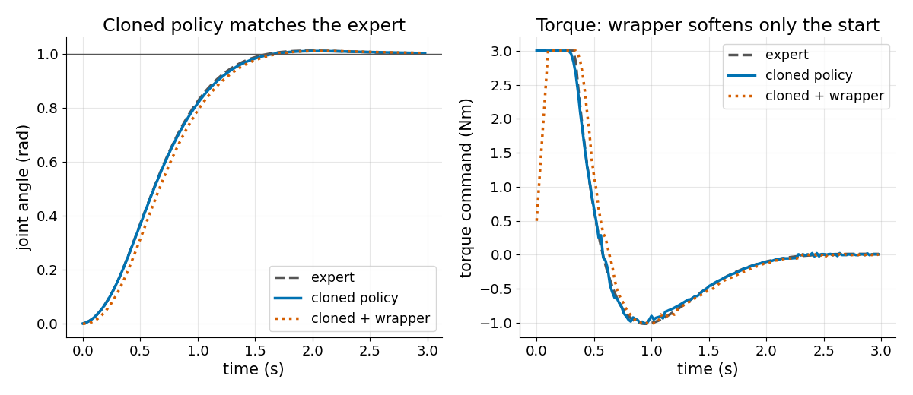
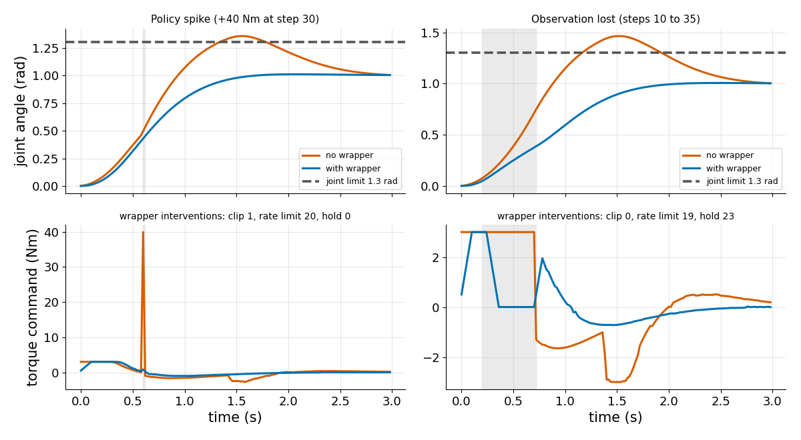

# 안전 wrapper를 두른 학습 정책

> 학습된 모델을 평범한 안전 층으로 감싸고 로봇 팔이 한계 안에 머무는 것을 봅니다.

**유형:** 만들기   **선수 지식:** 없음   **시간:** 약 30분

## 쉽게 말하면

learned policy는 카메라가 본 것으로 팔을 얼마나 밀지 고르는 프로그램이에요. 카메라 화면이 멈추면 팔은 마지막 화면에 따라 움직이다가 안전 한계를 넘어 밀어 버려요.

wrapper는 정책과 모터 사이에 끼우는 평범한 코드예요. 화면이 낡았다는 것을 알아채고 미는 힘을 서서히 없애요. 너무 큰 힘도 잘라 내요.

## 핵심 용어

- **Learned policy**: 로봇이 본 것을 행동으로 바꾸는 학습된 모델입니다.
- **Safety wrapper**: 정책과 모터 사이에서 모든 명령을 제한하는 평범한 코드입니다.
- **Clip**: 값을 범위 안으로 잘라 넣는 것입니다.
- **Rate limit**: step 한 번에 명령이 바뀔 수 있는 크기의 상한입니다.
- **Stale observation**: wrapper가 허용하는 것보다 오래된 카메라 화면입니다.

## 문제

학습된 모델이 팔이 얼마나 세게 밀지 고릅니다. 모든 테스트를 통과하지만 엉뚱한 출력 하나나 유실된 카메라 프레임 하나에 팔이 한계로 달려갑니다. 

## 개념

학습된 모델은 강력하지만 예측하기 어려워서 실제 로봇은 명령의 한계를 시험할 수 있는 코드로 감쌉니다. wrapper에는 단순한 규칙이 세 개 있습니다. 화면이 너무 오래됐거나 모델의 출력이 숫자가 아니면 미는 힘을 서서히 0으로 줄입니다. 안전한 최댓값보다 세게 밀지 않습니다.
미는 힘을 너무 빨리 바꾸지 않습니다. 규칙마다 몇 번 작동했는지 세므로 wrapper가 무엇을 고쳐야 했는지 알 수 있습니다.



*action은 wrapper를 지나고 wrapper는 화면이 얼마나 오래됐는지도 확인합니다.*



*갑자기 튀는 큰 출력은 잘리고 변화율이 제한됩니다. 낡은 화면은 힘 0을 요청하는 hold가 되고 변화율 제한 때문에 서서히 줄어듭니다.*

[](../assets/clip-example.mp4)

*갑작스러운 충격이 파란 팔을 빨간 한계 막대 너머로 던집니다. wrapper를 두른 초록 팔은 거의 영향을 받지 않습니다.*



*깨끗한 실행에서 wrapper는 거의 아무것도 바꾸지 않습니다.*



*wrapper가 있으면 spike나 화면 유실 뒤에도 관절이 한계 아래에 머뭅니다. 없으면 한계를 넘습니다.*

<details><summary>The math (optional)</summary>

이 규칙은 명령을 제한하지만 관절 위치의 안전까지 보장하지는 않습니다. 항상 3 Nm를 요청하는 정책은 이 wrapper 안에서도 관절을 8.5 rad까지 보냅니다.
규칙은 이렇습니다. 화면이 3 step보다 오래되었거나 action이 숫자가 아니면 토크 0을 요청하고(1 step은 0.02초) 토크는 3 Nm로 clip하고 step당 변화는 최대 0.5 Nm로 제한합니다.
step 30에서 spike 때문에 정책이 39.9 Nm를 요구합니다. clip하면 3 Nm인데 직전 토크가 0.31 Nm였으므로 변화율 제한이 0.81 Nm까지만 허용합니다.
spike에서는 최대 토크가 wrapper 없이 약 40 Nm, 있으면 3 Nm이고 관절 최대각은 1.36 rad 대 1.01 rad입니다. 관측 유실에서는 1.47 rad 대 1.01 rad입니다. 한계는 1.3 rad입니다.
충격으로 파란 팔은 한계를 0.056 rad 지나칩니다(4배로 크게 그렸습니다). 깨끗한 실행은 clip과 hold가 0회이지만 변화율 제한은 19회 작동합니다. spike 실험은 clip 1회, 관측 유실 실험은 토크 0을 요청한 step이 23개입니다.

</details>

## 만들기

코드는 규칙 세 개를 그 순서대로 실행합니다.

```python
if age > self.max_age or not np.isfinite(raw): raw = 0.0
c = np.clip(raw, -self.umax, self.umax)
r = self.u + np.clip(c - self.u, -self.du, self.du)
```

규칙마다 action을 몇 번 바꿨는지 셉니다.

```bash
cd robotics-engineering-from-scratch
python3 -m pytest phases/16-capstones/03-learned-policy-with-safety-wrapper -q
python3 phases/16-capstones/03-learned-policy-with-safety-wrapper/code/main.py
```

## 실제 도구로 보기

ROS 2의 로봇 하드웨어 구동 패키지인 ros2_control도 joint 명령을 제한합니다. 명령을 어떻게 제한하는지 읽고 각 제한을 여기의 규칙 세 개 중 하나와 짝지어 보세요.

출처: [ros2_control joint limiting](https://control.ros.org/rolling/doc/ros2_control/hardware_interface/doc/joint_limiting.html), 2026년 11월 9일 확인.

## 결과물

`outputs/skill-policy-wrapper-audit.md`는 범위, 변화율, 낡은 관측을 점검합니다.

## 연습 문제

1. 허용하는 화면 나이를 올려서 화면 유실 실험이 한계를 넘는 때를 찾으세요.
2. 네 번째 규칙으로 위치 제한이나 속도 제한을 넣으세요.

